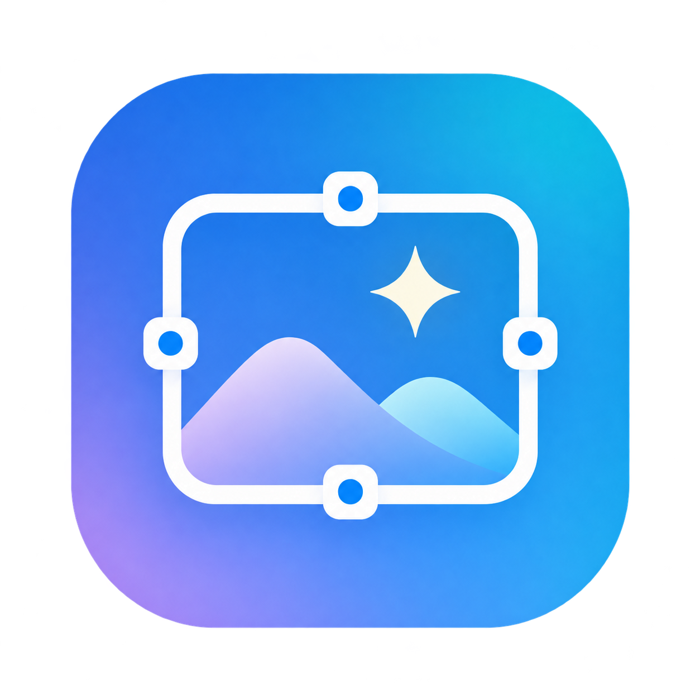
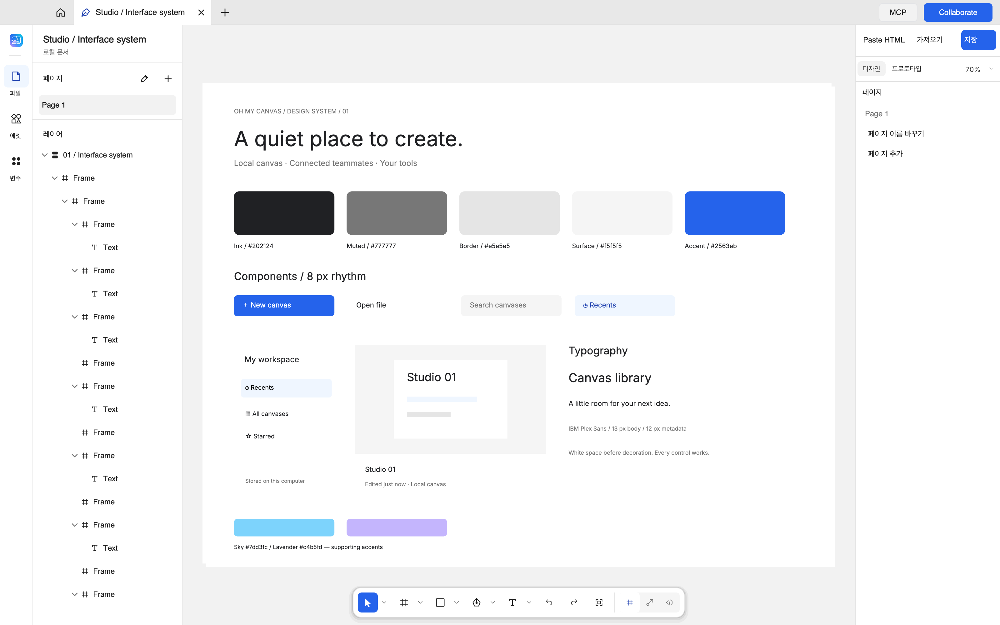
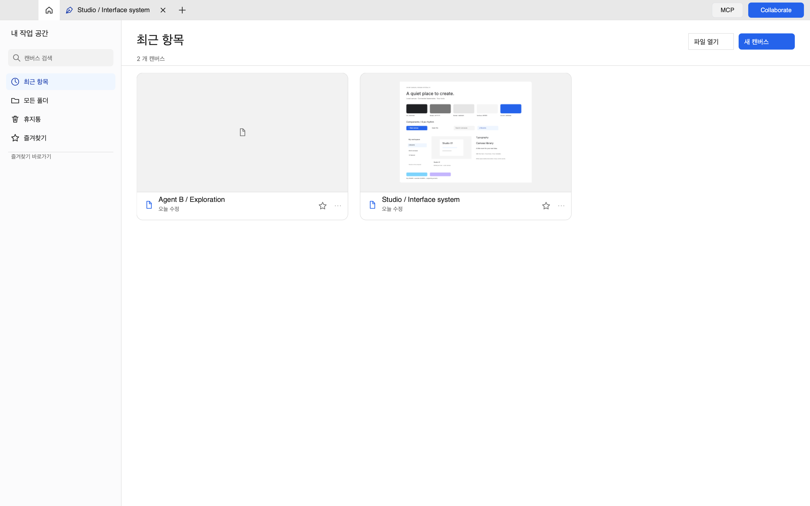

<p align="center"></p>
<h1 align="center">Oh My Canvas</h1>
<p align="center"><strong>HTML/CSSから編集可能なデザインへ。人と複数のエージェントが一緒に。</strong></p>
<p align="center">RustとSkiaによるローカル優先のネイティブデザインスタジオ。HTML/CSSで描き、複数のMCPエージェントと同時に作業できます。</p>
<p align="center"></p>
<p align="center"><a href="README.md">English</a> · <a href="README-ko.md">한국어</a> · <strong>日本語</strong> · <a href="README-zh-CN.md">简体中文</a></p>

<p align="center"></p>

## Oh My Canvasの特長

- **HTML/CSSで直接作成。** HTMLを貼り付けるか、MCPの`write_html`を使用します。対応するCSSは編集可能なレイヤー・テキスト・レイアウトになります。
- **複数エージェントで同時作業。** 各エージェントに`documentId`を指定し、バックグラウンド文書で作業できます。Undoは作成者ごとに分離されます。同じレイヤーへの変更は調整してください。
- **ローカルのネイティブ構成。** デスクトップとサービスはElectronやブラウザレンダラーなしで動作。ローカル保存、コンポーネント、スタイル、変数、エクスポートを提供します。
- **必要なコンテキストに集中。** HTML/CSS作成、一括操作、範囲を絞った読み取りに対応。初期LD03実験ではPaper/Figmaより総トークン数が約1万少なくなりました。条件は下記を参照してください。
- **アプリの利用クレジット不要。** ローカルMCPに呼び出し単位の課金はありません。到達可能なTLSホストで最大4人が共同作業できます。AIクライアントの料金・制限は別です。

<a id="screenshots"></a>

## アプリ画面

HTML/CSSで作成した画面をレイヤー単位で編集し、ローカル文書一覧でキャンバスを管理できます。



ローカル文書一覧と実際のキャンバスプレビュー。

<a id="quick-start"></a>

## ネイティブアプリを起動

Rustupと固定されたRust 1.92.0を使用します。3つのバイナリを一緒にビルドしてから起動してください。

```sh
cd /path/to/oh-my-canvas/native
cargo build --locked --release -p omc-desktop -p omc-service -p omc-cli
./target/release/omc-desktop
```

ネイティブアプリの実行にNode.jsは不要です。ネイティブパッケージと各OSのリリース検証は未完了です。[ネイティブガイド](native/README.md)。

<a id="components"></a>

## 編集できるコンポーネントとデザインシステム

メインコンポーネント、リンクされたインスタンス、variantを作り、テキスト・表示状態・個別の上書きを編集できます。共有スタイルとトークンで反復要素を管理します。[ネイティブのコンポーネント・スタイル・ライブラリ操作](docs/MCP_PARITY.md)を参照してください。

<a id="mcp"></a>

## エージェントごとにキャンバスを接続

ネイティブアプリの **MCP → Copy MCP configuration** でstdio設定をコピーしてください。インストール先の`omc-cli`とプロファイルを参照し、グローバル設定を自動変更しません。

**OMC方言は59個のMCPツール（基本50個＋ネイティブ拡張9個）**を提供します。別の**FigCraft互換方言は19個のMCPツール経由で643個のコマンドID**を公開します。643個のMCPツールではありません。

`list_documents` → `open_document`または`create_document` → `get_context`から開始。変更には`documentId`を指定します。`create_board`、`write_html`、`edit_shapes`、`components`、`batch`、`screenshot`で作成・検証します。拡張は範囲制限クエリ、コメント、トークン、ジョブ、コード出力に対応します。

各エージェントは背景文書を維持できます。人の編集中に`busy`が返ったら完了後に再試行してください。Undoは他の作成者の履歴を消費せず、表示中のタブを暗黙の変更対象にしません。

[ツール仕様と移行](docs/MCP_PARITY.md) · [接続と共同作業](native/README.md)

## 速度・メモリ・トークンの測定

プロジェクト独自のパイロットでOMC・Paper・Figma・Penpotを比較しました。選択した60秒試行では、OMCはPenpotより**受け入れ済み作業を21–55%早く完了**しました。Paper/Figmaは同じ検証を完了できませんでした。LD02/LD03ではPaper/Penpotより低いRAMピークも観測しましたが、集計範囲は不完全で製品ごとに異なります。

同じモデル・課題・プロンプトを使った**以前のLD03実験**：

| Product | Gross provider tokens | Cached input included |
| --- | ---: | ---: |
| OMC | 22,604 | 7,110 |
| Paper | 32,820 | 16,782 |
| Figma | 32,363 | 16,578 |
| Penpot | 22,624 | 7,110 |

この実験では**Paperより10,216トークン（31.1%）**、**Figmaより9,759トークン（30.2%）**少ない結果でした。キャッシュ入力と出力を含む全受付リクエストの合計です。OMC/Penpotは共通検証を通過し、Paper/Figmaは編集結果のみ確認され、再オープン等の検証が不足しています。単発の探索実験であり、一般的な削減保証や請求額比較ではありません。後の60秒LD02/LD03では各製品の合計がほぼ同じでした。

[結果と限界](docs/benchmarks/results/2026-11-18/README.md) · [初期トークン記録](docs/benchmarks/results/2026-11-18/LD03/earlier-tokens.json) · [プロトコル](docs/benchmarks/README.md)

### 実験インデックス

| ID | 内容 | 記録 |
| --- | --- | --- |
| [LD01](docs/benchmarks/results/2026-11-18/LD01/README.md) | 画面作成 | 8 |
| [LD02](docs/benchmarks/results/2026-11-18/LD02/README.md) | 大規模文書の部分編集 | 4 |
| [LD03](docs/benchmarks/results/2026-11-18/LD03/README.md) | 共有コンポーネント・スタイル編集 | 16 |
| [LD04](docs/benchmarks/results/2026-11-18/LD04/README.md) | レスポンシブレイアウト | 11 |
| [LD05](docs/benchmarks/results/2026-11-18/LD05/README.md) | コード ↔ キャンバス往復 | 8 |
| [LD06](docs/benchmarks/results/2026-11-18/LD06/README.md) | アセット・フォント・コンテンツ | 10 |
| [LD07](docs/benchmarks/results/2026-11-18/LD07/README.md) | 不具合の診断・修正 | 2 |
| [LD08](docs/benchmarks/results/2026-11-18/LD08/README.md) | 同時文書作業 | 9 |
| [LD09](docs/benchmarks/results/2026-11-18/LD09/README.md) | 起動・インポート・再オープン | 7 |
| [LD10](docs/benchmarks/results/2026-11-18/LD10/README.md) | 操作・アイドル時の資源 | 中断・部分記録 |
| [LD11](docs/benchmarks/results/2026-11-18/LD11/README.md) | 保存・復旧 | 3 |
| [LD12](docs/benchmarks/results/2026-11-18/LD12/README.md) | ビルド・IDEとの資源競合 | 補助観測のみ |
| [LD13](docs/benchmarks/results/2026-11-18/LD13/README.md) | 4人共同作業 | 未測定 |

78 試行で、失敗と再試行を含みます。初期LD03トークン実験は別条件です。

## 人同士の共同作業

ネイティブTLSルームをホストし、証明書を固定検証する招待を非公開で共有します。最大4人が永続ローカル複製を保持します。ホストへの到達性が必要で、自動NAT越え・リレー・ホスト移行はありません。外部ネットワークと実機4台での検証は未完了。FigCraftサーバー公開は別の任意オンライン経路です。[ガイド](native/README.md)。

<a id="contributing"></a>

## 貢献と検証

[貢献](CONTRIBUTING.md) · [テスト](docs/TESTING.md) · [ネイティブ検証](native/README.md) · [セキュリティ](SECURITY.md) · [デザイン](DESIGN.md)

実装は[MIT](LICENSE)、依存関係・フォントは各ライセンスに従います。[第三者告知](THIRD_PARTY_NOTICES.md) · [実装の来歴](docs/independent/PROVENANCE.md)。ソースコードは[GitHub](https://github.com/Dindb-dong/oh-my-canvas)で公開しています。
