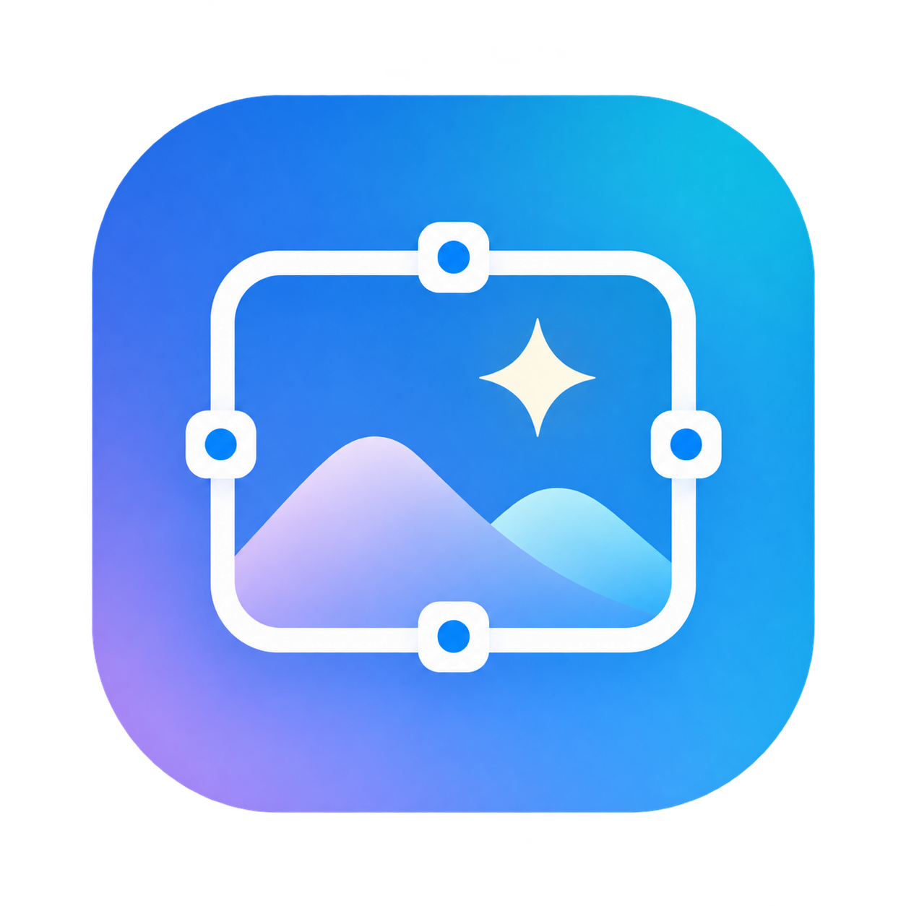
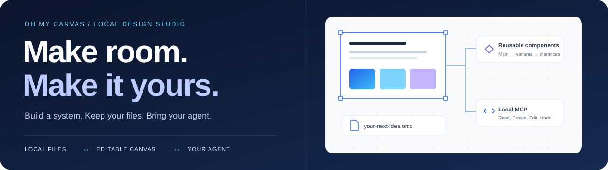
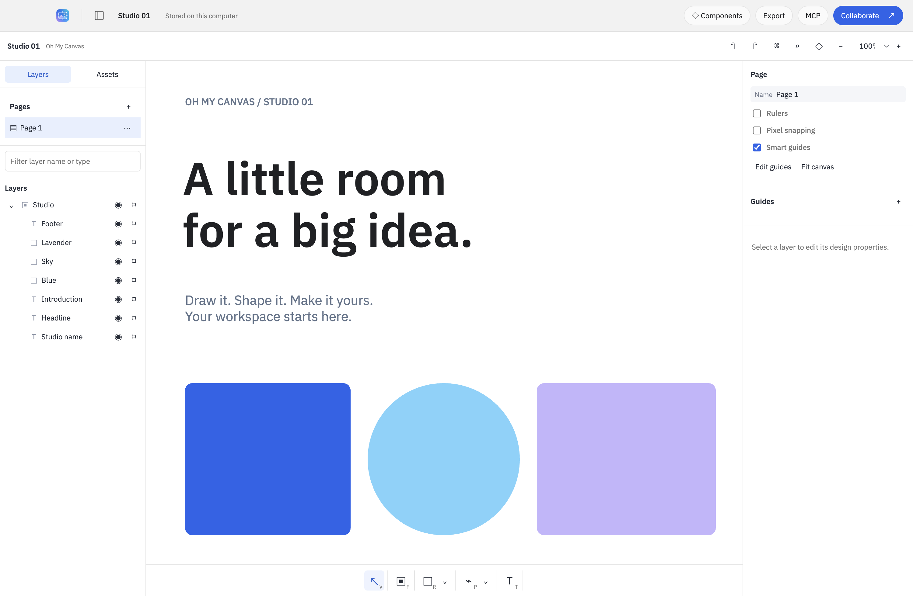
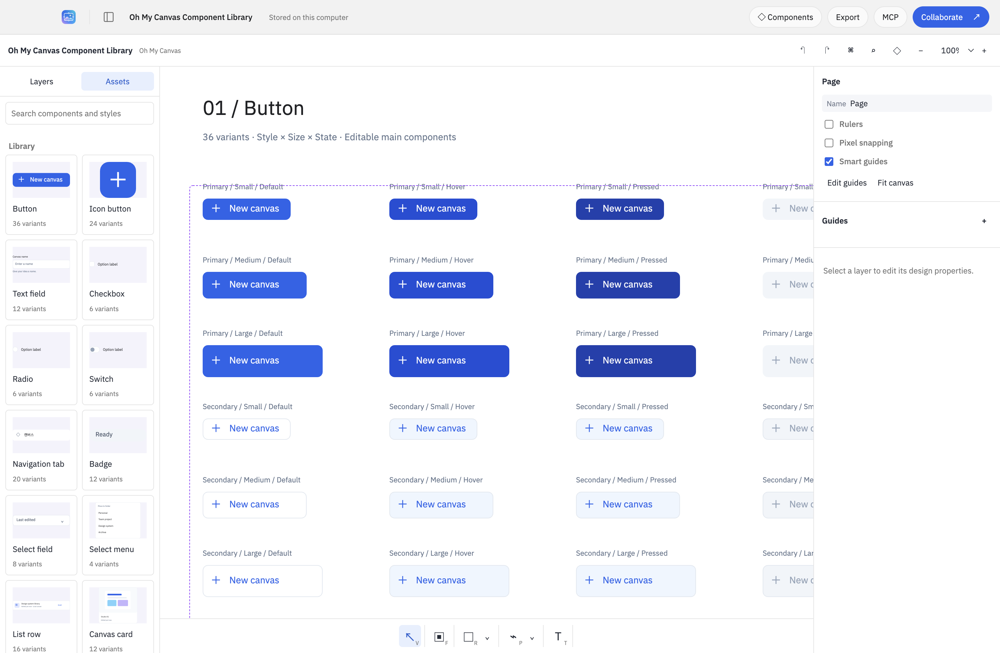
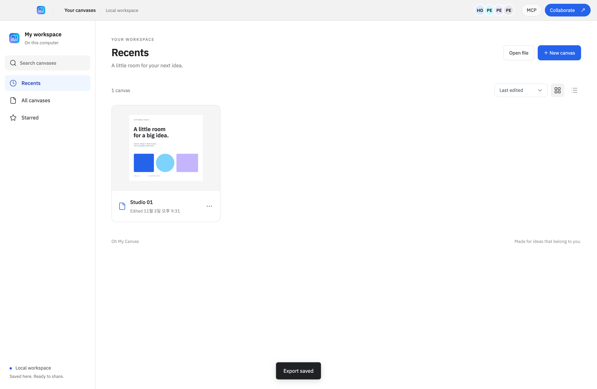
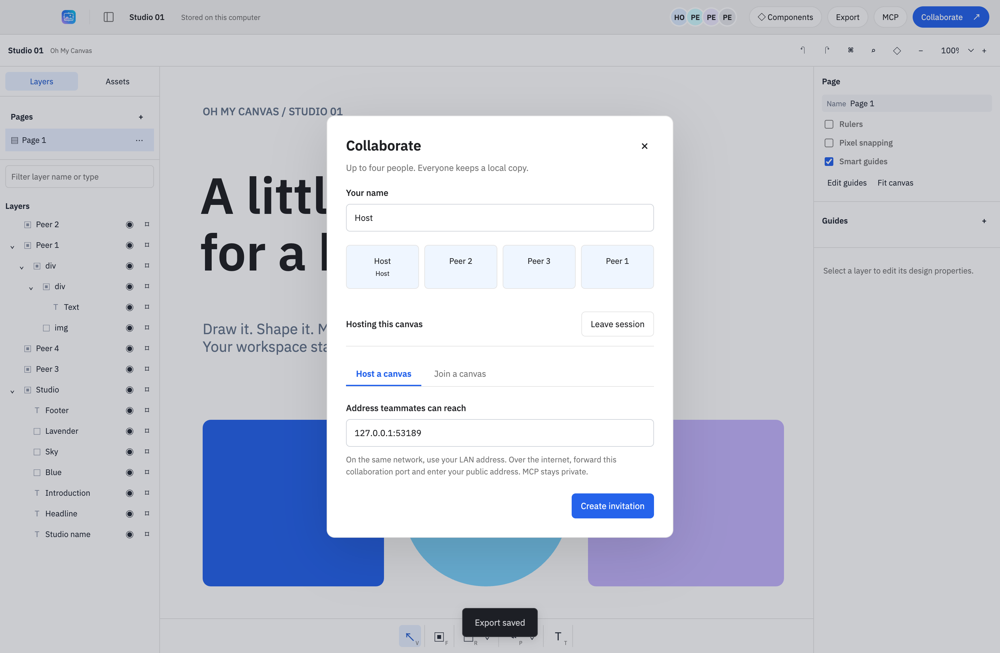

<p align="center"></p>
<h1 align="center">Oh My Canvas</h1>
<p align="center"><strong>あなたのキャンバス。あなたのファイル。あなたのエージェント。</strong></p>
<p align="center">再利用できるコンポーネント、MCP、最大4人の共同編集を備えたローカルのデザインスタジオ。</p>
<p align="center"></p>
<p align="center"><a href="README.md">English</a> · <a href="README-ko.md">한국어</a> · <strong>日本語</strong> · <a href="README-zh-CN.md">简体中文</a></p>
<p align="center"><a href="#quick-start">クイックスタート</a> · <a href="#screenshots">スクリーンショット</a> · <a href="#components">コンポーネント</a> · <a href="#mcp">MCP</a> · <a href="#contributing">貢献する</a></p>

<p align="center"></p>

## 次のアイデアを広げる場所

インターフェースをデザインし、コンポーネントライブラリを作り、同じ編集可能なキャンバスでエージェントと作業できます。ドキュメントと埋め込みアセットは自分のコンピューターに保存されます。Leviosaへのログイン、Paperのサブスクリプション、アプリ内クレジット、クラウドデータベース、テレメトリーは組み込まれていません。

**エディターとローカルMCPに利用クレジットの課金はありません。** 選択したAIクライアントの契約や利用制限は別途適用されます。共同編集では、参加者が接続可能なホストへ直接接続します。開発者が運営するサーバーは使用しません。

| 作る | 手元に残す | 一緒に進める |
| --- | --- | --- |
| ベクター図形、パス、テキスト、画像、フレーム、ページ、オートレイアウト | ローカル自動保存、アトミック書き込み、復旧用バックアップ、持ち運べる `.omc` ファイル | 証明書を固定検証するTLSで最大4人が接続。エージェントにはローカルMCP |
| メインコンポーネント、リンクされたインスタンス、バリアント、テキスト・表示・差し替えプロパティ | 画像の埋め込み、同梱の英語・韓国語フォント、オフライン編集 | 再接続時にオフラインの変更をマージ。各参加者がローカル複製を保持 |

<a id="screenshots"></a>

## アプリのスクリーンショット

以下は独立実装の `editor/` をElectron上で実行し、合成ローカルドキュメントで撮影した画面です。エディター画面は **2026-11-04** のUI配置検査で更新し、共同編集・ドキュメント一覧は以前の4クライアント受け入れ検査で撮影しました。UIは英語で、一部のコンポーネント名に韓国語を使います。4言語のREADMEはUIの4言語対応を意味しません。

<p align="center"></p>
<p align="center"><em>左にレイヤー、中央にキャンバス、右にプロパティ。</em></p>

<details>
<summary><strong>実際のコンポーネントライブラリとドキュメント一覧を見る</strong></summary>



実際の1,065オブジェクトの文書で170バリアントと254プロパティバインドを保持します。16個すべてのAssetsプレビューとラベル収容検査は、初回読み込みと別プロセスでの再読み込みで合格しました。



合格した操作と適用範囲の制限は [現在の検証記録](docs/independent/VERIFICATION.md) に分けて記載しています。スクリーンショットは検査したローカル操作の資料であり、外部インターネットからの接続を証明しません。

</details>

<a id="quick-start"></a>

## ローカルで始める

### 1. ビルドして起動

既存のローカルチェックアウトと、**Node.js 22.12以上**、npmを使用します。依存関係のインストールにはネットワーク接続が必要です。ビルド後のエディターはオフラインで動作します。

```sh
cd /path/to/oh-my-canvas
npm ci
npm run build
npm start
```

現在のチェックアウトはローカル専用で、公開ダウンロードはありません。`/Applications/Oh My Canvas.app` の既存のインストールは独立エンジンへの置き換え前の版かもしれません。現在の実装はこのチェックアウトをビルドして実行してください。

<details>
<summary>macOSアプリバンドルを作る</summary>

```sh
npm run dist:mac
```

ビルドは `--publish never` を使い、`release/mac-arm64/Oh My Canvas.app` と `release/` 内のZIPを生成します。現在のmacOS arm64パッケージ、同梱CLI、正確なバイト比較によるパッケージ出自検査は合格しました。署名・公証は行っておらず、Windows/Linuxでの実行は未検証です。依存関係を共有するチェックアウトでは、先にビルドし、`node scripts/package-local.mjs` で実体ファイルをステージしてから `node scripts/packaged-smoke.mjs` で検査してください。別worktreeの `node_modules` リンクから直接梱包すると依存が欠落する場合があります。

</details>

### 2. 作ってみる

新しいキャンバスを作成するか、ライブラリが空の場合は **Explore a sample** を選びます。下部ツールバーでテキストや図形を追加し、レイヤーを整理し、**Design** でプロパティを編集します。変更はローカルに保存されます。**Export → Oh My Canvas** で編集可能なバックアップを書き出せます。JSON、SVG、PNGにも対応し、レイヤー別の書き出しはDesignパネルから実行できます。

[インストール、保存場所、復旧、書き出し形式、制限（英語）→](docs/GETTING_STARTED.md)

<a id="components"></a>

## 本当に編集できるデザインシステム

同梱の [Component Library](docs/design/system/component-library.omc) を **Open file** で開いてください。ボタン、入力欄、選択コントロール、ナビゲーション、バッジ、リスト、カード、ツールチップ、ダイアログを、**14種類・170バリアントと、5つのネストしたインスタンスを含む2つの複合コンポーネント**として収録しています。

合成ライブラリ全体でコンポーネント・プロパティ・バリアント・ソース編集、永続保存の照合、別プロセスでの再読み込みが合格しました。範囲と資料は [現在の検証記録](docs/independent/VERIFICATION.md) を参照してください。

1. ライブラリのドキュメントを複製し、画面を作るページを追加します。
2. **Components → Assets** を開き、コンポーネントをクリックしてリンクされたインスタンスを挿入します。
3. Designパネルで状態、テキスト、表示・非表示を変更します。
4. メインコンポーネントを編集すると、各インスタンスのオーバーライドを保ったまま変更が反映されます。

**Create component**（macOSでは `⌥⌘K`）、**Combine variants**、**Add variant** で独自の部品も作れます。**Reset all changes** は元の状態に戻し、**Detach instance** はリンクを解除します。

[コンポーネントの動作とMCP契約（英語）→](docs/design/components-implementation.md) · [ビジュアル方針（英語）→](DESIGN.md)

<a id="mcp"></a>

## エージェントにも本物のキャンバスを

MCP now defaults to the app-owned Streamable HTTP endpoint `https://127.0.0.1:47831/mcp`, authenticated with the private persistent `OMC_MCP_TOKEN`. The client must trust this profile's TLS certificate; the app never installs OS trust. Open a canvas and use **MCP → Copy configuration**. Read the [HTTP setup and stdio rollback guide (English)](docs/MCP.md); the app never edits global client settings automatically.

> 開いているキャンバスに1440 × 900のダッシュボードを作ってください。青、水色、淡いラベンダー、白、黒を使い、ナビゲーションとボタンを再利用できるコンポーネントにしてください。最後にスクリーンショットで確認してください。

まず `get_context` と `get_guide` を呼び、次に `create_board`、`write_html`、`update`、`components`、`component` などを使用します。ツールは **19個** あります。コンポーネント操作は `batch` の外で呼び出します。バリアント切り替え後は、新しい選択IDが返る場合があります。エージェントの編集も、ユーザーの編集と同じ保存・共同編集Undoの経路を通ります。

ユーザーが文字を入力したり値をスクラブ操作したりしている間も、読み取りツールは使用できます。エージェントの変更操作とUndoは `busy` を返すので、ユーザーのトランザクション終了後に再試行してください。MCPブリッジは認証付きのループバック専用で、共同編集とは分離されています。**MCPのポートを転送したり、`mcp-runtime.json` を共有したりしないでください。**

[設定とトラブルシューティング（英語）→](docs/TROUBLESHOOTING.md) · [信頼境界（英語）→](SECURITY.md)

## ホスティング用バックエンドなしで、最大4人

ホストが **Collaborate → Host a canvas** を開き、招待を非公開で共有します。残り3人は **Join a canvas** から参加できます。全員がローカルコピーを持ち、接続が切れても編集を続け、再接続後に変更をマージできます。

新しいローカル受け入れ検査では、独立した4つのElectronプロセスによる実際のTLS通信、同時挿入、作業者別Undo、埋め込み画像、公式SDK stdio、ローカル書き出し、オフライン再接続、永続保存後の再読み込み、旧形式ファイルのマージが合格しました。家庭・企業のNATや公開インターネットをまたぐ外部コンピューター間の接続は未検証です。



ホストに到達できる必要があります。自動NAT越え、リレー、TURNサービス、自動ホスト移行はありません。インターネット経由では、共同編集ポートの手動転送と到達可能なアドレスが必要になる場合があり、CGNATでは接続できないことがあります。アプリはルーター設定を変更しません。全参加者がプロトコルv2に対応したアプリを使用してください。招待を持つ人は信頼できる編集者として扱います。読み取り専用ロールやメンバー単位の権限取り消しはありません。

<details>
<summary>マージの動作とファイル互換性</summary>

独立した図形プロパティはYjsでマージします。正規化したジオメトリから一貫した描画境界を再構成し、親リンクから子要素リストを修復します。同じテキストレイヤーではリッチテキストプロパティ単位で競合を解決するため、**文字単位の同時入力マージには対応していません。** テキスト作業はレイヤーを分けてください。

書き込み形式は `.omc` v2で、v1ファイルも読み込めます。古い共同編集の招待・ハンドシェイクはドキュメント交換前に拒否します。元のホストが離れた場合は、参加者が保存済みの複製を再ホストし、新しい招待を共有できます。Undo/Redoの履歴は現在のセッション内だけに保持され、ドキュメントを開き直しても復元されません。

</details>

[接続手順と制限（英語）→](docs/GETTING_STARTED.md#collaboration)

## 検証できる実装

| 領域 | 検証対象 |
| --- | --- |
| ドキュメントの整合性 | 正規化ジオメトリ、同時編集、事前検証、作業者・グループの分離、Undo/Redo |
| 永続保存 | 直列化したアトミック保存、fsync、メタデータ検証、バックアップ復旧、ポータブル形式の取り込み・再読み込み |
| ネットワーク境界 | TLSの接続先確認、招待認証、4人制限、Origin拒否、分離されたローカルMCP |
| 実際のアプリ | 4クライアント共同編集、コンポーネント操作、テキスト編集、SVGの折り返し、ネイティブ書き出し、インストール済みパッケージの照合 |

現在の実行では **14ファイル・353件のエディターテスト**、**40件のホストテスト**、**ネイティブUI 37/37件・レンダラーエラー0件**が合格しました。描画検査は32シナリオ・830アサーションと、大規模フィクスチャ・キャッシュの8アサーションを含みます。実際のコンポーネントライブラリと現在のパッケージ検査も合格しました。これは範囲を定めたローカル結果であり、全機能レコードに個別テストがあるという主張ではありません。独立エンジニアリングレビューは **APPROVE**、アーキテクチャは **WATCH** です。新しい履歴のソース候補もmanifest・プライバシー検査に合格しました。[最終レビュー](docs/independent/ASTRA_FINAL_REVIEW.md)と[検証記録](docs/independent/VERIFICATION.md)を参照してください。

[現在の検証と制限（英語）→](docs/independent/VERIFICATION.md) · [検査の実行方法（英語）→](docs/TESTING.md)

<a id="contributing"></a>

## プロジェクトを一緒に育てる

再現できるバグ報告、目的を絞った修正、役立つコンポーネント例、内容の揃った翻訳を歓迎します。まず貢献ガイドを読み、非公開のデザイン、招待、実行時トークン、個人情報を報告に含めないでください。

- [貢献ガイド](docs/contributing/ja.md) — 作業手順、変更範囲、検査、英語のコミット、レビュー基準
- [Pull requestテンプレート（英語）](.github/PULL_REQUEST_TEMPLATE.md) — 問題、動作、検証結果、制限
- [バグ報告フォーム（英語）](.github/ISSUE_TEMPLATE/bug_report.yml) · [機能提案フォーム（英語）](.github/ISSUE_TEMPLATE/feature_request.yml)
- [アーキテクチャ（英語）](docs/ARCHITECTURE.md) · [セキュリティ（英語）](SECURITY.md) · [トラブルシューティング（英語）](docs/TROUBLESHOOTING.md)

リポジトリは [Dindb-dong/oh-my-canvas](https://github.com/Dindb-dong/oh-my-canvas) に非公開でホストしています。アクセス権のある共同作業者はIssueフォームとPRテンプレートを利用できます。ダウンロード可能なリリースやホスト型サービスを提供するという意味ではありません。

## ライセンスと出自

独立して記述したプロジェクト実装には [MITライセンス](LICENSE) が適用されます。外部ライブラリ、ネイティブランタイム、フォントは各自のライセンスを維持します。[外部ライセンスの通知](THIRD_PARTY_NOTICES.md)と[依存関係一覧](docs/licensing/DEPENDENCIES.md)を参照してください。

現在のエディターは `editor/` に実装しています。以前取り込んだエディター、補助コード、コピーしたテストは公開対象のソースから除去しました。計画参加者は以前の実装を閲覧しており、非公開ソースに触れていないクリーンルーム実装とは称しません。[実装の出自](docs/independent/PROVENANCE.md)と[機能契約](docs/independent/behavior-contract.md)は英語です。

このリポジトリは、確認済みの独立実装ソースのスナップショットから、別のGit履歴で開始しています。除去した会社コードの過去の履歴は含みません。MITは対象となるプロジェクト実装に適用され、会社コードや外部著作物のライセンスは変更しません。現在のアクセス範囲は非公開です。
