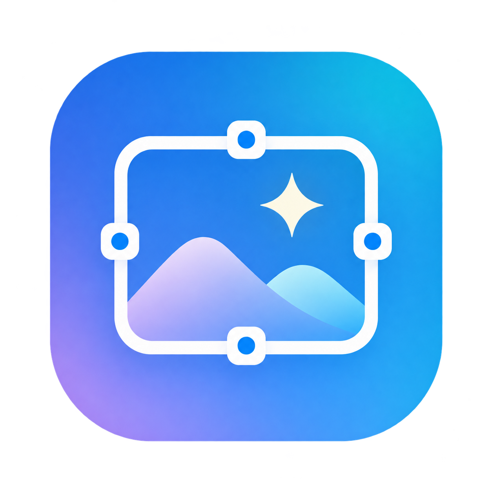
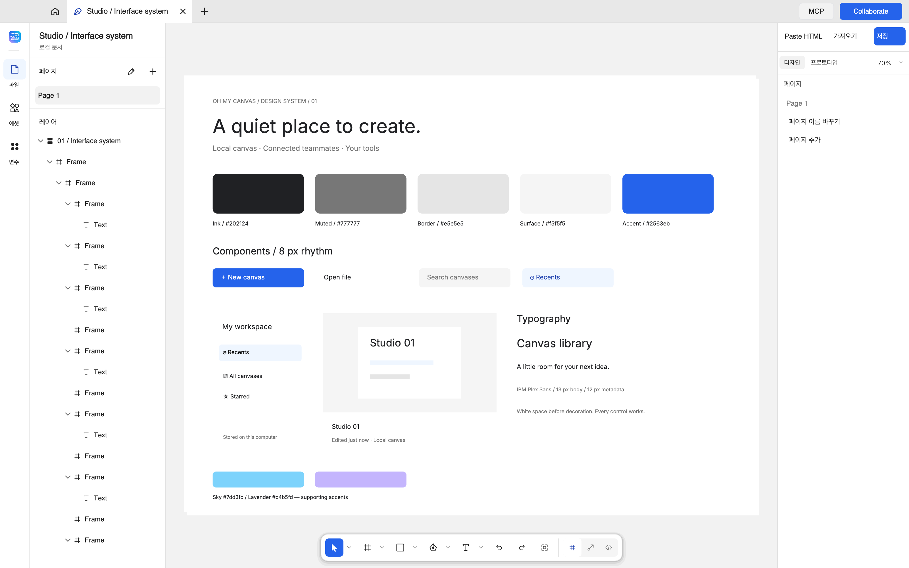
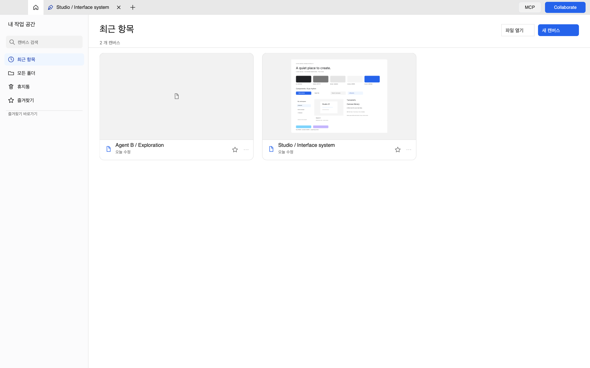

<p align="center"></p>
<h1 align="center">Oh My Canvas</h1>
<p align="center"><strong>HTML/CSS로 그리는 디자인. 사람과 여러 에이전트가 함께.</strong></p>
<p align="center">Rust와 Skia 기반의 로컬 우선 네이티브 디자인 스튜디오. HTML/CSS로 직접 그리고, 여러 MCP 에이전트와 동시에 작업하세요.</p>
<p align="center"></p>
<p align="center"><a href="README.md">English</a> · <strong>한국어</strong> · <a href="README-ja.md">日本語</a> · <a href="README-zh-CN.md">简体中文</a></p>

<p align="center"></p>

## Oh My Canvas의 장점

- **HTML/CSS로 바로 그리기.** 앱에 HTML을 붙여 넣거나 MCP의 `write_html`을 호출하세요. 지원하는 CSS를 편집 가능한 레이어·텍스트·레이아웃으로 변환하고 캔버스에서 계속 수정합니다.
- **여러 에이전트와 동시 작업.** 에이전트마다 명시적인 `documentId`를 지정하면 별도 백그라운드 문서에서 작업할 수 있습니다. 사용자도 디자인을 계속하고 작성자별 Undo도 분리됩니다. 같은 레이어를 바꿀 때는 작업을 조율하세요.
- **가벼운 로컬 작업 구조.** 네이티브 앱과 서비스는 Electron·브라우저 렌더러 없이 동작합니다. 로컬 저장, 재사용 컴포넌트, 스타일·변수와 내보내기를 지원합니다.
- **변경에 필요한 컨텍스트만 사용.** HTML/CSS 생성, 일괄 작업과 범위를 좁힌 조회로 문서 전체를 반복 전송할 필요를 줄입니다. 초기 LD03 실험에서는 Paper/Figma보다 전체 토큰을 약 1만 개 적게 사용했습니다. 아래에 측정 조건을 구분했습니다.
- **앱 크레딧 없이 협업.** 로컬 MCP에 호출별 앱 크레딧 과금이 없습니다. 접속 가능한 네이티브 TLS 호스트로 최대 4인이 협업합니다. AI 클라이언트의 요금·한도는 별도입니다.

<a id="screenshots"></a>

## 앱 화면

HTML/CSS로 만든 화면을 레이어 단위로 편집하고, 로컬 문서 목록에서 캔버스를 관리하세요.



로컬 문서 목록과 실제 캔버스 미리보기.

<a id="quick-start"></a>

## 네이티브 앱 시작하기

Rustup과 고정된 Rust 1.92.0 도구 체인을 사용합니다. 바이너리 세 개를 함께 빌드한 뒤 데스크톱을 실행하세요.

```sh
cd /path/to/oh-my-canvas/native
cargo build --locked --release -p omc-desktop -p omc-service -p omc-cli
./target/release/omc-desktop
```

네이티브 앱 실행에는 Node.js가 필요하지 않습니다. 네이티브 패키징과 플랫폼별 출시 검증은 아직 완료되지 않았습니다. [네이티브 안내](native/README.md).

<a id="components"></a>

## 편집 가능한 컴포넌트와 디자인 시스템

원본 컴포넌트·연결된 인스턴스·variant를 만들고 텍스트·표시 여부·개별 override를 바꿉니다. 공유 스타일과 토큰으로 반복 요소를 관리합니다. [네이티브 컴포넌트·스타일·라이브러리 도구](docs/MCP_PARITY.md)를 참고하세요.

<a id="mcp"></a>

## 에이전트마다 실제 캔버스 연결하기

네이티브 앱의 **MCP → Copy MCP configuration**에서 stdio 설정을 복사해 클라이언트에 등록하세요. 설치된 `omc-cli`와 프로필을 가리키며 글로벌 클라이언트 설정을 자동으로 변경하지 않습니다.

**OMC 방언은 MCP 도구 59개(편집·작업 공간 50개 + 네이티브 확장 9개)**를 제공합니다. 별도 **FigCraft 호환 방언은 MCP 도구 19개를 통해 명령 ID 643개**를 노출합니다. 명령 643개가 MCP 도구 643개를 뜻하지는 않습니다.

`list_documents` → `open_document` 또는 `create_document` → `get_context` 순서로 시작하세요. 문서 변경에는 `documentId`가 필요합니다. `create_board`, `write_html`, `edit_shapes`, `components`, `batch`, `screenshot`으로 생성·수정·확인합니다. 네이티브 확장에는 범위 제한 조회, 댓글, 토큰, 작업과 코드 내보내기가 있습니다.

에이전트마다 백그라운드 문서를 유지할 수 있습니다. 사람이 편집 중이면 `busy`가 반환될 수 있으므로 작업 종료 후 재시도하세요. 작성자별 Undo는 다른 작성자의 이력을 소비하지 않습니다. 같은 연결을 공유해도 보이는 탭을 암묵적 변경 대상으로 쓰지 않습니다.

[도구 계약·마이그레이션](docs/MCP_PARITY.md) · [stdio·선택적 이전 HTTPS·협업 설정](native/README.md)

## 속도·메모리·토큰 측정 결과

프로젝트 자체 파일럿에서 OMC·Paper·Figma·Penpot을 비교했습니다. 선택된 60초 실험에서 OMC는 Penpot보다 **수용 검사를 통과한 작업을 21–55% 빠르게 완료**했습니다. 같은 시도의 Paper/Figma는 동일한 수용 검사를 완료하지 못했습니다. LD02/LD03에서 Paper/Penpot보다 낮은 RAM 피크도 관측했지만, 제품별 자원 집계 범위는 불완전하며 서로 다릅니다.

동일 모델·과제·프롬프트를 사용한 **더 이른 LD03 실험**의 토큰 수는 다음과 같습니다.

| Product | Gross provider tokens | Cached input included |
| --- | ---: | ---: |
| OMC | 22,604 | 7,110 |
| Paper | 32,820 | 16,782 |
| Figma | 32,363 | 16,578 |
| Penpot | 22,624 | 7,110 |

이 실험에서 OMC는 **Paper보다 10,216개(31.1%)**, **Figma보다 9,759개(30.2%)** 적게 사용했습니다. 캐시 입력과 출력을 포함해 승인된 모든 모델 요청의 토큰을 합산한 값입니다. OMC/Penpot은 공통 검사를 통과했고, Paper/Figma는 편집 결과만 확인되어 전체 재열기 검증 등이 빠졌습니다. 단일 탐색 실험의 관측값이며 일반적인 절감 보장이나 청구 금액 비교는 아닙니다. 이후 중단 조건을 정리한 60초 LD02/LD03 실험에서는 제품 간 토큰 합계가 거의 비슷했습니다.

[전체 결과·한계](docs/benchmarks/results/2026-11-18/README.md) · [초기 토큰 기록](docs/benchmarks/results/2026-11-18/LD03/earlier-tokens.json) · [실험 프로토콜](docs/benchmarks/README.md)

### 실험 인덱스

| ID | 내용 | 기록 |
| --- | --- | --- |
| [LD01](docs/benchmarks/results/2026-11-18/LD01/README.md) | 화면 생성 | 8 |
| [LD02](docs/benchmarks/results/2026-11-18/LD02/README.md) | 대형 문서 부분 수정 | 4 |
| [LD03](docs/benchmarks/results/2026-11-18/LD03/README.md) | 공유 컴포넌트·스타일 변경 | 16 |
| [LD04](docs/benchmarks/results/2026-11-18/LD04/README.md) | 반응형 레이아웃 | 11 |
| [LD05](docs/benchmarks/results/2026-11-18/LD05/README.md) | 코드 ↔ 캔버스 왕복 | 8 |
| [LD06](docs/benchmarks/results/2026-11-18/LD06/README.md) | 에셋·폰트·콘텐츠 | 10 |
| [LD07](docs/benchmarks/results/2026-11-18/LD07/README.md) | 결함 진단·수정 | 2 |
| [LD08](docs/benchmarks/results/2026-11-18/LD08/README.md) | 동시 문서 작업 | 9 |
| [LD09](docs/benchmarks/results/2026-11-18/LD09/README.md) | 시작·가져오기·재열기 | 7 |
| [LD10](docs/benchmarks/results/2026-11-18/LD10/README.md) | 상호작용·유휴 자원 | 중단·부분 기록 |
| [LD11](docs/benchmarks/results/2026-11-18/LD11/README.md) | 저장·복구 | 3 |
| [LD12](docs/benchmarks/results/2026-11-18/LD12/README.md) | 빌드·IDE 자원 경합 | 보조 관측만 |
| [LD13](docs/benchmarks/results/2026-11-18/LD13/README.md) | 4인 협업 | 미측정 |

78개 시도이며 실패·재시도를 포함합니다. 초기 LD03 토큰 실험은 별도 조건입니다.

## 사람끼리도 함께 작업하기

네이티브 TLS 방을 호스팅하고 인증서를 고정 검증하는 초대장을 비공개로 공유합니다. 최대 4인이 영속 로컬 복제본을 유지합니다. 호스트에 직접 접속할 수 있어야 하며 자동 NAT 통과·중계·호스트 이전은 제공하지 않습니다. 외부 네트워크·실물 기기 4대 검증은 미완료입니다. 선택적 FigCraft 서버 게시 기능은 별도 온라인 경로입니다. [네이티브 안내](native/README.md).

<a id="contributing"></a>

## 기여와 검증

[기여 안내](CONTRIBUTING.md) · [테스트](docs/TESTING.md) · [네이티브 검증](native/README.md) · [보안](SECURITY.md) · [디자인 방향](DESIGN.md)

프로젝트 구현은 [MIT](LICENSE)이며 외부 의존성·폰트는 각 라이선스를 따릅니다. [외부 구성요소 고지](THIRD_PARTY_NOTICES.md) · [구현 출처](docs/independent/PROVENANCE.md). 소스 코드는 [GitHub](https://github.com/Dindb-dong/oh-my-canvas)에서 확인할 수 있습니다.
