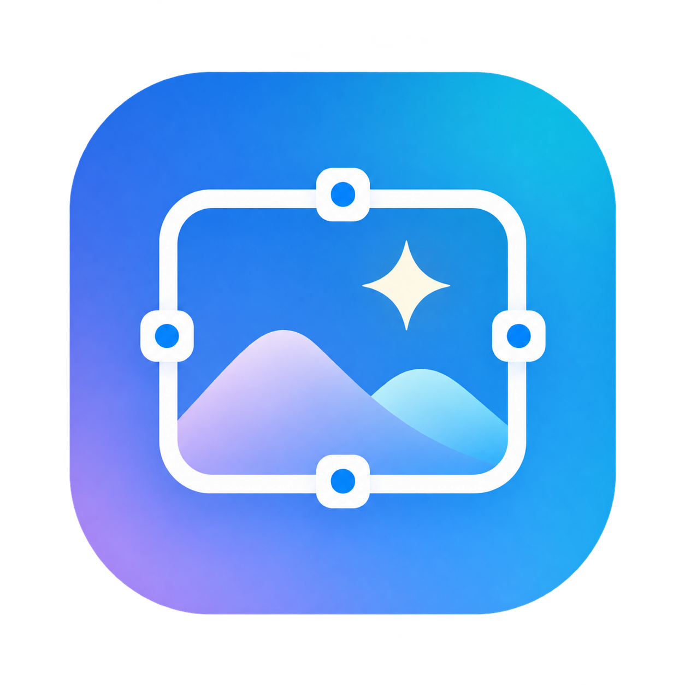
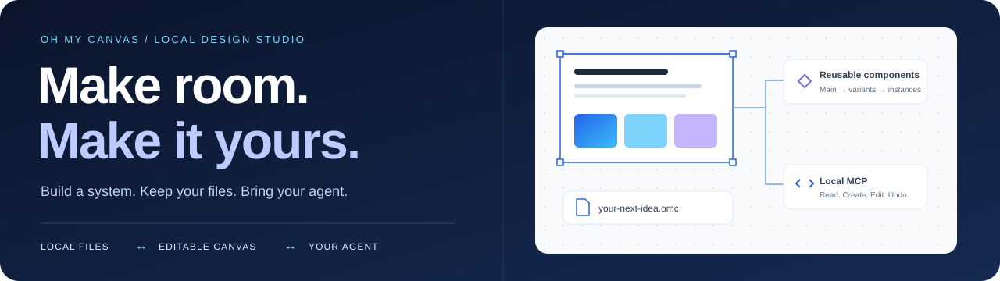
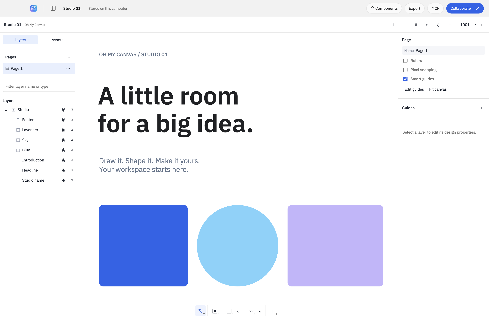
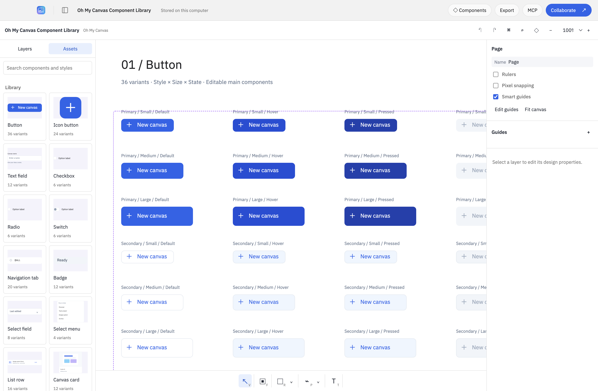
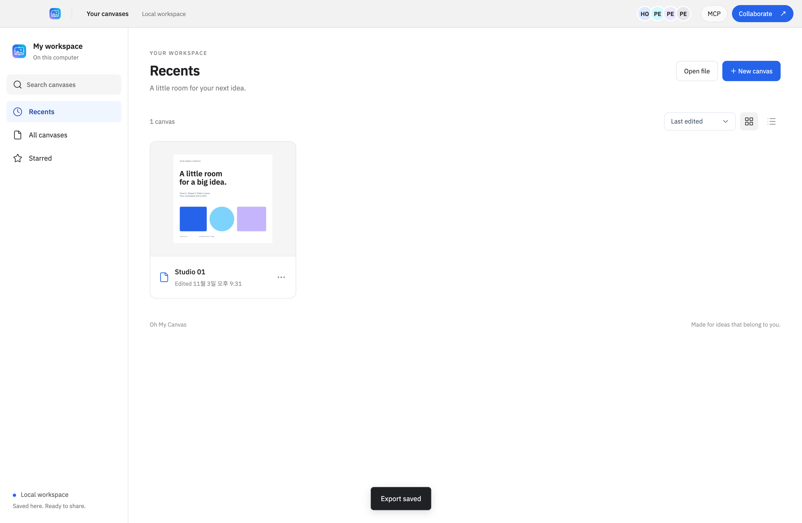
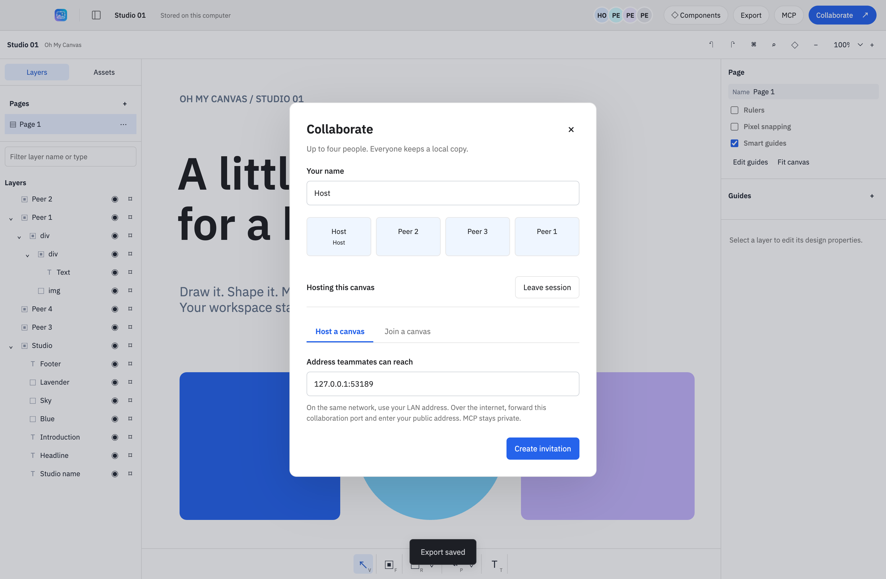

<p align="center"></p>
<h1 align="center">Oh My Canvas</h1>
<p align="center"><strong>나의 캔버스. 나의 파일. 나의 에이전트.</strong></p>
<p align="center">재사용 컴포넌트, MCP, 최대 4인 협업을 갖춘 로컬 데스크톱 디자인 스튜디오.</p>
<p align="center"></p>
<p align="center"><a href="README.md">English</a> · <strong>한국어</strong> · <a href="README-ja.md">日本語</a> · <a href="README-zh-CN.md">简体中文</a></p>
<p align="center"><a href="#quick-start">빠른 시작</a> · <a href="#screenshots">스크린샷</a> · <a href="#components">컴포넌트</a> · <a href="#mcp">MCP</a> · <a href="#contributing">기여하기</a></p>

<p align="center"></p>

## 다음 아이디어를 위한 작은 공간

인터페이스를 디자인하고, 컴포넌트 라이브러리를 만들고, 에이전트와 같은 편집 가능한 캔버스에서 작업하세요. 문서와 포함된 에셋은 내 컴퓨터에 저장됩니다. Leviosa 로그인, Paper 구독, 앱 크레딧, 클라우드 DB, 텔레메트리는 포함하지 않습니다.

**편집기와 로컬 MCP에는 사용 크레딧 과금이 없습니다.** 선택한 AI 클라이언트의 구독·이용 한도는 그대로 적용됩니다. 협업은 참여자가 접속 가능한 호스트에 직접 연결하며, 배포자가 운영하는 서버를 사용하지 않습니다.

| 만들기 | 보관하기 | 함께 작업하기 |
| --- | --- | --- |
| 벡터 도형, 경로, 텍스트, 이미지, 프레임, 페이지, 자동 레이아웃 | 로컬 자동 저장, 원자적 쓰기, 복구용 백업, 휴대용 `.omc` 파일 | 인증서를 고정 검증하는 TLS로 최대 4인 협업, 에이전트용 로컬 MCP |
| 원본 컴포넌트, 연결된 인스턴스, variant, 텍스트·표시·swap 속성 | 이미지 문서 내 포함, 영문·한글 폰트 번들, 오프라인 편집 | 재접속 시 오프라인 변경 병합, 참여자마다 로컬 복제본 유지 |

<a id="screenshots"></a>

## 앱 스크린샷

아래는 독립 구현한 `editor/`를 Electron에서 실행하고 합성 로컬 문서로 촬영한 화면입니다. 편집기 화면은 **2026-11-04** UI 정렬 점검에서 갱신했고, 협업·문서 목록 화면은 앞선 4개 클라이언트 수용 검사에서 촬영했습니다. UI는 영어와 일부 한국어 컴포넌트 이름을 사용합니다. README 네 언어 지원이 UI의 네 언어 지원을 뜻하지는 않습니다.

<p align="center"></p>
<p align="center"><em>왼쪽에는 레이어, 가운데에는 캔버스, 오른쪽에는 디자인 속성.</em></p>

<details>
<summary><strong>실제 컴포넌트 라이브러리와 문서 목록 더 보기</strong></summary>



실제 객체 1,065개 문서에서 variant 170개와 속성 연결 254개를 보존합니다. Assets 미리보기 16개와 라벨 영역 검사는 최초 열기·새 프로세스 재열기 모두 통과했습니다.



통과한 흐름과 적용 한계는 [현재 검증 기록](docs/independent/VERIFICATION.md)에 구분해 기록합니다. 스크린샷은 검사한 로컬 흐름의 근거이며 외부 인터넷 연결을 입증하지 않습니다.

</details>

<a id="quick-start"></a>

## 로컬에서 시작하기

### 1. 빌드하고 실행

기존 로컬 체크아웃과 **Node.js 22.12 이상**, npm이 필요합니다. 의존성 설치에는 네트워크가 필요하지만, 빌드한 편집기는 오프라인으로 사용할 수 있습니다.

```sh
cd /path/to/oh-my-canvas
npm ci
npm run build
npm start
```

현재 체크아웃은 로컬 전용이며 공개 다운로드는 없습니다. `/Applications/Oh My Canvas.app`의 기존 설치본은 독립 엔진 교체 전 버전일 수 있으므로, 현재 구현은 이 체크아웃을 빌드해 실행하세요.

<details>
<summary>macOS 앱 번들 만들기</summary>

```sh
npm run dist:mac
```

빌드는 `--publish never`로 `release/mac-arm64/Oh My Canvas.app`과 `release/` 아래 ZIP을 생성합니다. 현재 macOS arm64 패키지·번들 CLI·정확한 바이트 기반 패키지 출처 검사는 통과했습니다. macOS 빌드는 서명·공증하지 않았고 Windows/Linux 실행은 미검증입니다. 의존성을 공유하는 체크아웃은 먼저 빌드한 뒤 `node scripts/package-local.mjs`로 실제 파일을 스테이징하고 `node scripts/packaged-smoke.mjs`로 검사하세요. 다른 worktree의 `node_modules` 링크로 직접 패키징하면 의존성이 빠질 수 있습니다.

</details>

### 2. 첫 작업 만들기

새 캔버스를 만들거나, 문서가 없을 때 **Explore a sample**을 선택하세요. 하단 도구 모음으로 텍스트와 도형을 추가하고, 레이어를 정리하며 **Design**에서 속성을 바꿀 수 있습니다. 변경은 로컬에 저장됩니다. **Export → Oh My Canvas**로 편집 가능한 휴대용 백업을 만드세요. JSON·SVG·PNG도 지원하며, 레이어별 내보내기는 Design 패널에 있습니다.

[설치·데이터 위치·복구·내보내기·용량 제한 자세히 보기(영문) →](docs/GETTING_STARTED.md)

<a id="components"></a>

## 직접 편집하는 디자인 시스템

**Open file**로 제공된 [Component Library](docs/design/system/component-library.omc)를 열어보세요. **14종·170개 variant와, 실제 중첩 인스턴스 5개를 포함한 조합 컴포넌트 2개**가 들어 있습니다. 버튼, 입력 필드, 선택 컨트롤, 내비게이션, 배지, 목록, 카드, 툴팁, 대화상자를 포함합니다.

전체 합성 라이브러리의 컴포넌트·속성·variant·원본 편집, 디스크 저장 확인, 새 프로세스 재열기 검사를 통과했습니다. 범위와 근거는 [현재 검증 기록](docs/independent/VERIFICATION.md)에 있습니다.

1. 라이브러리 문서를 Duplicate하고 화면용 페이지를 추가합니다.
2. **Components → Assets**에서 컴포넌트를 눌러 연결된 인스턴스를 삽입합니다.
3. Design 패널에서 상태·텍스트·표시 여부를 바꿉니다.
4. 원본을 수정하면 인스턴스에 반영되며, 인스턴스별 override는 유지됩니다.

**Create component**(macOS `⌥⌘K`), **Combine variants**, **Add variant**로 직접 구성할 수 있습니다. **Reset all changes**는 원본 상태로 복귀하고, **Detach instance**는 연결을 해제합니다.

[컴포넌트 동작·MCP 계약(영문) →](docs/design/components-implementation.md) · [디자인 기준(영문) →](DESIGN.md)

<a id="mcp"></a>

## 에이전트에게 실제 캔버스를 연결하세요

MCP now defaults to the app-owned Streamable HTTP endpoint `https://127.0.0.1:47831/mcp`, authenticated with the private persistent `OMC_MCP_TOKEN`. The client must trust this profile's TLS certificate; the app never installs OS trust. Keep the app running and use **MCP → Copy configuration**. Read the [HTTP setup and stdio rollback guide (English)](docs/MCP.md); the app never edits global client settings automatically.

> 지금 열린 캔버스에 1440 × 900 대시보드를 만들어줘. 파란색·하늘색·옅은 보라색·흰색·검정색을 사용하고, 내비게이션과 버튼은 재사용 컴포넌트로 만들어줘. 스크린샷으로 결과도 확인해줘.

Choose a canvas with `list_documents` and `open_document` or `create_document`, then read `get_context` and `get_guide`. Supply its `documentId` to every document mutation; then use `create_board`, `write_html`, `update`, `components`, and `component`. There are **31 tools**. Component actions run outside `batch`; variant switching can return a new selection ID. Agent edits use the same persistence and collaborative Undo path as local edits.

The desktop MCP can list, create, open, rename, and duplicate local canvases without manual library clicks. Start with `list_documents`, then `open_document` or `create_document`, followed by `get_context`. Use stable document IDs with `rename_document` and `duplicate_document`; `select_page` changes the active page. Multiple canvases stay open in tabs, with independent background editors for agents. MCP open/create/duplicate default to background operation; `focus:true` reveals the result. Tab switching preserves each session’s target, and explicit document IDs also separate repositories sharing one transport. In the UI, click the canvas title to edit it in place; Enter or blur saves and Escape cancels. **File → Rename canvas** opens the same inline field. The library also offers **Actions → Rename canvas**. See the [workspace tool contract](docs/MCP.md#documents-and-pages).

사용자가 텍스트를 입력하거나 값을 스크럽하는 동안 읽기는 가능하지만, 에이전트 수정·Undo는 `busy`를 반환합니다. 사용자 작업을 마친 뒤 재시도하세요. MCP bridge는 인증된 loopback 전용이며 협업과 분리됩니다. **MCP 포트를 포워딩하거나 `mcp-runtime.json`을 공유하지 마세요.**

[설정·문제 해결(영문) →](docs/TROUBLESHOOTING.md) · [신뢰 경계(영문) →](SECURITY.md)

## 서버 운영 없이 최대 4인 협업

호스트가 **Collaborate → Host a canvas**를 열고 초대를 비공개로 전달하면 팀원 3명이 **Join a canvas**로 참여할 수 있습니다. 모두 로컬 복제본을 가지며, 연결이 끊겨도 편집한 뒤 재접속 시 병합할 수 있습니다.

새 로컬 수용 검사는 독립 Electron 프로세스 4개 사이의 실제 TLS, 동시 삽입, 작성자별 Undo, 내장 이미지, 공식 SDK stdio, 로컬 내보내기, 오프라인 재접속, 저장 후 재열기, 이전 파일 병합을 통과했습니다. 서로 다른 가정·기업 NAT나 외부 인터넷의 컴퓨터 사이 연결은 미검증입니다.



호스트는 접속 가능한 주소에 있어야 합니다. 자동 NAT 우회, 릴레이, TURN, 자동 호스트 이전은 없습니다. 인터넷에서는 협업 포트의 수동 포워딩과 접속 가능한 주소가 필요할 수 있으며, CGNAT에서는 막힐 수 있습니다. 앱이 공유기 설정을 바꾸지는 않습니다. 모든 참여자는 프로토콜 v2가 필요합니다. 초대받은 사람은 신뢰하는 편집자로 간주하며 읽기 전용 권한·멤버별 권한 철회는 없습니다.

<details>
<summary>병합 동작과 파일 호환성</summary>

독립적인 도형 속성은 Yjs로 병합합니다. 기준 기하에서 일관된 렌더링 좌표를 계산하고, 부모 링크로 자식 목록을 복구합니다. 같은 텍스트 레이어는 rich-text 속성 충돌 해결을 사용하며 **글자 단위 동시 입력 병합이 아닙니다.** 텍스트 작업은 레이어를 나눠 진행하세요.

새 파일은 `.omc` v2로 저장하며 v1도 읽습니다. 구버전 협업 초대·handshake는 문서 교환 전에 거절합니다. 호스트가 떠나면 기존 참여자가 로컬 복제본을 다시 호스팅하고 새 초대를 전달할 수 있습니다. Undo/Redo 기록은 현재 세션에서만 유지되며 문서를 다시 열면 복원되지 않습니다.

</details>

[연결 단계와 한계(영문) →](docs/GETTING_STARTED.md#collaboration)

## 검증 근거도 함께

| 영역 | 검증 대상 |
| --- | --- |
| 문서 일관성 | 기준 기하, 동시 수정, 사전 검증, 작성자·작업 단위 격리, Undo/Redo |
| 저장 안정성 | 직렬화된 원자적 저장, fsync, 메타데이터 검증, 백업 복구, 휴대용 파일 열기 |
| 네트워크 경계 | TLS 인증서 검증, 초대 인증, 4인 제한, Origin 거절, 로컬 MCP 격리 |
| 실제 앱 | 4개 클라이언트 협업, 컴포넌트, 텍스트 편집, SVG 줄바꿈, 네이티브 내보내기, 설치 패키지 읽기 검증 |

현재 실행은 **편집기 14개 파일·353개 테스트**, **호스트 40개 테스트**, **네이티브 UI 37/37개 사례·렌더러 오류 0개**를 통과했습니다. 렌더링 검사는 32개 시나리오·830개 단언과 대형 예제·캐시 단언 8개를 포함합니다. 실제 컴포넌트 라이브러리 흐름과 현재 패키지 검사도 통과했습니다. 이는 범위를 명시한 로컬 결과이며, 모든 기능 기록에 개별 테스트가 있다는 주장은 아닙니다. 독립 엔지니어링 리뷰는 **APPROVE**, 아키텍처 상태는 **WATCH**이며, 새 이력의 소스 후보도 manifest·개인정보 검사를 통과했습니다. [최종 리뷰](docs/independent/ASTRA_FINAL_REVIEW.md)와 [검증 기록](docs/independent/VERIFICATION.md)을 참고하세요.

[현재 검증과 한계(영문) →](docs/independent/VERIFICATION.md) · [검사 실행 방법(영문) →](docs/TESTING.md)

<a id="contributing"></a>

## 함께 다듬기

재현 가능한 버그, 범위가 명확한 수정, 유용한 컴포넌트 예제, 내용이 일치하는 번역을 환영합니다. 기여 가이드부터 확인하고, 비공개 디자인·초대·런타임 토큰·개인정보는 보고서에 넣지 마세요.

- [기여 가이드](docs/contributing/ko.md): 작업 절차·범위·검사·영어 커밋·리뷰 기준
- [PR 템플릿](.github/PULL_REQUEST_TEMPLATE.md): 문제·변경 동작·근거·한계
- [버그 리포트](.github/ISSUE_TEMPLATE/bug_report.yml) · [기능 제안](.github/ISSUE_TEMPLATE/feature_request.yml)
- [구조(영문)](docs/ARCHITECTURE.md) · [보안(영문)](SECURITY.md) · [문제 해결(영문)](docs/TROUBLESHOOTING.md)

저장소는 [Dindb-dong/oh-my-canvas](https://github.com/Dindb-dong/oh-my-canvas)에 비공개로 호스팅합니다. 접근 권한이 있는 협업자는 이슈 양식과 PR 템플릿을 사용할 수 있습니다. 다운로드 가능한 릴리스나 호스팅 서비스를 제공한다는 뜻은 아닙니다.

## 라이선스와 출처

독립적으로 작성한 프로젝트 구현에는 [MIT 라이선스](LICENSE)가 적용됩니다. 외부 라이브러리·네이티브 런타임·폰트는 각자의 라이선스를 유지합니다. [외부 고지](THIRD_PARTY_NOTICES.md)와 [의존성 목록](docs/licensing/DEPENDENCIES.md)을 참고하세요.

현재 편집기는 `editor/`에 구현되어 있으며, 이전에 가져온 편집기·보조 코드·복사한 테스트는 공개 대상 소스에서 제거했습니다. 계획 참여자가 이전 구현을 읽었으므로 비노출 클린룸 구현이라고 표현하지 않습니다. [구현 출처](docs/independent/PROVENANCE.md)와 [기능 계약](docs/independent/behavior-contract.md)은 영문입니다.

이 저장소는 점검한 독립 구현 소스 스냅샷에서 별도의 Git 이력으로 시작합니다. 제거한 회사 코드의 과거 이력은 포함하지 않습니다. MIT는 해당 프로젝트 구현에 적용되며 회사 코드나 외부 저작물의 라이선스를 바꾸지 않습니다. 현재 저장소 접근은 비공개입니다.
