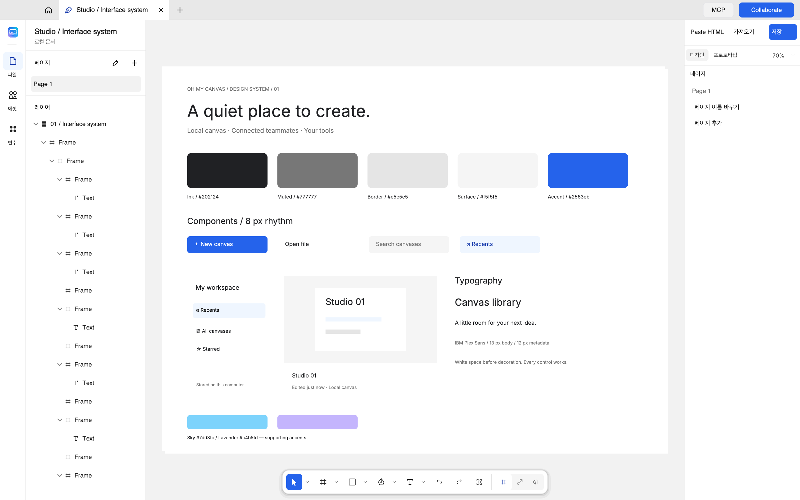
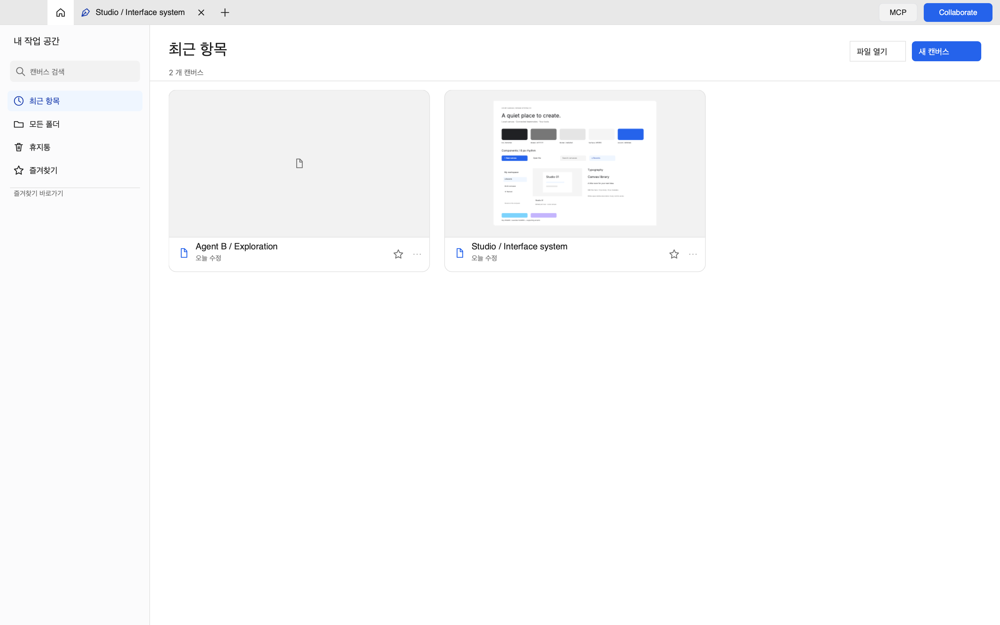

<p align="center"></p>
<h1 align="center">Oh My Canvas</h1>
<p align="center"><strong>用 HTML/CSS 绘制可编辑设计。人与多个智能体一起工作。</strong></p>
<p align="center">基于 Rust 和 Skia 的本地优先原生设计工作室，支持 HTML/CSS 创作和多个 MCP 智能体并行工作。</p>
<p align="center"></p>
<p align="center"><a href="README.md">English</a> · <a href="README-ko.md">한국어</a> · <a href="README-ja.md">日本語</a> · <strong>简体中文</strong></p>

<p align="center"></p>

## 为什么选择 Oh My Canvas

- **直接用 HTML/CSS 绘制。** 粘贴 HTML 或通过 MCP 调用 `write_html`，将受支持的 CSS 转换成可编辑图层、文字和布局。
- **多个智能体同时工作。** 为每个智能体指定 `documentId`，在独立后台文档中工作。撤销历史按作者隔离；修改同一图层时需协调。
- **本地原生架构。** 桌面与服务无需 Electron 或浏览器渲染器，支持本地保存、组件、样式、变量和导出。
- **只使用必要的上下文。** HTML/CSS 创作、批量操作和局部查询减少重复传输完整文档的需要。早期 LD03 实验中，OMC 比 Paper/Figma 少用约一万个总令牌，条件见下文。
- **无应用调用积分。** 本地 MCP 不按调用收取应用积分。通过可访问的 TLS 主机支持最多四人协作。AI 客户端的费用和限制另计。

<a id="screenshots"></a>

## 重新拍摄的应用截图

2026 年 11 月 18 日，在隔离配置下以隐藏、不聚焦方式运行已安装的原生 macOS 应用并截图。已有 HTML 设计系统通过 MCP 导入为可编辑图层。这是实际运行画面；安装的二进制构建于 11 月 17 日，并非当前 HEAD 的重新构建。



本地文档列表与实际画布预览。

<a id="quick-start"></a>

## 启动原生应用

使用 Rustup 和固定的 Rust 1.92.0 工具链。一起构建三个二进制文件，再启动桌面：

```sh
cd /path/to/oh-my-canvas/native
cargo build --locked --release -p omc-desktop -p omc-service -p omc-cli
./target/release/omc-desktop
```

Node.js 用于保留的 Electron 实现和 JavaScript 测试客户端，原生运行时无需 Node.js。原生打包与跨平台发布验证尚未完成。[原生指南](native/README.md)。

<a id="components"></a>

## 可编辑组件与设计系统

支持主组件、关联实例、变体、文字与可见性覆盖，以及共享样式和令牌。[旧示例库](docs/design/system/component-library.omc)包含 170 个变体，使用 Electron 格式，并非原生入门文件。[组件约定](docs/design/components-implementation.md) · [迁移](docs/MCP_PARITY.md#files-and-repeatable-output)。

<a id="mcp"></a>

## 为每个智能体连接真实画布

在原生应用中点击 **MCP → Copy MCP configuration**，将 stdio 配置加入客户端。配置指向安装的 `omc-cli` 和对应配置目录，不会自动修改全局设置。

**OMC 方言提供 59 个 MCP 工具：50 个基本工具与 9 个原生扩展。** 独立的 **FigCraft 兼容方言通过 19 个 MCP 工具提供 643 个命令 ID**，并不是 643 个 MCP 工具。本次更新已通过安装版的 `tools/list` 确认两组工具数量。

从 `list_documents` → `open_document` 或 `create_document` → `get_context` 开始。修改文档须指定 `documentId`。用 `create_board`、`write_html`、`edit_shapes`、`components`、`batch` 和 `screenshot` 完成创作与检查。原生扩展支持有界查询、评论、令牌、任务和代码导出。

各智能体可保持独立后台文档。用户正在编辑时若返回 `busy`，请在事务结束后重试。撤销不会消耗其他作者的历史，当前可见标签也不会成为隐式修改目标。

[工具约定与迁移](docs/MCP_PARITY.md) · [连接与协作](native/README.md)

## 速度、内存与令牌测量

项目自测比较了 OMC、Paper、Figma 和 Penpot。在选定的 60 秒实验中，OMC **完成通过验收的任务比 Penpot 快 21–55%**；Paper/Figma 未完成相同验收。LD02/LD03 中 OMC 的采样 RAM 峰值也低于 Paper/Penpot，但资源统计不完整且各产品范围不同。

使用相同模型、任务和提示词的**早期 LD03 实验**记录如下：

| Product | Gross provider tokens | Cached input included |
| --- | ---: | ---: |
| OMC | 22,604 | 7,110 |
| Paper | 32,820 | 16,782 |
| Figma | 32,363 | 16,578 |
| Penpot | 22,624 | 7,110 |

该实验中 OMC **比 Paper 少 10,216 个令牌（31.1%）**、**比 Figma 少 9,759 个（30.2%）**。统计包含所有已接纳请求的缓存输入和输出。OMC/Penpot 通过共同验收；Paper/Figma 仅验证了编辑结果，缺少完整重新打开等观察。这是单次探索实验，不代表普遍节省保证或账单费用比较。后续调整停止条件的 60 秒 LD02/LD03 实验中，各产品总量接近。

[完整结果与限制](docs/benchmarks/results/2026-11-18/README.md) · [早期令牌记录](docs/benchmarks/results/2026-11-18/earlier-ld03-tokens.json) · [实验协议](docs/benchmarks/README.md)

## 人与人也能协作

托管原生 TLS 房间，私下共享固定证书验证邀请。最多四人保留持久本地副本。主机必须可访问；不提供自动 NAT 穿透、中继或主机迁移。外部网络和四台真实设备验证尚未完成。可选的 FigCraft 服务器发布属于独立在线路径。[原生指南](native/README.md)。

## 为什么还保留 `electron/`？

`native/` 包含原生桌面、服务和 CLI。`electron/`、`editor/`、`core/` 保留旧实现、迁移支持和回归测试。根目录的 **`npm start`、`npm run build`、`npm run dist:mac` 仍然指向 Electron**，不会启动或打包原生应用。

只删除 `electron/` 会破坏这些脚本和测试，因此保留其兼容与开发用途。本 README 推荐上述原生命令。Electron `.omc` 的 Yjs 历史不能直接变为原生历史；请保留原始备份，导出 canvas JSON 后导入原生应用以迁移可编辑内容。

<a id="contributing"></a>

## 贡献与验证

[贡献](CONTRIBUTING.md) · [测试](docs/TESTING.md) · [原生验证](native/README.md) · [安全](SECURITY.md) · [设计方向](DESIGN.md)

实现采用 [MIT](LICENSE)，依赖和字体保留各自许可证。[第三方声明](THIRD_PARTY_NOTICES.md) · [实现来源](docs/independent/PROVENANCE.md)。当前为私有仓库，不承诺公共下载或托管服务。
