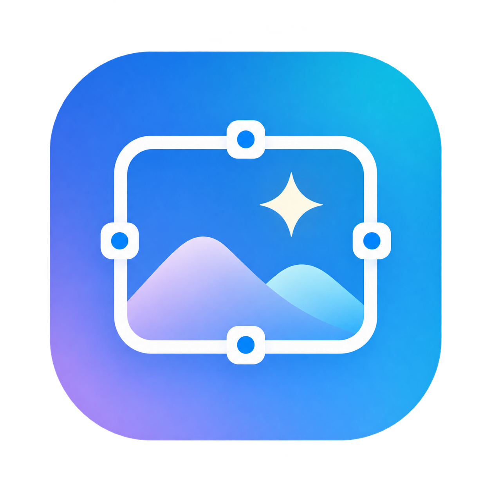
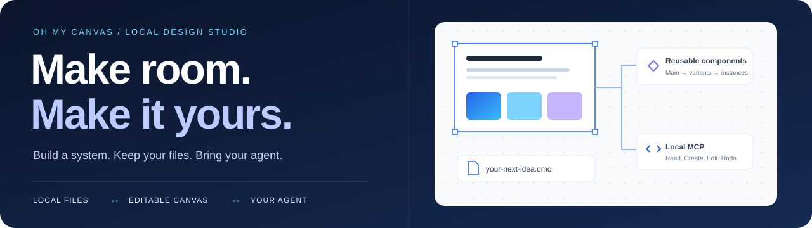
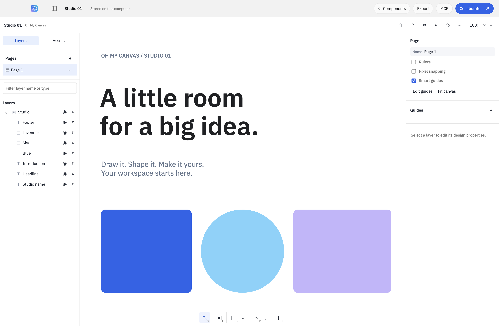
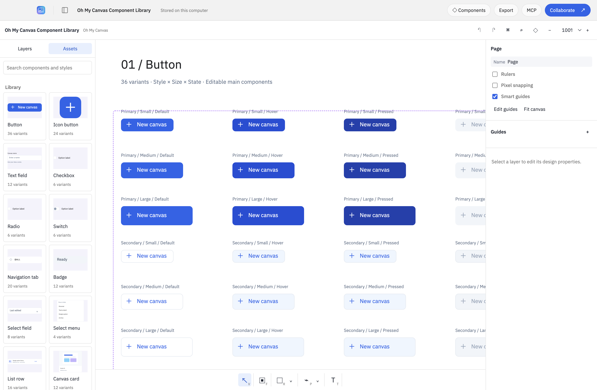
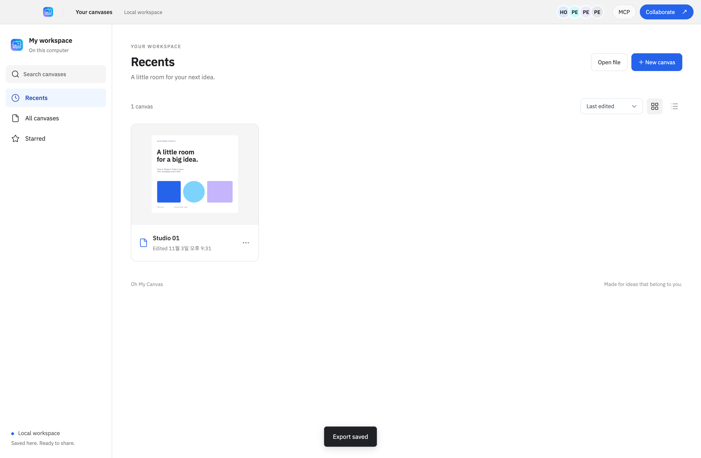
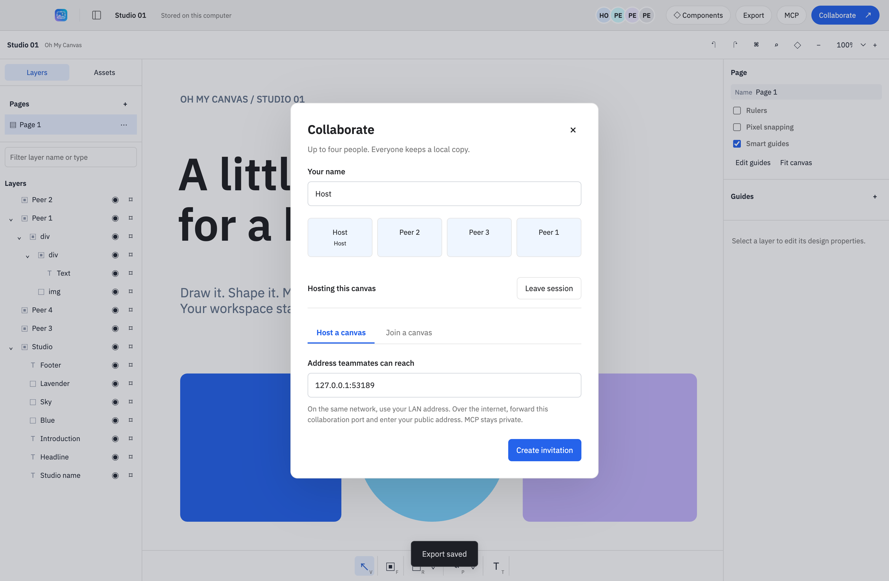

<p align="center"></p>
<h1 align="center">Oh My Canvas</h1>
<p align="center"><strong>你的画布。你的文件。你的智能体。</strong></p>
<p align="center">本地桌面设计工作室，支持可复用组件、MCP 和最多四人协作。</p>
<p align="center"></p>
<p align="center"><a href="README.md">English</a> · <a href="README-ko.md">한국어</a> · <a href="README-ja.md">日本語</a> · <strong>简体中文</strong></p>
<p align="center"><a href="#quick-start">快速开始</a> · <a href="#screenshots">截图</a> · <a href="#components">组件</a> · <a href="#mcp">MCP</a> · <a href="#contributing">参与贡献</a></p>

<p align="center"></p>

## 给下一个想法留一点空间

设计界面、搭建组件库，让智能体与你一起编辑同一张画布。文档和嵌入的素材保存在你自己的电脑上。应用不依赖 Leviosa 登录、Paper 订阅、应用内积分、云数据库或遥测服务。

**编辑器和本地 MCP 不收取使用积分。** 你选择的 AI 客户端仍适用其自身的订阅和用量限制。协作时，参与者直接连接可访问的主机，不使用开发者运营的服务器。

| 创作 | 保存 | 协作 |
| --- | --- | --- |
| 矢量图形、路径、文字、图片、画框、页面和自动布局 | 本地自动保存、原子写入、恢复备份和可携带的 `.omc` 文件 | 通过固定验证主机证书的 TLS 支持最多四人；通过本地 MCP 连接智能体 |
| 主组件、关联实例、变体，以及文字、可见性和替换属性 | 嵌入图片、内置英文与韩文字体、离线编辑 | 重连后合并离线修改；每位参与者都保留本地副本 |

<a id="screenshots"></a>

## 应用截图

以下截图于 **2026-11-03** 拍摄，展示独立实现的 `editor/` 在 Electron 中运行合成本地文档。新的四客户端验收运行更新了编辑器、协作和文档列表图片。界面使用英文及部分韩文组件标签；四种语言的 README 不代表界面支持四种语言。

<p align="center"></p>
<p align="center"><em>左侧是图层，中间是画布，右侧是属性。</em></p>

<details>
<summary><strong>展开查看实际组件库与文档浏览器</strong></summary>



实际包含 1,065 个对象的文档保留了 170 个变体和 254 个属性绑定。首次打开及新进程重开时，全部 16 个 Assets 预览和标签区域检查均通过。



[当前验证记录](docs/independent/VERIFICATION.md) 区分已通过的流程与适用限制。截图记录本地受测流程，不能证明外部互联网连接能力。

</details>

<a id="quick-start"></a>

## 在本地开始

### 1. 构建并启动

使用现有的本地代码副本，以及 **Node.js 22.12 或更高版本**和 npm。安装依赖需要联网；构建完成的编辑器可以离线使用。

```sh
cd /path/to/oh-my-canvas
npm ci
npm run build
npm start
```

当前检出仅供本地使用，暂无公开下载。`/Applications/Oh My Canvas.app` 的现有安装可能早于独立引擎替换；请构建当前检出来体验新实现。

<details>
<summary>构建 macOS 应用包</summary>

```sh
npm run dist:mac
```

构建使用 `--publish never`，生成 `release/mac-arm64/Oh My Canvas.app` 及 `release/` 下的 ZIP。当前 macOS arm64 应用包、内置 CLI 和逐字节包来源检查均已通过。构建未签名或公证，Windows/Linux 执行尚未验证。共享依赖的检出应先构建，使用 `node scripts/package-local.mjs` 暂存真实依赖文件，再运行 `node scripts/packaged-smoke.mjs`。直接通过其他 worktree 的 `node_modules` 符号链接打包可能遗漏依赖。

</details>

### 2. 开始创作

创建一张画布，或在文档库为空时选择 **Explore a sample**。通过底部工具栏添加文字与图形、整理图层，并在 **Design** 面板修改属性。修改会保存在本地。使用 **Export → Oh My Canvas** 导出可携带、可继续编辑的备份，也可以导出 JSON、SVG 和 PNG。逐图层导出功能位于 Design 面板中。

[安装、数据位置、恢复、导出格式及限制（英文）→](docs/GETTING_STARTED.md)

<a id="components"></a>

## 真正可编辑的设计系统

通过 **Open file** 打开内置的 [Component Library](docs/design/system/component-library.omc)。其中包含 **14 类组件、170 个变体，以及两个含有五个嵌套实例的组合组件**：按钮、输入框、选择控件、导航、徽标、列表、卡片、提示框和对话框。

完整合成组件库已通过组件、属性、变体、源组件编辑、持久保存内容核对及新进程重开流程。范围和证据请见[当前验证记录](docs/independent/VERIFICATION.md)。

1. 复制组件库文档，为你的界面添加一个新页面。
2. 打开 **Components → Assets**，点击组件以插入关联实例。
3. 在 Design 面板修改实例的状态、文字或可见性。
4. 修改主组件，实例会跟随更新，同时保留各自的覆盖设置。

通过 **Create component**（macOS 快捷键为 `⌥⌘K`）、**Combine variants** 和 **Add variant** 创建自己的组件。**Reset all changes** 恢复来源组件的设置，**Detach instance** 解除关联。

[组件行为与 MCP 接口约定（英文）→](docs/design/components-implementation.md) · [视觉设计规范（英文）→](DESIGN.md)

<a id="mcp"></a>

## 给智能体一张真正的画布

打开文档，点击 **MCP → Copy configuration**，然后将配置注册到你的 MCP 客户端。应用包内的 CLI 使用 Electron 的 Node 模式，因此已安装的应用不需要另外安装 Node。应用不会擅自修改 Codex 或 Claude 的全局配置。

> 在当前打开的画布中创建一个 1440 × 900 的仪表盘。使用蓝色、天蓝色、浅薰衣草紫、白色和黑色。将导航和按钮做成可复用组件，最后通过截图检查结果。

先使用 `get_context` 和 `get_guide`，再调用 `create_board`、`write_html`、`update`、`components`、`component` 等工具。共有 **19 个工具**。组件操作应在 `batch` 之外调用；切换变体后可能返回新的选中对象 ID。智能体修改与本地修改使用相同的持久化和协作 Undo 路径。

用户正在输入文字或拖动调整数值时，读取工具仍可使用，智能体修改与 Undo 会返回 `busy`。请等用户事务结束后再重试。MCP 桥接服务需要认证，仅绑定回环地址，并与协作服务分离。**不要转发 MCP 端口，也不要共享 `mcp-runtime.json`。**

[设置与故障排查（英文）→](docs/TROUBLESHOOTING.md) · [信任边界（英文）→](SECURITY.md)

## 最多四人协作，无需托管后端

主机打开 **Collaborate → Host a canvas**，私下分享邀请。其他三位成员通过 **Join a canvas** 加入。每个人都保留本地副本；断开连接后可以继续编辑，重连时再合并修改。

新的本地验收已通过四个独立 Electron 进程的真实 TLS 通信、并发插入、按作者 Undo、内嵌图片、官方 SDK stdio、本地导出、离线重连、持久保存后重开及旧文件合并。跨家庭或企业 NAT、公共互联网的外部电脑连接仍未验证。



主机必须可以访问。应用没有自动 NAT 穿透、中继、TURN 服务或自动主机迁移。通过互联网连接时，可能需要手动转发协作端口并提供可达地址；CGNAT 可能导致连接失败。应用不会修改路由器设置。所有成员都需要使用支持协议 v2 的应用。持有邀请的人应被视为可信编辑者；应用没有只读角色，也不能单独撤销某位成员的权限。

<details>
<summary>合并行为与文件兼容性</summary>

独立的图形属性通过 Yjs 合并。应用从规范化的几何数据重建一致的渲染边界，并从父级链接修复子元素列表。同一文字图层采用富文本属性级的冲突解决，**不支持逐字符合并同时输入的文字**。请将文字编辑任务分配到不同图层。

写入使用 `.omc` v2，也能读取 v1 文件。旧版协作邀请和握手会在交换文档前被拒绝。原主机离开后，之前的成员可以重新托管保存的副本，并分享新邀请。Undo/Redo 历史仅保留在当前会话中，重新打开文档时不会恢复。

</details>

[连接步骤与边界（英文）→](docs/GETTING_STARTED.md#collaboration)

## 可以检查和验证的实现

| 范围 | 验证目标 |
| --- | --- |
| 文档完整性 | 规范化几何数据、并发修改、预验证、作者与分组隔离、Undo/Redo |
| 持久化存储 | 串行原子保存、fsync、元数据验证、备份恢复、可携带文件的导入与重开 |
| 网络边界 | TLS 身份验证、邀请认证、四人限制、拒绝 Origin 请求、隔离的本地 MCP |
| 实际应用 | 四客户端协作、组件工作流、文字编辑、SVG 自动换行、原生导出、安装包内容核验 |

当前运行通过 **12 个文件中的 339 项编辑器测试**、**38 项宿主测试**及**原生 UI 37/37 项、渲染器错误为零**。渲染检查覆盖 32 个场景、830 项断言，另有 8 项大型示例与缓存断言。实际组件库流程和当前应用包检查也已通过。这些是限定范围的本地结果，不表示每个功能记录都有单独测试。独立工程审核结论为 **APPROVE**，架构状态为 **WATCH**；干净历史源码候选的 manifest 和隐私检查也已通过。请参阅[最终审核](docs/independent/ASTRA_FINAL_REVIEW.md)和[验证记录](docs/independent/VERIFICATION.md)。

[当前验证与限制（英文）→](docs/independent/VERIFICATION.md) · [检查步骤（英文）→](docs/TESTING.md)

<a id="contributing"></a>

## 一起完善这个项目

可复现的缺陷报告、范围明确的修复、实用的组件示例和保持一致的翻译，都能帮助项目改进。请先阅读贡献指南，不要在报告中包含私人设计、邀请、运行时令牌或个人信息。

- [贡献指南](docs/contributing/zh-CN.md) — 工作流程、修改范围、检查、英文提交信息和评审要求
- [Pull request 模板（英文）](.github/PULL_REQUEST_TEMPLATE.md) — 问题、行为、验证证据和限制
- [缺陷报告表单（英文）](.github/ISSUE_TEMPLATE/bug_report.yml) · [功能建议表单（英文）](.github/ISSUE_TEMPLATE/feature_request.yml)
- [架构（英文）](docs/ARCHITECTURE.md) · [安全（英文）](SECURITY.md) · [故障排查（英文）](docs/TROUBLESHOOTING.md)

这些模板已为将来的 GitHub 仓库准备好。当前本地代码副本尚未配置 Issue 跟踪器、发布服务或远程上传地址。

## 许可证与来源

独立编写的项目实现采用 [MIT 许可证](LICENSE)。外部库、原生运行时组件和字体保留各自的许可证；请参阅[第三方声明](THIRD_PARTY_NOTICES.md)及[依赖清单](docs/licensing/DEPENDENCIES.md)。

当前编辑器实现在 `editor/` 中。此前引入的编辑器、辅助代码和复制的测试已从计划公开的源码中移除。规划参与者阅读过旧实现，因此不宣称这是未接触旧源码的净室实现。[实现来源](docs/independent/PROVENANCE.md)及[功能契约](docs/independent/behavior-contract.md)为英文。

非公开 Git 的历史提交仍包含已移除的源码。未来仅拟公开单独审查过的发布快照；新许可证不会将历史上的公司代码重新授权为 MIT。尚未向远程上传。
