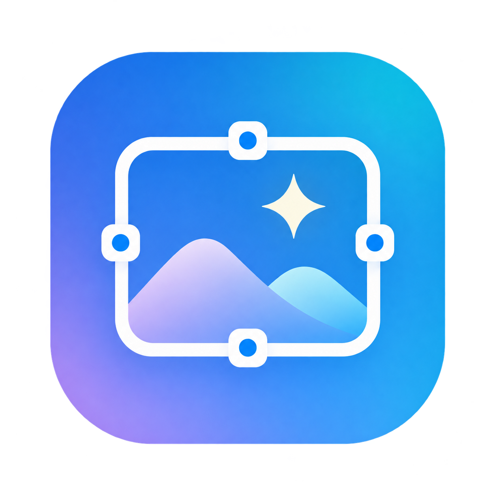
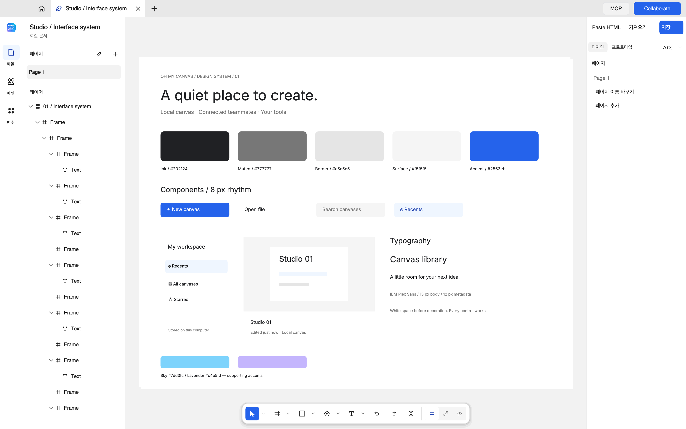
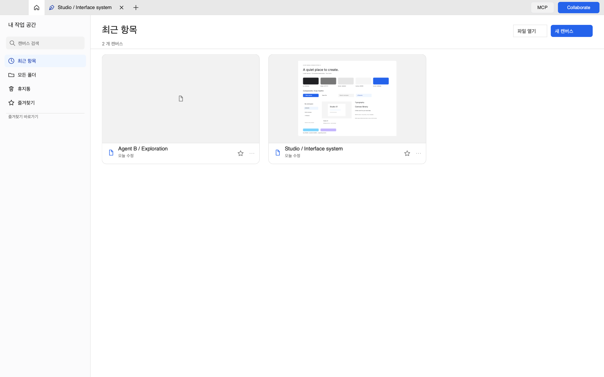

<p align="center"></p>
<h1 align="center">Oh My Canvas</h1>
<p align="center"><strong>HTML/CSS to editable designs. Humans and agents, together.</strong></p>
<p align="center">A local-first native design studio built in Rust, with Skia rendering, HTML/CSS authoring and concurrent MCP agents.</p>
<p align="center"></p>
<p align="center"><strong>English</strong> · <a href="README-ko.md">한국어</a> · <a href="README-ja.md">日本語</a> · <a href="README-zh-CN.md">简体中文</a></p>

<p align="center"></p>

## Why Oh My Canvas

- **Draw with HTML/CSS.** Paste HTML in the app or call `write_html` through MCP. Supported CSS becomes editable layers, text and layout. Inspect the result and keep refining it on the canvas.
- **Work with several agents at once.** Give each agent an explicit `documentId`. Agents can work in separate background documents while you keep designing; per-author Undo keeps their histories separate. Coordinate edits to the same layers.
- **Keep the workflow local.** The native desktop and service run without an Electron/browser renderer. Local persistence, reusable components, styles, variables and exports keep your design work close to your code.
- **Spend context on the change.** HTML/CSS creation, batched operations and scoped queries let agents work without repeatedly sending an entire document. In an earlier LD03 experiment, OMC used about 10,000 fewer gross provider tokens than Paper/Figma; see the measured scope below.
- **Collaborate without app credits.** Local MCP has no per-use app credits. Up to four participants can share a reachable native TLS room; your AI client's pricing and limits still apply.

<a id="screenshots"></a>

## App screenshots

Design interfaces with editable layers, reusable elements and HTML/CSS, then organize your work in the local canvas library.



Local document library and rendered canvas preview.

<a id="quick-start"></a>

## Start the native app

Use Rustup with the pinned Rust 1.92.0 toolchain. Build the three binaries together, then launch the desktop:

```sh
cd /path/to/oh-my-canvas/native
cargo build --locked --release -p omc-desktop -p omc-service -p omc-cli
./target/release/omc-desktop
```

The native runtime does not require Node.js. Native packaging and cross-platform release qualification remain incomplete. See the [native guide](native/README.md).

<a id="components"></a>

## Editable components and design systems

Create main components, linked instances and variants, then edit text, visibility and instance overrides. Shared styles and tokens support repeated designs. See the [native component, style and library operations](docs/MCP_PARITY.md) for the editable workflow.

<a id="mcp"></a>

## Give every agent a real canvas

Click **MCP → Copy MCP configuration** in the native app and add the generated stdio configuration to your client. It references this installation's `omc-cli` and profile; no global client settings are silently changed.

The default OMC endpoint exposes native design, review, and workspace tools. The separate FigCraft-compatible endpoint supports its own command protocol. Use each endpoint’s live tool list for the installed build.

Start with `list_documents`, then `open_document` or `create_document`, followed by `get_context`. Document edits require `documentId`. Use `create_board`, `write_html`, `edit_shapes`, `components`, `batch` and `screenshot` for a complete design loop. Native extensions add bounded queries, comments, tokens, jobs and code export.

Separate agents can keep separate documents open in the background. A human's active transaction may return `busy`; finish it before retrying. Agent-scoped Undo does not consume another author's history. A shared transport does not make the visible tab an implicit edit target.

[Tool contracts and migration](docs/MCP_PARITY.md) · [Native stdio, optional legacy HTTPS and collaboration setup](native/README.md)

## Measured speed, memory and token usage

The project-authored pilot covers OMC, Paper, Figma and Penpot. In the selected 60-second tasks, OMC completed accepted work **21–55% sooner than Penpot**. Paper/Figma did not complete the same acceptance gates within those attempts. OMC also recorded lower sampled RAM peaks than Paper/Penpot in LD02/LD03, but resource scopes were incomplete and differed between products.

An **earlier LD03 experiment**, with the same model, fixture and prompt, recorded:

| Product | Gross provider tokens | Cached input included |
| --- | ---: | ---: |
| OMC | 22,604 | 7,110 |
| Paper | 32,820 | 16,782 |
| Figma | 32,363 | 16,578 |
| Penpot | 22,624 | 7,110 |

That is **10,216 fewer tokens than Paper (31.1%)** and **9,759 fewer than Figma (30.2%)** in this experiment. Counts include cached input and output across all admitted provider requests. OMC/Penpot passed the common oracle; Paper/Figma qualified the edited candidate but lacked full lifecycle observations. These are single exploratory runs, not a general saving guarantee or a billing-cost comparison. Later guarded 60-second LD02/LD03 runs had nearly equal provider totals across products.

[Full results and limits](docs/benchmarks/results/2026-11-18/README.md) · [Earlier token records](docs/benchmarks/results/2026-11-18/LD03/earlier-tokens.json) · [Protocol](docs/benchmarks/README.md)

### Experiment index

| ID | Task | Records |
| --- | --- | --- |
| [LD01](docs/benchmarks/results/2026-11-18/LD01/README.md) | Dashboard creation | 8 |
| [LD02](docs/benchmarks/results/2026-11-18/LD02/README.md) | Scoped large-document edit | 4 |
| [LD03](docs/benchmarks/results/2026-11-18/LD03/README.md) | Shared component/style edit | 16 |
| [LD04](docs/benchmarks/results/2026-11-18/LD04/README.md) | Responsive layout | 11 |
| [LD05](docs/benchmarks/results/2026-11-18/LD05/README.md) | Code ↔ canvas round trips | 8 |
| [LD06](docs/benchmarks/results/2026-11-18/LD06/README.md) | Assets, fonts and content | 10 |
| [LD07](docs/benchmarks/results/2026-11-18/LD07/README.md) | Defect diagnosis and repair | 2 |
| [LD08](docs/benchmarks/results/2026-11-18/LD08/README.md) | Concurrent documents | 9 |
| [LD09](docs/benchmarks/results/2026-11-18/LD09/README.md) | Startup/import/reopen | 7 |
| [LD10](docs/benchmarks/results/2026-11-18/LD10/README.md) | Interaction and idle use | Interrupted |
| [LD11](docs/benchmarks/results/2026-11-18/LD11/README.md) | Save and recovery | 3 |
| [LD12](docs/benchmarks/results/2026-11-18/LD12/README.md) | Build/IDE contention | Companion only |
| [LD13](docs/benchmarks/results/2026-11-18/LD13/README.md) | Four-person collaboration | Not measured |

78 attempts, including failures/retries; the earlier LD03 token experiment is separate.

## People can work together too

Host a native TLS room and privately share its pinned-certificate invitation. Up to four participants keep durable local replicas. The host must be reachable: automatic NAT traversal, relays and host migration are not provided. External-network and four-hardware-peer qualification remain incomplete. Optional FigCraft server publishing is a separate online route; see the [native guide](native/README.md).

<a id="contributing"></a>

## Contribute and inspect

[Contributing](CONTRIBUTING.md) · [Testing](docs/TESTING.md) · [Native verification](native/README.md) · [Security](SECURITY.md) · [Design direction](DESIGN.md)

The implementation is [MIT licensed](LICENSE); dependencies and fonts keep their own licenses. See [third-party notices](THIRD_PARTY_NOTICES.md) and [implementation provenance](docs/independent/PROVENANCE.md). Source code is available on [GitHub](https://github.com/Dindb-dong/oh-my-canvas).
