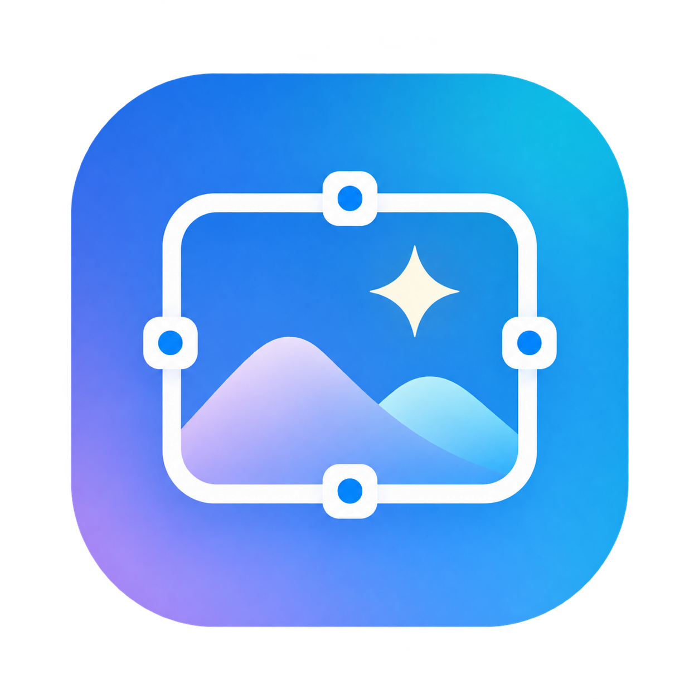
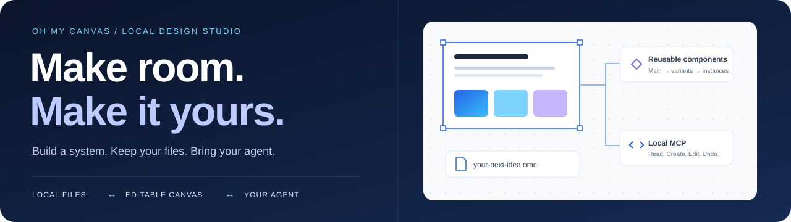
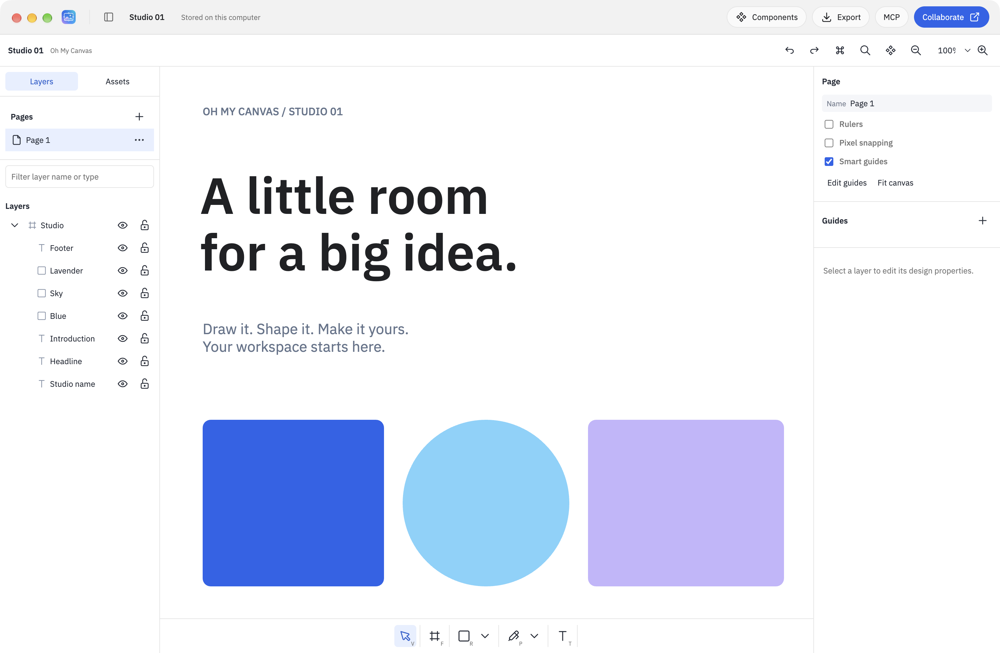
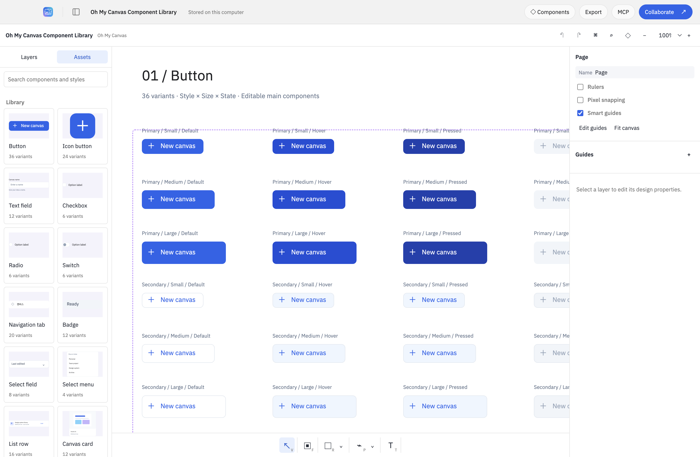
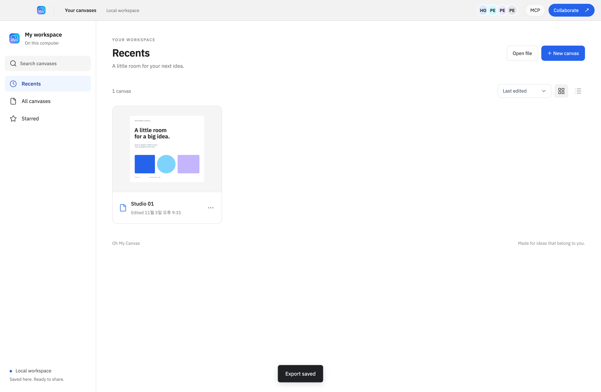
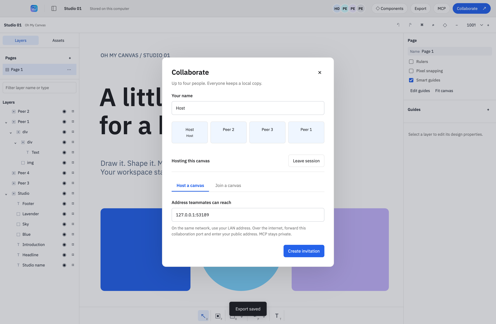

<p align="center"></p>
<h1 align="center">Oh My Canvas</h1>
<p align="center"><strong>Your canvas. Your files. Your agents.</strong></p>
<p align="center">A local desktop design studio with reusable components, MCP, and four-person collaboration.</p>
<p align="center"></p>
<p align="center"><strong>English</strong> · <a href="README-ko.md">한국어</a> · <a href="README-ja.md">日本語</a> · <a href="README-zh-CN.md">简体中文</a></p>
<p align="center"><a href="#quick-start">Quick start</a> · <a href="#screenshots">Screenshots</a> · <a href="#components">Components</a> · <a href="#mcp">MCP</a> · <a href="#contributing">Contribute</a></p>

<p align="center"></p>

## A little room for your next idea

Design interfaces, build a component library, and let an agent work on the same editable canvas. Your documents and embedded assets stay on your computer. No Leviosa login, Paper subscription, application credits, cloud database, or telemetry is built into the app.

**The editor and local MCP do not charge usage credits.** Your chosen AI client's subscription and limits still apply. Collaboration connects participants directly to a reachable host; it does not use a developer-operated server.

| Make it | Keep it | Work together |
| --- | --- | --- |
| Vector shapes, paths, text, images, frames, pages, and auto layout | Local autosave, atomic writes, a recovery backup, and portable `.omc` files | Up to four participants over pinned-certificate TLS; local MCP for agents |
| Main components, linked instances, variants, text/visibility/swap properties | Embedded images, bundled English/Korean fonts, offline editing | Reconnect and merge offline changes; each participant keeps a local replica |

<a id="screenshots"></a>

## App screenshots

These screenshots show the independent `editor/` implementation running synthetic local documents in Electron. The editor view was refreshed in the **2026-11-04** interface layout audit; the collaboration and document-browser views come from the earlier four-client acceptance run. The UI uses English with some Korean component labels; four README languages do not imply four-language UI support.

<p align="center"></p>
<p align="center"><em>The editor: layers on the left, your canvas in the middle, properties on the right.</em></p>

<details>
<summary><strong>Explore the real component library and document browser</strong></summary>



The real 1,065-object document preserves 170 variants and 254 property bindings. All 16 Assets previews and label-containment checks passed on initial open and fresh-process reopen.



The [current verification record](docs/independent/VERIFICATION.md) states which workflows passed and their remaining limits. Screenshots document the tested local flow; they do not establish external-internet reachability.

</details>

<a id="quick-start"></a>

## Start locally

### 1. Build and launch

Use an existing local checkout and **Node.js 22.12+** with npm. Dependency installation needs network access; the built editor works offline.

```sh
cd /path/to/oh-my-canvas
npm ci
npm run build
npm start
```

This checkout is currently local-only; published downloads are not available. An existing installation at `/Applications/Oh My Canvas.app` may predate the independent engine; build this checkout to try the current implementation.

<details>
<summary>Build a macOS app bundle</summary>

```sh
npm run dist:mac
```

The build writes `release/mac-arm64/Oh My Canvas.app` and a ZIP under `release/`, using `--publish never`. The current macOS arm64 package, bundled CLI, and exact-byte package provenance checks passed. The macOS build is unsigned and not notarized; Windows/Linux execution remains unverified. For shared dependency checkouts, build first and use `node scripts/package-local.mjs` to stage real dependency files before `node scripts/packaged-smoke.mjs`; packaging directly through an inter-worktree `node_modules` symlink can omit packages.

</details>

### 2. Make something

Create a canvas, or choose **Explore a sample** when the library is empty. Add text and shapes with the bottom toolbar, organize layers, and edit properties in **Design**. Changes save locally. Use **Export → Oh My Canvas** for a portable, editable backup; JSON, SVG, and PNG are also available. Per-layer exports are in the Design panel.

[Installation, data locations, recovery, export formats, and limits →](docs/GETTING_STARTED.md)

<a id="components"></a>

## A design system you can actually edit

Open the included [Component Library](docs/design/system/component-library.omc) with **Open file**. It contains **14 families, 170 variants, and two composed components with five nested instances**: buttons, fields, selection controls, navigation, badges, lists, cards, tooltips, and dialogs.

The full synthetic library passed component/property/variant/source-edit workflows, durable disk readback, and fresh-process reopen. See the [current verification record](docs/independent/VERIFICATION.md) for scope and evidence.

1. Duplicate the library document and add a page for your screens.
2. Open **Components → Assets** and click a component to insert a linked instance.
3. Change its state, text, or visibility in the Design panel.
4. Edit the main component to update its instances while keeping their overrides.

Create your own with **Create component** (`⌥⌘K` on macOS), **Combine variants**, and **Add variant**. **Reset all changes** restores the source; **Detach instance** removes the link.

[Component behavior and MCP contract →](docs/design/components-implementation.md) · [Visual direction →](DESIGN.md)

<a id="mcp"></a>

## Give your agent a real canvas

Open a document, click **MCP → Copy configuration**, and register that configuration in your MCP client. The packaged CLI uses Electron's Node mode; a separate Node installation is unnecessary for the installed app. The app does not silently edit global Codex or Claude settings.

> In this open canvas, create a 1440 × 900 dashboard. Use blue, sky, pale lavender, white, and black. Make the navigation and buttons reusable components. Check the result with a screenshot.

Start with `get_context` and `get_guide`; then use `create_board`, `write_html`, `update`, `components`, and `component`. There are **19 tools**. Component actions run outside `batch`; variant switching can return a new selection ID. Agent edits use the same persistence and collaborative Undo path as local edits.

While a user is typing or scrubbing a value, read tools stay available and agent mutations/Undo return `busy`. Finish the user transaction before retrying. The MCP bridge is authenticated, loopback-only, and separate from collaboration. **Never forward its port or share `mcp-runtime.json`.**

[Setup and troubleshooting →](docs/TROUBLESHOOTING.md) · [Trust boundaries →](SECURITY.md)

## Four people, without a hosted backend

A host opens **Collaborate → Host a canvas** and privately shares an invitation. Three teammates can join with **Join a canvas**. Everyone keeps a local copy; a disconnected participant can keep editing and merge after reconnecting.

The fresh local acceptance run passed with four independent Electron processes over real TLS: concurrent inserts, author Undo, embedded images, official SDK stdio, local exports, offline rejoin, durable reopen, and older-file merging. Connections between external computers across residential/enterprise NATs or the public internet remain unverified.



A host must be reachable. There is no automatic NAT traversal, relay, TURN service, or automatic host migration. Internet use may require a manually forwarded collaboration port and a reachable address; CGNAT can prevent that. The app does not change router settings. All teammates need protocol v2. Treat invite holders as trusted editors: there are no read-only roles or per-member revocations.

<details>
<summary>Merge behavior and file compatibility</summary>

Independent shape properties merge with Yjs. Canonical geometry is projected into consistent render bounds. Child lists are repaired from parent links. The same text layer uses rich-text property conflict resolution, **not character-by-character concurrent typing**. Split text work into separate layers.

The writer uses `.omc` v2 and reads v1 files. Old collaboration invitations/handshakes are rejected before document exchange. A former guest can rehost a saved replica and share a new invitation if the original host leaves. Undo/Redo stacks are session-local and are not restored when a document is reopened.

</details>

[Connection steps and boundaries →](docs/GETTING_STARTED.md#collaboration)

## Built to be inspected

| Area | Verification target |
| --- | --- |
| Document integrity | Canonical geometry, concurrent edits, speculative validation, author/group isolation, Undo/Redo |
| Durable storage | Serialized atomic saves, fsync, metadata validation, backup recovery, portable import/reopen |
| Network boundaries | TLS identity, invite authentication, four-person limit, Origin rejection, isolated local MCP |
| Actual application | Four-client collaboration, component workflows, text editing, SVG wrapping, native exports, installed-package readback |

The current run passed **353 editor tests across 14 files**, **40 host tests**, and **37/37 native UI cases with zero renderer errors**. Rendering checks covered 32 scenarios with 830 assertions plus eight large-fixture/cache assertions. The real component-library journey and current package checks also passed. These are scoped local results, not a claim that every feature record has its own test. Independent engineering review is **APPROVE**, with architecture marked **WATCH**; the reviewed clean-history source candidate also passed its manifest and privacy audit. See the [final review](docs/independent/ASTRA_FINAL_REVIEW.md) and [verification record](docs/independent/VERIFICATION.md).

[Current verification and limits →](docs/independent/VERIFICATION.md) · [How to run checks →](docs/TESTING.md)

<a id="contributing"></a>

## Help shape the project

Reproducible bugs, focused fixes, useful component examples, and aligned translations make the project better. Start with the contribution guide and keep private designs, invitations, runtime tokens, and personal data out of reports.

- [Contributing](CONTRIBUTING.md) — workflow, scope, checks, English commits, and review expectations
- [Pull request template](.github/PULL_REQUEST_TEMPLATE.md) — problem, behavior, evidence, and limits
- [Bug report form](.github/ISSUE_TEMPLATE/bug_report.yml) · [Feature request form](.github/ISSUE_TEMPLATE/feature_request.yml)
- [Architecture](docs/ARCHITECTURE.md) · [Security](SECURITY.md) · [Troubleshooting](docs/TROUBLESHOOTING.md)

The repository is hosted privately at [Dindb-dong/oh-my-canvas](https://github.com/Dindb-dong/oh-my-canvas). Collaborators with repository access can use the issue forms and PR template. No downloadable release or hosted service is promised.

## License and provenance

The independently authored project implementation is licensed under [MIT](LICENSE). External libraries, native runtime components and fonts retain their own licenses; see [third-party notices](THIRD_PARTY_NOTICES.md) and the [dependency inventory](docs/licensing/DEPENDENCIES.md).

The active editor is implemented in `editor/`. The earlier inherited editor, helper and copied tests have been retired from the intended source tree. Planning participants inspected the old implementation; this is not described as an unexposed clean-room process. Read the [implementation provenance](docs/independent/PROVENANCE.md) and [feature contract](docs/independent/behavior-contract.md).

This repository starts from the reviewed independent-source snapshot, with a separate Git history. The retired company-source history is not included. MIT covers the eligible project implementation and does not relicense company code or third-party materials. Repository access is currently private.
