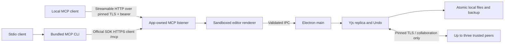

# Architecture

[README](../README.md) · [Implementation contract](../IMPLEMENTATION.md) · [Design direction](../DESIGN.md)

Oh My Canvas uses an independently authored DOM/SVG editor inside an Electron application. The application has no runtime dependency on the original repository, Leviosa login/credits, Paper's service, a cloud database, or a telemetry endpoint.

## Ownership and modules

| Module | Responsibility |
| --- | --- |
| `editor/` | Immutable editor documents, commands, layout, text editing, components, DOM rendering, SVG and layer export |
| `src/` | Document library and shell, mounting, pending projections, transaction/author propagation, native export callbacks |
| `core/document.mjs` | Field representation, changed-entity diff, containment repair, limits, pending edit projection |
| `core/geometry.mjs` | Canonical scalar box and coherent orientation/path; derive render caches after merge |
| `core/replica.mjs` | Yjs state, speculative validation, local/remote edits, author/group-aware Undo, caches |
| `core/storage.mjs` | Metadata validation, portable file encoding, checksums, atomic writes/fsync, backups and per-document save queues |
| `core/collaboration.mjs` | TLS listener, private invitation, certificate pinning, capacity, presence and reconnect |
| `electron/` | Trusted main-process dispatch, preload allowlist, file dialogs, custom asset protocol and MCP bridge |
| `cli/mcp.mjs` | Official SDK stdio server and a unique author identity per process |
| `docs/independent/VERIFICATION.md` | Current verification scope, results, open work and evidence limits |
| `docs/qa/` | Explicitly reviewed fresh screenshots and runtime evidence |

## An edit, end to end

1. An editor command produces an immutable document and a current operation identity. User batches group text input and value scrubbing; the label comes from this operation rather than a previous Undo entry.
2. The shell compares changed entities, sequences the local patch, and keeps unacknowledged patches for projection.
3. Main validates the IPC sender and dispatches document operations serially. The replica validates a speculative candidate before publishing to live state.
4. CRDT updates notify storage and connected peers. A synchronized validation document follows live garbage collection and retains data needed by local Undo. Rejected candidates are discarded.
5. A serialized atomic save completes before the commit reply. Main returns the authoritative snapshot and sequence acknowledgment.
6. The renderer drops acknowledged patches and reapplies pending ones. Same-page projection reloads rendering without ending a valid active text session.

The cached document and diff fast path rely on the editor's immutable-document contract. Do not mutate a `Replica.document` tree in place; create the next document with immutable changes or a clone. Do not bypass validation to improve benchmark numbers.

## Geometry and merging

Independent scalar box fields merge independently. Orientation groups the transform with its display rotation and flips. Path coordinates are represented relative to that basis. The materialized document derives box/corners/inverse-transform caches rather than independently merging contradictory render representations. Legacy v1 state can be read without eagerly rewriting all history; new files/protocol use v2 to prevent incompatible older clients from interpreting the new fields.

Containment uses parent links and deterministic sibling ranks. Materialization repairs dangling/cyclic containment and projects a blank deterministic recovery page if concurrent valid deletions remove every page. The complete current document and retained state remain subject to capacity checks.

## Separate network boundaries

MCP defaults to an authenticated app-owned Streamable HTTP listener at `https://127.0.0.1:47831/mcp`. A persistent per-profile self-signed TLS identity protects the bearer from a different process reusing the port. Clients must trust that specific certificate; the app does not install OS trust. Node SDK consumers and the current bundled stdio relay use the certificate-pinned fetch helper. The stdio relay forwards cancellation through the official SDK HTTP client; the runtime descriptor contains no bearer. The installed SDK negotiates the 2025-11-25 protocol family, with one server, transport, and server-generated agent per session. It does not implement the later sessionless protocol. The current bundled stdio relay remains available during rollout; old pre-TLS relays fail closed on the version-2 descriptor and require a client restart; neither endpoint becomes the collaboration server. The collaboration listener is a separate pinned-certificate TLS WebSocket endpoint for invitation holders. There is no discovery service, relay, hosted backend, automatic NAT traversal, automatic host election, or shared asset server. Images travel inside the document.

The trust model is a local user and trusted invited editors. It is not a multi-tenant service or a permission system for mutually hostile participants. Read [SECURITY.md](../SECURITY.md) for what reports and screenshots must exclude.

Each HTTP session keeps its own aliases, Undo ownership, and bounded in-memory idempotency cache. DELETE, idle expiry, and app shutdown end that agent. Request cancellation crosses main/renderer IPC; queued and font-preflight writes stop before mutation. Cancellation after a committed write does not undo it. A disconnected HTTP request alone is not cancellation. Restart or document replacement discards aliases and cached results; reconnect with `get_context` and read back uncertain changes before issuing another mutation. See [MCP setup and recovery](MCP.md).

## Export paths

The top SVG export and layer SVG exports reuse the renderer's measured text layout and image-ready export host. The layer panel passes file bytes to the scoped native-save IPC, which validates MIME/extension/size and uses the existing atomic writer. Browser downloads remain denied in the Electron shell. Standalone editor mounts without this host callback keep their browser export behavior.

## Current acceptance evidence

The actual four-process Electron/TLS journey passed, including official SDK stdio, offline rejoin, local exports and durable reopen. The full 1,065-object component library passed its 170-variant/254-binding workflows and all 16 rendered Assets previews on initial open and reopen. Current packaged-app smoke and exact-byte package provenance checks passed. These are scoped local results; final independent review and a clean publication snapshot remain pending. See [VERIFICATION.md](independent/VERIFICATION.md) for detailed evidence and limits.

## Review before changing

A storage, protocol, geometry, or Undo change can affect offline replicas and old files. Add a regression at the actual boundary; comparing two final JSON trees alone does not prove the rendered geometry or native save action works. See the [test matrix](TESTING.md) and the [current verification record](independent/VERIFICATION.md).
