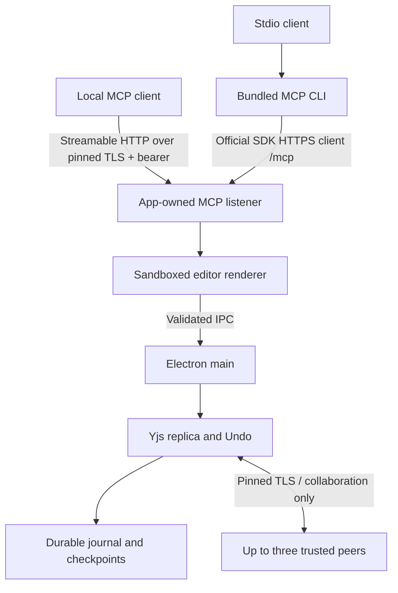

# Architecture

[README](../README.md) · [Implementation contract](../IMPLEMENTATION.md) · [Design direction](../DESIGN.md)

Oh My Canvas uses an independently authored DOM/SVG editor inside an Electron application. The application has no runtime dependency on the original repository, Leviosa login/credits, Paper's service, a cloud database, or a telemetry endpoint.

## Ownership and modules

| Module | Responsibility |
| --- | --- |
| `editor/` | Immutable editor documents, commands, layout, text editing, components, DOM rendering, SVG and layer export |
| `src/` | Document library and shell, mounting, pending projections, transaction/author propagation, native export callbacks |
| `core/document.mjs` | Field representation, changed-entity diff, containment repair, limits, pending edit projection |
| `core/geometry.mjs` | Canonical scalar box and coherent orientation/path; derive render caches after merge |
| `core/replica.mjs` | Yjs state, speculative validation, local/remote edits, author/group-aware Undo, caches |
| `core/storage.mjs`, `core/journal.mjs` | Local manifests, durable append journals, checkpoints, recovery and explicit portable export |
| `core/assets.mjs` | Immutable raster bytes addressed by SHA-256, verified before document publication |
| `core/projection.mjs` | Revisioned renderer deltas, accepted sequences and durable acknowledgments |
| `core/collaboration.mjs`, `core/collaboration-transfer.mjs` | Pinned TLS, protocol v3, bounded state/blob transfers, presence and reconnect |
| `electron/` | Trusted main-process dispatch, preload allowlist, file dialogs, custom asset protocol and MCP bridge |
| `cli/mcp.mjs` | Official SDK stdio server and a unique author identity per process |
| `docs/independent/VERIFICATION.md` | Current verification scope, results, open work and evidence limits |
| `docs/qa/` | Explicitly reviewed fresh screenshots and runtime evidence |

## An edit, end to end

1. An editor command creates an isolated draft, preserving native cloning support. Changed paths drive normalization, layout, validation and the existing detached journal patches. Structural edits check the affected page; component/style/library dependencies retain conservative fallbacks.
2. The renderer converts those patches to canonical fields, sequences them, and retains outstanding writes. It does not compare or clone the complete document for an ordinary page rename.
3. Main validates the sender and serializes document operations. New bitmap bytes are verified and persisted before their references can enter the Replica. Speculative validation still checks candidates before publishing them.
4. Main publishes revisioned document deltas. Topology and legacy-asset transitions use canonical changes so delete/Undo can restore all retained declarations. An accepted sequence is distinct from a durable acknowledgment.
5. Storage appends a checksummed update and fsyncs it before acknowledging. Periodic immutable checkpoints replace long journals. Portable compression/packaging is an explicit export operation.
6. The renderer retires only acknowledged writes, rebases pending changes, and requests a snapshot when revisions are missing. Failed writes cannot be skipped by a later cumulative acknowledgment. Same-page projection preserves a valid active editing session.

The cached document and diff fast path rely on the editor's immutable-document contract. Do not mutate a `Replica.document` tree in place; create the next document with immutable changes or a clone. Do not bypass validation to improve benchmark numbers.

## Geometry and merging

Independent scalar box fields merge independently. Orientation groups the transform with its display rotation and flips. Path coordinates are represented relative to that basis. The materialized document derives box/corners/inverse-transform caches rather than independently merging contradictory render representations. Legacy v1/v2 raw-state and v3 gzip portable files remain readable. New portable files with external image dependencies use v4. Collaboration uses a separate protocol v3; older invitations are rejected before synchronization.

Containment uses parent links and deterministic sibling ranks. Materialization repairs dangling/cyclic containment and projects a blank deterministic recovery page if concurrent valid deletions remove every page. The complete current document and retained state remain subject to capacity checks.

## Separate network boundaries

MCP defaults to an authenticated app-owned Streamable HTTP listener at `https://127.0.0.1:47831/mcp`. A persistent per-profile self-signed TLS identity protects the bearer from a different process reusing the port. Clients must trust that specific certificate; the app does not install OS trust. Node SDK consumers and the current bundled stdio relay use the certificate-pinned fetch helper. The stdio relay forwards cancellation through the official SDK HTTP client; the runtime descriptor contains no bearer. The installed SDK negotiates the 2025-11-25 protocol family, with one server, transport, and server-generated agent per session. It does not implement the later sessionless protocol. The current bundled stdio relay remains available during rollout; old pre-TLS relays fail closed on the version-2 descriptor and require a client restart; neither endpoint becomes the collaboration server. The collaboration listener is a separate pinned-certificate TLS WebSocket endpoint for invitation holders. There is no discovery service, relay, hosted backend, automatic NAT traversal, automatic host election, or shared asset server. Editable state contains hash references. Peers request missing bitmap blobs, verify their digests, and persist them before publishing a remote document. A transfer acknowledgment follows both image persistence and the document journal save. Frames are limited to 1 MiB independently of storage capacity; declared state, individual blobs, buffered data and aggregate transfers have separate limits.

The trust model is a local user and trusted invited editors. It is not a multi-tenant service or a permission system for mutually hostile participants. Read [SECURITY.md](../SECURITY.md) for what reports and screenshots must exclude.

Each HTTP session keeps its own aliases, Undo ownership, and bounded in-memory idempotency cache. DELETE, idle expiry, and app shutdown end that agent. Request cancellation crosses main/renderer IPC; queued and font-preflight writes stop before mutation. Cancellation after a committed write does not undo it. A disconnected HTTP request alone is not cancellation. Restart or document replacement discards aliases and cached results; reconnect with `get_context` and read back uncertain changes before issuing another mutation. See [MCP setup and recovery](MCP.md).

## Working storage and portable files

The local `<id>.omc` file is a small manifest. Its immutable checkpoint and append journal live under `.omc-data/<id>/`; shared bitmap bytes live under `assets/<hash-prefix>/<hash>`. Copying only that local manifest is not a portable backup. Use **Export canvas → Oh My Canvas** or MCP `export_document` to assemble a complete portable file.

Incomplete final journal writes recover to the last complete record. Complete checksum/sequence/Yjs corruption fails explicitly rather than silently omitting acknowledged edits. Current and backup checkpoint generations are retained, including active readers. Asset collection is deliberately deferred: hidden pages, Undo and other documents may still need a blob.

Opening legacy embedded images externalizes the current raster manifest without reseeding the Y.Doc or changing its merge identity. Historical data that Yjs must retain is not discarded. SVG and font resources retain their existing dedicated inline paths.

## Rendering and export paths

Large pages prepare an overscanned set of visible root subtrees. Masks, overflow and uncertain effect/text bounds remain conservative; backdrop dependencies can disable culling. Layer rows are virtualized, pointer viewport updates coalesce by frame, and hit/snap lookups use spatial candidates. These changes do not establish a fixed frame rate for every document.

The top SVG export and layer SVG exports reuse the renderer's measured text layout and image-ready export host. The layer panel passes file bytes to the scoped native-save IPC, which validates MIME/extension/size and uses the existing atomic writer. Browser downloads remain denied in the Electron shell. Standalone editor mounts without this host callback keep their browser export behavior. JSON/HTML hydrate each required image from verified bytes before serialization; SVG inlining deduplicates sources and bounds concurrent fetches. Export prepares the full requested content independently of screen culling. Clipboard shapes and properties share one `assetDefinitions` contract, including collision remapping and Undo.

## Current acceptance evidence

The actual four-process Electron/TLS journey passed, including official SDK stdio, offline rejoin, local exports and durable reopen. The full 1,065-object component library passed its 170-variant/254-binding workflows and all 16 rendered Assets previews on initial open and reopen. Current packaged-app smoke and exact-byte package provenance checks passed. These are scoped local results; final independent review and a clean publication snapshot remain pending. See [VERIFICATION.md](independent/VERIFICATION.md) for detailed evidence and limits.

For the large-library implementation boundaries, original prototype measurements, source fixture and remaining performance/fidelity criteria, see [Design-file import](DESIGN_FILE_IMPORT.md). Historical measurements must not be presented as results of the new paths.

## Review before changing

A storage, protocol, geometry, or Undo change can affect offline replicas and old files. Add a regression at the actual boundary; comparing two final JSON trees alone does not prove the rendered geometry or native save action works. See the [test matrix](TESTING.md) and the [current verification record](independent/VERIFICATION.md).
