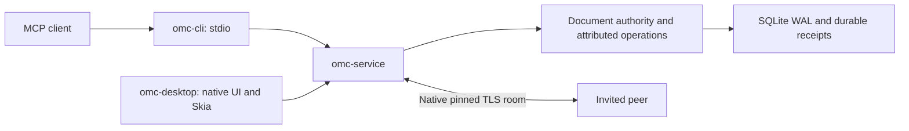

# Architecture

Oh My Canvas is a Rust-native desktop application. The desktop presents a Skia scene; a separate local service owns document authority and SQLite persistence. No Electron, Chromium, DOM renderer or JavaScript document engine is part of the app runtime.

## Ownership

| Path | Responsibility |
| --- | --- |
| `native/apps/omc-desktop/` | Native windows, input, inspector, accessibility and presentation |
| `native/apps/omc-service/` | Authenticated local service, workspace and collaboration routing |
| `native/apps/omc-cli/` | MCP stdio transport and profile connection |
| `native/crates/omc-model/`, `omc-protocol/` | Typed model, validated commands, identity and receipts |
| `native/crates/omc-engine/`, `omc-sync/`, `omc-storage/` | Document authority, attributed operations, Undo and SQLite persistence |
| `native/crates/omc-style/`, `omc-layout/`, `omc-text/`, `omc-scene/`, `omc-render/` | CSS, layout, shaping, scene construction and Skia rendering |
| `native/crates/omc-mcp/` | OMC and FigCraft-compatible tool interfaces |
| `native/crates/omc-import/`, `omc-export/` | Validated file interchange and rendered/code exports |
| `native/tests/` | Official MCP SDK integration tests; JavaScript is test tooling only |
| `tools/local-dev-bench/` | Benchmark adapters, fixtures and acceptance tools |

## Edits and persistence

The service validates commands against a named document and its revision. The engine checks candidate changes, commits operations and durable receipts, then publishes accepted snapshots. SQLite uses WAL and full synchronization. Author identity scopes Undo and replay; document IDs prevent a background agent from implicitly editing the visible tab.

Style, text, layout and scene work prepare renderable content for the native desktop. macOS presentation uses Metal; fallback and platform qualification remain subject to the [native qualification guide](native-engine/QUALIFICATION.md). A headless service test does not establish physical presentation or cross-platform performance.

## Boundaries

MCP stdio connects through the local authenticated service. Optional legacy HTTPS has a pinned profile certificate and separate bearer. Native collaboration uses its own reachable TLS endpoint and invitation; it is not the MCP listener. Never expose local MCP credentials or ports publicly.

Native editable copies and history packages are distinct formats. Import/export limits, old-file conversion warnings and merge behavior are documented in the [MCP contract](MCP_PARITY.md). Older Yjs documents are migration inputs, not a second application runtime.

[Native build and verification](../native/README.md) · [Security](../SECURITY.md) · [Testing](TESTING.md)
