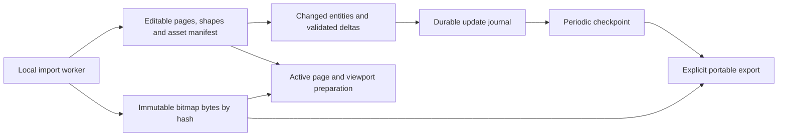

# Design-file import: prototype status and architecture proposal

Status: **prototype checkpoint published for integration; architecture improvements paused**. Updated 2026-11-10.

This document records the `.fig` / `.sketch` prototype, measured limits of a real large library, and recommendations from a read-only GPT-6 Astra review at high reasoning effort. PR #10 initially published documentation only. The subsequent implementation checkpoint includes the paused code and [full source fixture in Git LFS](../fixtures/design-files/README.md) for integration by the ongoing architecture work. The proposed redesign below is not implemented.

## Outcome and target

The target is [iOS and iPadOS 27 on Figma Community](https://www.figma.com/community/file/1651309003795292092/ios-and-ipados-27), with every user page retained and source fidelity evaluated separately.

The prototype imported all **46 user pages**, selected every page, accepted a page-name edit, saved, and reopened in a fresh Electron process with **39,363 objects and 160 referenced bitmap assets** intact. This establishes a scoped import/persistence result. It does not establish responsive editing, exact instance overrides, or pixel-perfect reproduction.

Raising capacity was necessary, but page separation alone did not remove lag. Rendering uses the active page while editing, validation, CRDT projection, IPC, and persistence still process substantial parts of the complete document.

## Implemented prototype

| Area | Work completed | Remaining limitation |
| --- | --- | --- |
| File entry points | Native Import, local MCP `import_document`, asset picker, and drag/drop accept `.fig` and `.sketch` | Document import preserves pages; placement intentionally inserts all imported page layers into the current page |
| Local decoding | `openfig-core` and `fflate` decode Figma Kiwi/ZIP and Sketch JSON archives in a desktop worker | Desktop-only conversion; bounded input, expansion, worker memory, concurrency, and timeout |
| Editable content | Frames/groups, basic geometry, paths, text, and embedded PNG/JPEG/GIF/WebP images | Component links, overrides, variables, mixed formatting, effects, paints, masks, and transforms can differ |
| Diagnostics | Conversion warnings are displayed and retained in document metadata | Source-specific visual and semantic parity remains unqualified |
| Shared bitmaps | SHA-256 asset IDs replace repeated inline bitmap data on layers | Original base64 bytes still live in `document.assets` and CRDT state |
| Rendering/export | Current-page image preparation, Blob URLs released on departure, hidden-subtree preparation deferred; SVG/HTML/Canvas JSON resolve bitmap references | No viewport culling or layer-panel virtualization; shared-asset copy contracts still have gaps |
| Capacity | Ordinary canvas budgets retained; imported libraries opt into a larger bounded profile | Larger limits are not a performance or collaboration guarantee |
| Persistence | Large states use compressed `.omc` v3; v1/v2 remain readable; validated replica caches and coalesced/cached library listing | Whole-state encode/compress/write remains on the edit path; old apps cannot read v3 |

The prototype capacity profile is:

| Boundary | Ordinary canvas | Imported large library |
| --- | --- | --- |
| Document / encoded CRDT state | 16 MiB each | 256 MiB each |
| Objects | 20,000 | 100,000 |
| Pages | 100 | 100 |
| Design-file input / expanded archive | Not applicable | 256 MiB / 512 MiB |
| File envelope | Prototype globally raises the envelope ceiling to 384 MiB | Same ceiling; the unintended coupling to network limits must be resolved |

These are prototype validation limits, not the current default-branch product contract.

## Measured evaluation

The full local source was 160,627,671 bytes, with 424 ZIP entries and 37,743 decoded source nodes. Of 47 CANVAS records, one was internal and 46 were user pages. Instance expansion produced 39,363 output objects, including page roots. Shared-asset converted JSON was 158,849,316 bytes. Output object counts do not imply semantic equivalence with the source.

The following values come from one native macOS Electron run, not a distribution or a performance target. The sanitized [evaluation summary](qa/design-file-import-evaluation.json) preserves the values and scope without redistributing the source file, generated document, or design screenshots.

| Operation | Observed time | Measurement scope |
| --- | --- | --- |
| Import complete source | 22.76 s | Native import invocation through document creation/opening |
| Reopen saved document | 19.05 s | Open invocation after a fresh app process had launched; excludes process launch |
| Rename Cover page | 20.29 s | Complete MCP operation, including its persistence/settling path; phase timings were not collected |
| Final flush | 0.18 s | Flush after the earlier edit completed; not representative of edit-save latency |
| Cover page selection | 0.11 s | Selection through tool completion/settling |
| Examples page selection | 6.01 s | 18,380 objects |
| Product Bezels page selection | 0.65 s | 88 objects |
| System page selection | 1.39 s | 3,680 objects |
| Buttons page selection | 0.40 s | 1,166 objects |
| Keyboards page selection | 1.14 s | 3,834 objects |

Every page was selected and settled. A fresh process reopened the document with the page rename preserved. Detailed cold/warm cache classification, repeated p95 measurements, peak memory during the full journey, and phase-level attribution were not collected. Object count alone does not predict image decode, text layout, or rendering cost.

### Failed approaches and what the passing run means

- Raising only the conversion limits initially failed with an invalid-string-length error: repeated inline image data made serialization too large.
- Shared bitmap references made full conversion possible, but the large uncompressed JSON/base64 `.omc` envelope still caused native V8 allocation failure during fresh-process reopen.
- The compressed v3 envelope passed the recorded reopen journey. This fixes that observed persistence boundary; it does not make editing incremental or prove that all large documents fit in memory.

### Verification already performed on the prototype

| Check | Recorded result | Limit |
| --- | --- | --- |
| Editor suite | 754 passed | Unit/regression coverage, not source visual parity |
| Full Node suite | 103 passed | Recorded before the final additional compressed-payload rejection test |
| Final focused storage suite | 11 passed, including that additional test | Not represented as a fresh 104-test full-suite run |
| Syntax / TypeScript | 68 application syntax checks and typecheck passed | Static checks |
| Production build | Passed | Packaged distribution was not qualified |
| Native synthetic format journey | Figma and Sketch import, plus Figma drop through worker/IPC/CSP, passed | Small synthetic inputs |
| Actual target journey | All pages selected; rename, save, and fresh-process reopen passed | Single-machine run with substantial latency |

The prototype runners were `node scripts/design-import-e2e.mjs` and `node scripts/design-library-e2e.mjs <absolute-local-fig-path>`. They use isolated temporary profiles and remove their own test profiles. These runners are included in the published implementation checkpoint. Application tests were `npm run test:editor`, `npm test`, `node --test tests/storage.test.mjs`, `npm run check`, and `npm run build`.

## Astra review: findings and confidence

The review inspected the prototype code and existing measurements without modifying files, running new benchmarks, or visually comparing the source. The paths below identify implementation areas; proposed changes are not implemented behavior.

| Finding | Evidence in the prototype | Assessment |
| --- | --- | --- |
| Small edits repeatedly clone and validate the complete document | `editor/document/index.ts`, `editor/document/factory.ts`, `editor/document/validation.ts`, `editor/document/journal.ts` | Code-confirmed work; its share of the 20.29 s edit is unmeasured |
| Bitmap bytes remain inside the CRDT; the entire assets map occupies one meta register | `core/document.mjs` field flattening and `core/replica.mjs` patching | Code-confirmed representation; loss of concurrent independent asset additions is a risk requiring reproduction |
| Materialization scans the shapes map for each page | `core/document.mjs` materialization | O(pages × shapes) scanning in that portion; page buckets can remove redundant traversal |
| The runtime re-diffs editor changes and receives full snapshots from both update events and commit replies | `src/document-runtime.js`, `electron/document-manager.mjs`, `electron/main.mjs` | Code-confirmed duplication; revision/ACK behavior must be preserved when changing it |
| Saving encodes/hashes/compresses the whole state and rewrites file/backup | `core/replica.mjs`, `core/storage.mjs` | Code-confirmed full-state work, including synchronous gzip |
| Current visibility filtering skips hidden subtrees rather than offscreen content | `editor/render/index.ts`, `editor/render/scene.ts`; layer rows in `editor/ui/index.ts` | Code-confirmed; viewport preparation and panel virtualization remain separate work |
| Fidelity losses are converter decisions as well as engine limitations | `editor/formats/design-file.ts`, existing geometry/effect/component implementations | Reuse existing engine capabilities before considering a renderer rewrite; current components still expand instance subtrees |

### Correctness gaps to close first

1. MCP copy exports bitmap dependencies through `assetDefinitions`, resource preparation handles fonts, and command paste merges `payload.assets`. The contracts do not currently align for shared bitmaps across documents.
2. UI property copy can transfer an image-fill reference without its asset definition.
3. Removing a shared image asset currently detaches references into inline sources. A heavily reused image can become duplicated enough to exceed capacity; deletion needs a durable reference/retention policy.
4. The enlarged `MAX_ENVELOPE_BYTES` also controls collaboration payload/backpressure. Local compressed reopen does not qualify full-state base64 network messages. Storage and wire budgets need separate contracts.
5. Large-library listing uses compressed on-disk file size to choose whether to instantiate a replica. A highly compressible large state can still enter the expensive path. Listing should eventually read independent metadata.

## Recommended architecture

Preserve the import worker, content hashes, all-page traversal, existing validation guarantees, retained renderer, and reopen regression. Avoid a complete rewrite before measuring individual phases.

This is a proposed boundary diagram, not the current architecture.

| Stage | Change | Required proof before proceeding |
| --- | --- | --- |
| P0: measure and protect correctness | Time clone, normalize, reconcile, validation, diff, IPC, replica, save, and render separately; unify clipboard asset contracts; reproduce independent asset-add merging | Existing content preserved; cross-document UI/MCP shape/property paste retains bitmaps; no lost concurrent additions |
| P1: separate immutable bytes | Retain hash IDs; move bitmap originals outside editable document/CRDT into a blob store; keep a small manifest and resolve requested image URLs | Rename transfers and rewrites zero bitmap bytes; missing/corrupt blobs detected; legacy embedded documents migrate without losing content |
| P2: process changes incrementally | Adapt existing editor patches into validated entity/page changes; copy and normalize affected paths; use revisioned deltas and explicit ACKs | Concurrent edits, active local previews, Undo, rejection, reconnect, and runtime generation changes retain correctness |
| P3: separate persistence and rendering work | Durably append small updates; checkpoint/compact separately; prepare visible content and virtualize layer rows | ACKed writes survive interruption; bounded journal/cache; mask/effect/export and keyboard/accessibility behavior preserved |
| Fidelity track | Preserve source IDs and diagnostics; map existing transform/effect/style/component capabilities; compare representative reference frames | Structural and visual evidence for text, overrides, colors, clipping, transforms, and effects; remaining unsupported cases reported |

### Constraints and tradeoffs

- **Working storage and portable export should differ.** Editing should not rebuild a complete portable package for every change. Exact storage/container/version choices remain undecided.
- Blob garbage collection must account for Undo, every page, components, pending writes, and checkpoint references. Current visible shapes alone are insufficient to determine safe deletion.
- Keep complete validation at imports, remote inputs, and checkpoints. Incremental local validation must include dependencies; do not remove validation or replace Yjs history size with a naive string-size sum.
- Dropping assets from snapshots through an implicit cache is insufficient. Delta sequencing, durable ACKs, runtime generation, missing-revision recovery, and full resynchronization need explicit contracts.
- Keep a single Y.Doc initially. Per-page CRDT partitioning introduces cross-page component, move, and Undo atomicity costs; reconsider only after assets and redundant traversal are addressed.
- Reuse the retained scene/leaf update path. Offscreen culling must respect overflow, masks, shadows, and backdrop dependencies. Export must still include the requested content outside the viewport.
- A GPU/WebGL rewrite does not eliminate document cloning, IPC, or gzip. It is not the first recommended step.

## Proposed acceptance criteria

These are targets for future work, **not measured achievements**. Use the same machine, full source, fonts, viewport, and cold/warm definitions; record repeated samples and memory, not only a single successful run.

| Concern | Proposed target |
| --- | --- |
| Content integrity | Preserve 46 user pages in order, their content, and all 160 referenced bitmap hashes; verify source semantics separately |
| Small edits | Screen response p95 ≤100 ms and durable ACK p95 ≤500 ms for rename/single-shape changes; rename sends ≤10 KiB and transfers/rewrites zero bitmap bytes |
| Page navigation | Warm transition p95 ≤500 ms; first usable Examples viewport ≤1 s; full-page settling reported separately |
| Recovery | ACKed edits survive forced termination; interrupted checkpoint, truncated final journal record, and missing assets produce safe recovery or explicit failure |
| Memory | Two complete page traversals do not cause continuing steady-state growth; decoded-image cache has a byte budget |
| Collaboration | Independent asset additions survive merging; bounded transfer, interruption, reconnect, and legacy compatibility are explicitly tested |
| Fidelity | Representative source/reference frames compared with matching fonts and dimensions, plus structural checks; unverified regions never labeled perfect |

## Outstanding decisions and publication boundaries

Implementation remains paused pending a chosen architecture and staged verification. Exact blob storage, journal/checkpoint format, migration strategy, wire protocol, cache budgets, and fidelity thresholds have not been selected. The existing prototype is a useful checkpoint, not a merge-ready large-library editor.

The full third-party `.fig` is now available through the linked Git LFS fixture at the user’s explicit request. A [native runtime screenshot](qa/design-file-import-examples.png) records the Examples page. Generated documents and detailed internal logs remain unpublished. The code checkpoint retains the documented correctness and latency gaps; no architecture redesign, packaged release, or deployment is implied.
