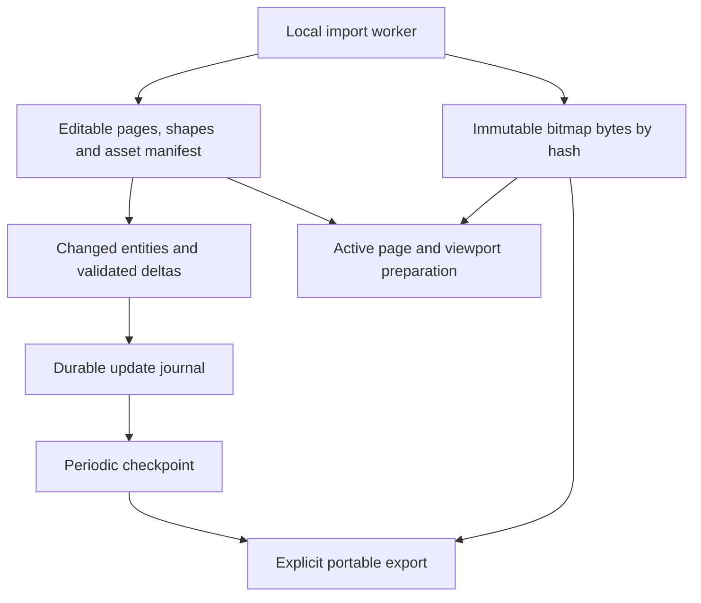

# Design-file import and large-document boundaries

Status: **incremental architecture implemented; performance and source fidelity remain separately qualified**. Updated 2026-11-10 UTC.

PR #12 continues the import work with a different storage, editing and rendering boundary. PR #11 is a reference checkpoint; its successful structure import is not proof of acceptable performance or source fidelity. The [full original fixture](../fixtures/design-files/README.md) is available through Git LFS and its byte count and SHA-256 were verified during this work.

## Implemented boundaries

- Desktop decoding transfers original raster buffers out of the worker. A durable SHA-256 blob store receives them before the editable document exposes references. The current document and Yjs fields do not carry those original bitmap bytes.
- Local drafts, normalization, layout, validation and patch conversion follow changed paths. Imports and untrusted replacements retain full validation. Structural/dependency edits conservatively process their affected graph.
- Renderer IPC uses revisioned deltas and separate accepted/durable sequence counters. Undo resurrection, missing revisions, rejected edits and persistence retries have explicit handling.
- Working storage uses a small manifest, immutable checkpoints and a checksummed append journal. Save acknowledgment follows fsync. Explicit portable export assembles v4 image packages; v1/v2 and PR #11's compressed v3 remain readable.
- Image copy/paste and property copy share `assetDefinitions`; collisions remap IDs atomically. Referenced catalog assets remain retained instead of being expanded into every shape. JSON/HTML/SVG exports hydrate their dependencies.
- Large pages use conservative viewport preparation, virtual layer rows, coalesced viewport input and spatial hit/snap candidates. Effects, masks, overflow, uncertain bounds and complete export retain conservative behavior.
- Collaboration v3 transfers state and missing blobs in bounded chunks. A 1 MiB frame budget is independent of the 384 MiB portable-file budget. Assets are digest-checked and persisted before remote publication; the document save precedes transfer ACK.

These are implemented contracts, not a claim that all acceptance targets below have been met. The immutable plain-object shape index still imposes some work proportional to the edited page size. Full initial validation/materialization, text layout, large root subtrees and export can remain expensive. No decoded-pixel memory ceiling, packaged cross-platform qualification, or perfect source reproduction is claimed.

## Current conversion limits

The current converter still has known losses, beyond the need for visual comparison:

- Figma effects and variable bindings are omitted. Unsupported paints are omitted with warnings.
- Components and instances become ordinary editable layers; instance overrides can differ. Boolean operations become editable groups, and auto layout retains saved positions.
- Masks are incomplete, mixed text styles can be simplified, and nonstandard blend modes can differ. The recorded Linux viewport also shows fallback fonts, missing glyphs and overlapping labels.

The document retains `importFidelity: 'unverified'` and conversion warnings. The native round trips check page IDs and order, per-page object counts, page names, original bitmap hash sets, and the dragged shape's coordinates. These checks do not establish complete field-by-field or visual fidelity to the source. Representative original Figma frames with matching fonts are still required to assess source reproduction. Existing editor component and effect features do not establish their mapping from imported design files.

## Native validation: `cfa052c8`

The [2026-11-10 native run](https://github.com/Dindb-dong/oh-my-canvas/actions/runs/42869423111) tested runtime commit `cfa052c8d08aa368017314f3ba08f50a36fd2e47`. Syntax/type checks, documentation checks, 189 Node tests, 823 editor tests and the production build passed. All 17 native checks passed with zero renderer exceptions. The [sanitized evaluation record](qa/pr12-large-document-evaluation.json) retains the measured values and their scope after the workflow artifacts expire.

The full original source was 160,627,671 bytes with SHA-256 `c7c4fdbe469ae451c9a3d3d384a2102fa08dfaa220a1277e2df17fc2146c5ee7`. Import, working-storage reopen, portable OMC import and portable JSON import retained 46 pages, 39,363 objects and the same 160 original bitmap hashes. Round trips also retained page IDs/order/names and the dragged shape's coordinates. JSON and SVG exports contained embedded image data without local or remote image references. The valid-asset route returned 200 and the deliberately missing hash returned 404; three cancelled image fetches on page departure were recorded separately from renderer exceptions.

This was one journey on Linux x64/Xvfb, AMD EPYC 9V74, two logical CPUs and 7.75 GiB RAM, using Electron 45.2.1 with software rendering. The harness used Node 22.23.4; Electron used Node 24.22.1. These are individual observations, except for the explicitly sampled gesture distributions. They are not directly comparable to the earlier macOS prototype or the Linux reference run on an EPYC 7763.

| Operation | Final observation | Measurement scope |
| --- | --- | --- |
| Import complete source | 38.89 s | Native import invocation through editor readiness; full check including metadata/memory assertions took 41.26 s |
| Page rename | 102.1 ms screen paint; 24.0 ms acceptance; 379.3 ms durable save | One UI edit; paint uses two animation frames and save follows fsync |
| Complete MCP page rename | 21.08 ms | Separate native MCP operation |
| Enter Examples | 610.8 ms screen paint; 557.0 ms additional settling | First measured entry into the 18,380-object page |
| Pan, 90 wheel events | 50.0 ms frame-interval p95; 83.4 ms maximum | Input-handler p95 0.1 ms; no document writes |
| Hover, 90 pointer events | 16.8 ms frame-interval p95; no long tasks | Input-handler p95 0.4 ms; no document writes |
| Leaf drag, 24 movement steps | 133.4 ms frame-interval p95; 1,400 ms maximum | Input-handler p95 59.8 ms, maximum 1,284.9 ms; release-to-durable save 307.7 ms |
| Reopen working document | 21.44 s | Fresh process after app launch; excludes launch and is not a cold-disk measurement |
| Fresh-profile portable OMC import | 28.92 s | Complete image package and retained edits |
| Fresh-profile portable JSON import | 34.47 s | Embedded images re-enter the external blob store |

Explicit exports took 10.92 s for JSON (246,625,867 bytes), 0.61 s for SVG (13,984,120 bytes) and 6.46 s for portable OMC (129,899,344 bytes). Export remains whole-content work; these costs are separate from normal edit persistence.

At the fixed Examples viewport, 6,245 shape elements and 25,351 total scene nodes were mounted, with 40 layer rows. This is still substantial DOM work. Aggregate process working-set snapshots were 2,204.6 MiB after import and 3,567.7 MiB after the gestures; these are snapshots, not a combined peak, and do not establish bounded decoded-image memory. The frame intervals include Playwright scheduling and software rendering, so their reciprocals are not a hardware FPS benchmark.

The final Examples screenshot is byte-identical to the preceding `75c9dcb2` run: 0 of 1,369,500 full-image pixels differ, including all 745,780 canvas pixels. Both use the same source, viewport and DOM counts. This verifies that the final gesture-origin and bounds-invalidation changes preserved this imported viewport; it is not a comparison with the original Figma rendering.

A separate six-wheel diagnostic trace completed without reported data loss. In its 651.034 ms marked window, exclusive main-thread attribution recorded 229.881 ms in style/layout/hit-testing, 157.161 ms in paint/compositing, 8.204 ms in script/callbacks, 11.159 ms in other observed work and 244.629 ms idle or unobserved. Six main-thread tasks exceeded 50 ms. Four unpaired synchronous begin events were excluded from attribution. This points to retained SVG layout and paint as the remaining pan bottleneck in this environment; it does not attribute GPU-process work, generalize to hardware rendering, or diagnose the separate drag spike. The original 90-event pan sample excludes tracing overhead.

These results close the observed persistence/export correctness failures and demonstrate the new boundaries on the real fixture. They do **not** meet all responsiveness, memory, collaboration or fidelity targets below: drag still has a 1.4-second frame, import/reopen remain long, and the full fixture has not been qualified across four native collaboration peers or current packaged macOS/Windows builds.

## Intermediate core checkpoint: `37fec915`

The verified 160,627,671-byte source produced 46 pages, 39,363 objects and 160 external bitmap blobs containing 90,234,314 original bytes. The editable JSON is 41,452,401 bytes and its initial Yjs state is 107,305,531 bytes. Separating the images does not eliminate the remaining geometry, text or CRDT representation costs.

One core-process journey on Linux x64, Node 24.22.1, Intel Xeon Platinum 8573C measured the following phases with `scripts/benchmark-document-core.mjs`, after direct checkpoint hydration and single-pass initial encoding were implemented in commit `37fec9158fa17e1032f1f632b1ad48cb62578834`. The source replica was closed before the single reopen observation. Explicit garbage collection was enabled. These measurements exclude Electron IPC, editor initialization/reconciliation, native rendering, image decoding for display, portable export and visual fidelity.

| Core phase | Observed time | Scope |
| --- | --- | --- |
| Worker import | 14.48 s | Includes 6.48 s of full worker validation |
| Persist original bitmap blobs | 2.26 s | Verified durable blob writes |
| Initial replica | 16.30 s | Includes 5.89 s of projection/validation and 2.19 s of state encoding |
| Initial checkpoint | 0.84 s | Initial working-storage checkpoint |
| Reopen | 12.07 s | One observation after closing the source replica; process launch excluded |
| First page rename | 12.75 ms | Patch translation, replica acceptance and fsynced journal |
| Five subsequent page renames | 2.94 ms median; 3.64 ms maximum | Same core path, after the first edit; nearest-rank p95 equals the maximum for five samples |

The warm rename samples were 3.31, 3.64, 2.94, 2.01 and 2.05 ms. Each produced a 49-byte Yjs update and a 319-byte journal record, with no full-state encoding during validation. The edited page contained 18,380 objects. The process snapshot after reopen reported 1,344,315,392 bytes RSS and 590,392,904 bytes of used JavaScript heap; these are not peaks and do not include a desktop renderer. This establishes bounded small-edit work in that core path, not a desktop input-latency or frame-rate result. Initial import and reopen remain expensive and do not meet a responsiveness claim.

The [testing guide](TESTING.md#large-design-file-journey) describes the separate native journey, including UI paint versus durable acknowledgment, pan/hover/drag, portable exports and fresh-profile reopen. The native runner records its actual GPU environment and failures; a timeout is a failed acceptance. The historical macOS timings below must not be treated as a same-host comparison with these Linux core observations.

The sections below preserve **historical PR #11 measurements and review findings**. They describe the prototype that motivated this work.

## Outcome and target

The target is [iOS and iPadOS 27 on Figma Community](https://www.figma.com/community/file/1651309003795292092/ios-and-ipados-27), with every user page retained and source fidelity evaluated separately.

The prototype imported all **46 user pages**, selected every page, accepted a page-name edit, saved, and reopened in a fresh Electron process with **39,363 objects and 160 referenced bitmap assets** intact. This establishes a scoped import/persistence result. It does not establish responsive editing, exact instance overrides, or pixel-perfect reproduction.

Raising capacity was necessary, but page separation alone did not remove lag. Rendering uses the active page while editing, validation, CRDT projection, IPC, and persistence still process substantial parts of the complete document.

## Historical prototype implementation

| Area | Work completed | Remaining limitation |
| --- | --- | --- |
| File entry points | Native Import, local MCP `import_document`, asset picker, and drag/drop accept `.fig` and `.sketch` | Document import preserves pages; placement intentionally inserts all imported page layers into the current page |
| Local decoding | `openfig-core` and `fflate` decode Figma Kiwi/ZIP and Sketch JSON archives in a desktop worker | Desktop-only conversion; bounded input, expansion, worker memory, concurrency, and timeout |
| Editable content | Frames/groups, basic geometry, paths, text, and embedded PNG/JPEG/GIF/WebP images | Component links, overrides, variables, mixed formatting, effects, paints, masks, and transforms can differ |
| Diagnostics | Conversion warnings are displayed and retained in document metadata | Source-specific visual and semantic parity remains unqualified |
| Shared bitmaps | SHA-256 asset IDs replace repeated inline bitmap data on layers | Original base64 bytes still live in `document.assets` and CRDT state |
| Rendering/export | Current-page image preparation, Blob URLs released on departure, hidden-subtree preparation deferred; SVG/HTML/Canvas JSON resolve bitmap references | No viewport culling or layer-panel virtualization; shared-asset copy contracts still have gaps |
| Capacity | Ordinary canvas budgets retained; imported libraries opt into a larger bounded profile | Larger limits are not a performance or collaboration guarantee |
| Persistence | Large states use compressed `.omc` v3; v1/v2 remain readable; validated replica caches and coalesced/cached library listing | Whole-state encode/compress/write remains on the edit path; old apps cannot read v3 |

The prototype capacity profile is:

| Boundary | Ordinary canvas | Imported large library |
| --- | --- | --- |
| Document / encoded CRDT state | 16 MiB each | 256 MiB each |
| Objects | 20,000 | 100,000 |
| Pages | 100 | 100 |
| Design-file input / expanded archive | Not applicable | 256 MiB / 512 MiB |
| File envelope | Prototype globally raises the envelope ceiling to 384 MiB | Same ceiling; the unintended coupling to network limits must be resolved |

These are historical prototype limits. The current implementation keeps document/input budgets but separates portable files from 1 MiB collaboration frames; see [Architecture](ARCHITECTURE.md).

## Historical prototype evaluation

The full local source was 160,627,671 bytes, with 424 ZIP entries and 37,743 decoded source nodes. Of 47 CANVAS records, one was internal and 46 were user pages. Instance expansion produced 39,363 output objects, including page roots. Shared-asset converted JSON was 158,849,316 bytes. Output object counts do not imply semantic equivalence with the source.

The following values come from one native macOS Electron run, not a distribution or a performance target. The sanitized [evaluation summary](qa/design-file-import-evaluation.json) preserves the values and scope without redistributing the source file, generated document, or design screenshots.

| Operation | Observed time | Measurement scope |
| --- | --- | --- |
| Import complete source | 22.76 s | Native import invocation through document creation/opening |
| Reopen saved document | 19.05 s | Open invocation after a fresh app process had launched; excludes process launch |
| Rename Cover page | 20.29 s | Complete MCP operation, including its persistence/settling path; phase timings were not collected |
| Final flush | 0.18 s | Flush after the earlier edit completed; not representative of edit-save latency |
| Cover page selection | 0.11 s | Selection through tool completion/settling |
| Examples page selection | 6.01 s | 18,380 objects |
| Product Bezels page selection | 0.65 s | 88 objects |
| System page selection | 1.39 s | 3,680 objects |
| Buttons page selection | 0.40 s | 1,166 objects |
| Keyboards page selection | 1.14 s | 3,834 objects |

Every page was selected and settled. A fresh process reopened the document with the page rename preserved. Detailed cold/warm cache classification, repeated p95 measurements, peak memory during the full journey, and phase-level attribution were not collected. Object count alone does not predict image decode, text layout, or rendering cost.

### Failed approaches and what the passing run means

- Raising only the conversion limits initially failed with an invalid-string-length error: repeated inline image data made serialization too large.
- Shared bitmap references made full conversion possible, but the large uncompressed JSON/base64 `.omc` envelope still caused native V8 allocation failure during fresh-process reopen.
- The compressed v3 envelope passed the recorded reopen journey. This fixes that observed persistence boundary; it does not make editing incremental or prove that all large documents fit in memory.

### Verification already performed on the prototype

| Check | Recorded result | Limit |
| --- | --- | --- |
| Editor suite | 754 passed | Unit/regression coverage, not source visual parity |
| Full Node suite | 103 passed | Recorded before the final additional compressed-payload rejection test |
| Final focused storage suite | 11 passed, including that additional test | Not represented as a fresh 104-test full-suite run |
| Syntax / TypeScript | 68 application syntax checks and typecheck passed | Static checks |
| Production build | Passed | Packaged distribution was not qualified |
| Native synthetic format journey | Figma and Sketch import, plus Figma drop through worker/IPC/CSP, passed | Small synthetic inputs |
| Actual target journey | All pages selected; rename, save, and fresh-process reopen passed | Single-machine run with substantial latency |

The prototype runners were `node scripts/design-import-e2e.mjs` and `node scripts/design-library-e2e.mjs <absolute-local-fig-path>`. They use isolated temporary profiles and remove their own test profiles. These runners are included in the published implementation checkpoint. Application tests were `npm run test:editor`, `npm test`, `node --test tests/storage.test.mjs`, `npm run check`, and `npm run build`.

## Astra review: findings and confidence

The review inspected the prototype code and existing measurements without modifying files, running new benchmarks, or visually comparing the source. The paths below identify the implementation areas reviewed at that time; the implemented boundaries above supersede these original findings.

| Finding | Evidence in the prototype | Assessment |
| --- | --- | --- |
| Small edits repeatedly clone and validate the complete document | `editor/document/index.ts`, `editor/document/factory.ts`, `editor/document/validation.ts`, `editor/document/journal.ts` | Code-confirmed work; its share of the 20.29 s edit is unmeasured |
| Bitmap bytes remain inside the CRDT; the entire assets map occupies one meta register | `core/document.mjs` field flattening and `core/replica.mjs` patching | Code-confirmed representation; loss of concurrent independent asset additions is a risk requiring reproduction |
| Materialization scans the shapes map for each page | `core/document.mjs` materialization | O(pages × shapes) scanning in that portion; page buckets can remove redundant traversal |
| The runtime re-diffs editor changes and receives full snapshots from both update events and commit replies | `src/document-runtime.js`, `electron/document-manager.mjs`, `electron/main.mjs` | Code-confirmed duplication; revision/ACK behavior must be preserved when changing it |
| Saving encodes/hashes/compresses the whole state and rewrites file/backup | `core/replica.mjs`, `core/storage.mjs` | Code-confirmed full-state work, including synchronous gzip |
| Current visibility filtering skips hidden subtrees rather than offscreen content | `editor/render/index.ts`, `editor/render/scene.ts`; layer rows in `editor/ui/index.ts` | Code-confirmed; viewport preparation and panel virtualization remain separate work |
| Fidelity losses are converter decisions as well as engine limitations | `editor/formats/design-file.ts`, existing geometry/effect/component implementations | Reuse existing engine capabilities before considering a renderer rewrite; current components still expand instance subtrees |

### Historical correctness gaps addressed by this work

1. MCP copy exported bitmap dependencies through `assetDefinitions`, while command paste merged `payload.assets`. The contracts did not align for shared bitmaps across documents.
2. UI property copy could transfer an image-fill reference without its asset definition.
3. Removing a shared image asset detached references into inline sources. A heavily reused image could become duplicated enough to exceed capacity.
4. The enlarged `MAX_ENVELOPE_BYTES` also controlled collaboration payload/backpressure. Local compressed reopen did not qualify full-state base64 network messages.
5. Large-library listing used compressed on-disk file size to choose whether to instantiate a replica. A highly compressible large state could still enter the expensive path.

## Architecture direction adopted

Preserve the import worker, content hashes, all-page traversal, existing validation guarantees, retained renderer, and reopen regression. Avoid a complete rewrite before measuring individual phases.

This boundary is implemented. Its performance and compatibility acceptance criteria still need to be assessed independently.

| Stage | Change | Required proof before proceeding |
| --- | --- | --- |
| P0: measure and protect correctness | Time clone, normalize, reconcile, validation, diff, IPC, replica, save, and render separately; unify clipboard asset contracts; reproduce independent asset-add merging | Existing content preserved; cross-document UI/MCP shape/property paste retains bitmaps; no lost concurrent additions |
| P1: separate immutable bytes | Retain hash IDs; move bitmap originals outside editable document/CRDT into a blob store; keep a small manifest and resolve requested image URLs | Rename transfers and rewrites zero bitmap bytes; missing/corrupt blobs detected; legacy embedded documents migrate without losing content |
| P2: process changes incrementally | Adapt existing editor patches into validated entity/page changes; copy and normalize affected paths; use revisioned deltas and explicit ACKs | Concurrent edits, active local previews, Undo, rejection, reconnect, and runtime generation changes retain correctness |
| P3: separate persistence and rendering work | Durably append small updates; checkpoint/compact separately; prepare visible content and virtualize layer rows | ACKed writes survive interruption; bounded journal/cache; mask/effect/export and keyboard/accessibility behavior preserved |
| Fidelity track | Preserve source IDs and diagnostics; map existing transform/effect/style/component capabilities; compare representative reference frames | Structural and visual evidence for text, overrides, colors, clipping, transforms, and effects; remaining unsupported cases reported |

### Constraints and tradeoffs

- **Working storage and portable export should differ.** Editing should not rebuild a complete portable package for every change. The selected contract is a local manifest/journal/checkpoint plus an explicit v4 portable image package.
- Blob garbage collection must account for Undo, every page, components, pending writes, and checkpoint references. Current visible shapes alone are insufficient to determine safe deletion.
- Keep complete validation at imports, remote inputs, and checkpoints. Incremental local validation must include dependencies; do not remove validation or replace Yjs history size with a naive string-size sum.
- Dropping assets from snapshots through an implicit cache is insufficient. Delta sequencing, durable ACKs, runtime generation, missing-revision recovery, and full resynchronization need explicit contracts.
- Keep a single Y.Doc initially. Per-page CRDT partitioning introduces cross-page component, move, and Undo atomicity costs; reconsider only after assets and redundant traversal are addressed.
- Reuse the retained scene/leaf update path. Offscreen culling must respect overflow, masks, shadows, and backdrop dependencies. Export must still include the requested content outside the viewport.
- A GPU/WebGL rewrite does not eliminate document cloning, IPC, or gzip. It is not the first recommended step.

## Proposed acceptance criteria

These are targets for future work, **not measured achievements**. Use the same machine, full source, fonts, viewport, and cold/warm definitions; record repeated samples and memory, not only a single successful run.

| Concern | Proposed target |
| --- | --- |
| Content integrity | Preserve 46 user pages in order, their content, and all 160 referenced bitmap hashes; verify source semantics separately |
| Small edits | Screen response p95 ≤100 ms and durable ACK p95 ≤500 ms for rename/single-shape changes; rename sends ≤10 KiB and transfers/rewrites zero bitmap bytes |
| Page navigation | Warm transition p95 ≤500 ms; first usable Examples viewport ≤1 s; full-page settling reported separately |
| Recovery | ACKed edits survive forced termination; interrupted checkpoint, truncated final journal record, and missing assets produce safe recovery or explicit failure |
| Memory | Two complete page traversals do not cause continuing steady-state growth; decoded-image cache has a byte budget |
| Collaboration | Independent asset additions survive merging; bounded transfer, interruption, reconnect, and legacy compatibility are explicitly tested |
| Fidelity | Representative source/reference frames compared with matching fonts and dimensions, plus structural checks; unverified regions never labeled perfect |

## Outstanding decisions and publication boundaries

The selected storage, journal, blob, IPC and wire contracts are implemented. Remaining work includes meeting the measured drag/page-entry targets, bounding decoded-image memory, and comparing representative original frames with matching fonts and dimensions. No Rust engine, per-page Y.Doc partition, renderer replacement or Tauri migration is included.

The full third-party `.fig` is available through the Git LFS fixture at the user’s explicit request. The [earlier native screenshot](qa/design-file-import-examples.png) records the prototype Examples page and is not visual evidence for this implementation. Generated documents and detailed internal logs remain unpublished. A packaged release or deployment is not implied.
