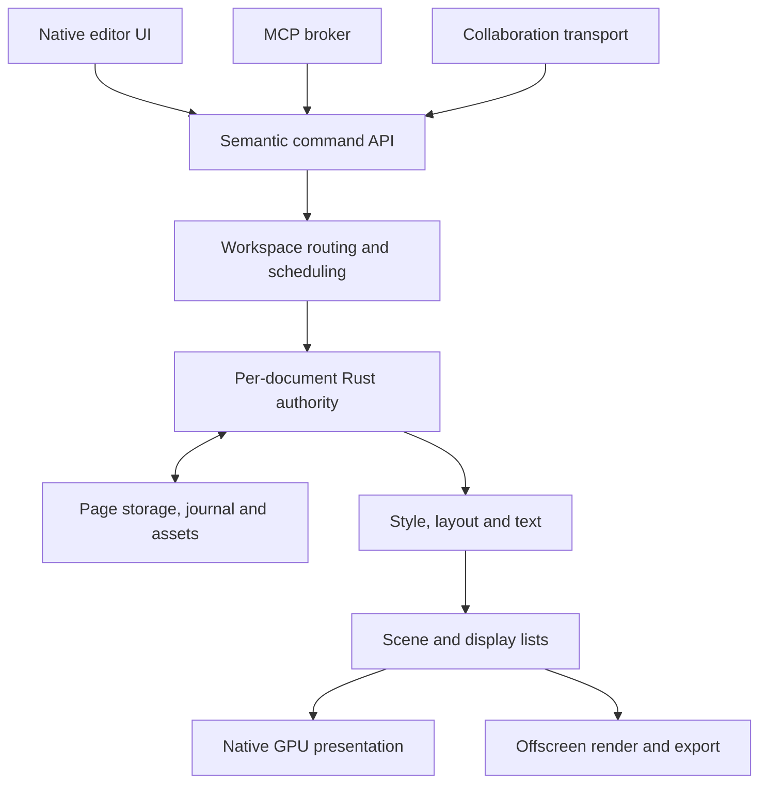

# Native engine rewrite plan

[Current architecture](ARCHITECTURE.md) · [MCP capability map](MCP_PARITY.md) · [Large-document evidence](DESIGN_FILE_IMPORT.md) · [Testing](TESTING.md)

**Decision date:** 2026-11-11.  
**Status:** Product direction accepted; native implementation and performance qualification are pending.  
**Reference baseline:** PR #13, merged as `950dec5f0329de0ee5ece60e5a88b83f083aeffd`; its measured runtime is `cf9f18433924a7d581c815be5df9bfb96505cd75`.

## 1. Product decision

Build Oh My Canvas into a fully local replacement for the agreed Paper design-and-agent workflows, using a native Rust application and an independently owned design engine. A substantial rewrite, including the desktop UI, is within scope.

The completed application must support several heavy documents, responsive MCP operations against foreground and background documents, and four people concurrently editing heavy content. These are architectural requirements and release gates, not features to add after a single-document renderer is finished.

The required production path for editing, layout, text measurement, screenshots, export, MCP and collaboration must operate without Electron, Chromium, browser DOM/SVG rendering or a WebView. Do not reintroduce a hidden browser for background documents, layout or screenshots. HTML/CSS remain important input, inspection and code-export languages; their semantics are implemented by the native design engine.

This decision supersedes the earlier recommendation to retain Electron, the DOM/SVG renderer and a single whole-document Y.Doc as the long-term architecture. Those choices and their measurements remain valid descriptions of the PR #12/#13 implementation. [ARCHITECTURE.md](ARCHITECTURE.md) describes the current runtime; this plan describes its intended replacement. A documentation commit does not mean that the native runtime exists or that the targets below have been achieved.

### Required outcomes

| ID | Requirement | Evidence required for completion |
| --- | --- | --- |
| N1 | Native desktop editing without a required browser engine | Packaged native application and dependency inspection; no hidden editor WebViews |
| N2 | Paper replacement for an explicit, dated workflow inventory | Workflow-by-workflow native UI, MCP, persistence and output evidence |
| N3 | HTML/CSS creates editable, meaningful designs | Structure/style/layout round trips, responsive resizing, tokens and stable identity |
| N4 | MCP works independently of the GUI | Create, query, edit, measure, screenshot, export and collaborate with no GUI process |
| N5 | Several heavy documents remain independently usable | Five- and ten-document workloads with concurrent editing, MCP and background jobs |
| N6 | Four-user collaboration remains usable under load | Four independent clients actively editing, plus agents, slow peers and reconnect |
| N7 | Edits remain durable and recoverable | Termination/restart after durable ACK; interrupted migration, journal and checkpoint cases |
| N8 | Memory and work are bounded across the application | Peak CPU/GPU accounting, budget enforcement, eviction and repeated-navigation stability |

"Paper replacement" is the product goal, not an assertion of present parity. Establish and version the actual Paper workflow inventory in milestone M0. Preserve the existing Oh My Canvas capability set as well; features already supported locally are not implicitly dropped because a reference product has different limits. Tool count, a fast rectangle demo or one attractive screenshot is insufficient evidence.

No hosted account, paid service, cloud database or telemetry dependency is introduced by this architecture. Local collaboration still requires a reachable peer; four-user editing is not a promise of automatic NAT traversal or a hosted relay.

## 2. What the current evidence establishes

The current editor uses a retained DOM/SVG scene. CanvasKit is used for path operations and stroke outlining, including live boolean geometry; it is not the main screen rasterizer. See [rendering](../editor/render/index.ts), [vector operations](../editor/render/vector.ts) and [outlining](../editor/render/outline.ts).

PR #12/#13 already implemented external original-image blobs, changed-path edits, revisioned deltas, a durable append journal, checkpoints, progressive page publication and a first-page reopen cache. Preserve the useful contracts. Do not propose those completed changes as if they were the new native architecture.

The [permanent PR #13 evaluation](qa/pr13-large-document-evaluation.json) records:

| Observation | Recorded value | Qualification |
| --- | --- | --- |
| Verified FIG source | 160,627,671 bytes; 46 pages; 39,363 objects; 160 original bitmap hashes | Structural round trips, not complete visual/source-semantic parity |
| Import first-paint milestone / all pages | 7.346 s / 41.370 s | Shared source graph is decoded before progressive page conversion |
| Cached reopen first-paint milestone / all pages | 0.773 s / 13.380 s | Excludes application launch; not a cold-disk measurement |
| Early reopen edit to observed Stored indicator | 5.504 s | Follow-up ACK/value verification; not isolated disk-write time |
| Drag frame interval p95 / maximum | 83.4 ms / 183.4 ms | Input handler maximum 104.0 ms; no complete per-stage movement profile |
| Page rename paint / durable notification | 520.1 ms / 501.2 ms | End-to-end observations; zero recorded renderer long tasks |
| Fixed viewport mounted content | 6,245 shape elements; 25,351 scene nodes | Specific Examples viewport |
| Aggregate process working-set snapshots | 2,871.1 MiB / 2,987.7 MiB | Separate snapshots after import/gestures, not a peak or memory attribution |

These are observations from one two-logical-CPU Linux/Xvfb runner using software rendering. The paint milestone is an application animation-frame wait, not proof that every image/font decoded or that pixels were presented by hardware. Native comparisons require the same machine, source, fonts, viewport, workload and cold/warm definitions. Do not claim an improvement ratio from unrelated runners.

Code-confirmed remaining costs span several layers:

- [Authority restoration](../electron/document-manager.mjs) waits for the complete stored replica before cached edits can be accepted and saved. [Replica hydration](../core/replica.mjs) applies Yjs state, materializes and validates the document, and can encode full state.
- [Import](../editor/formats/design-file.ts) parses shared source structure before page publication. Parsing already uses a worker, but large-page publication still performs substantial synchronous document work.
- [Draft finalization](../editor/document/draft.ts) still enumerates and can shallow-copy a large page object index. Small gestures can therefore retain page-size-dependent work.
- [Text measurement](../editor/render/text.ts) and scene presentation depend on browser layout/DOM. These dependencies are removed by the native target.

The evidence does not establish DOM, CanvasKit, Yjs or fsync as the sole cause of every delay. The rewrite addresses document ownership, storage granularity, scheduling and rendering together. No language or graphics-library choice alone establishes a latency or memory guarantee.

## 3. Architectural boundaries

This diagram shows responsibility, not a requirement that all boxes share one process or thread. Collaboration enters through the authority's validated merge path; it must not bypass validation or pretend a remote update is a local user command.

| Boundary | Owns | Must not depend on |
| --- | --- | --- |
| Native GUI | Windows, controls, focus, viewport, selection and transient gesture preview | FIG parsing, whole-document restore, disk flush or an MCP job on the input thread |
| Workspace service | Document catalog, ownership, MCP sessions, routing, job cancellation and global budgets | A selected tab, visible editor or one document's long-running handler |
| Document authority | Canonical entities, revisions, semantic commits, page residency, Undo, collaboration and persistence order | Renderer-specific DOM objects or a workspace-wide mutation lock |
| Compute workers | Parsing, decoding, candidate calculation, expensive geometry and checkpoint preparation | Holding the document writer while doing long CPU/I/O work |
| Layout and scene | Derived styles, text layout, spatial queries, display lists and effects | A browser measurement element or a full-document snapshot per pointer move |
| Assets and storage | Immutable original bytes, hashes, journals, checkpoints and recoverable migrations | Original image bytes embedded in routine commands or CRDT fields |
| Render/export | Native screen output, region screenshots and export from coherent revisions | A hidden GUI document or a different text-layout authority |

### Authority and lifecycle

There is one local write authority for a document/profile. GUI, daemon and CLI must discover and connect to it instead of independently opening competing writers. Define document leases, service discovery, worker restart and shutdown behavior before introducing a background service.

Closing a window and quitting the workspace are distinct operations. Closing a view can release rendering resources while MCP/collaboration owners retain the document. Explicit workspace quit drains or reports pending durable work. A process crash must not silently convert accepted-but-unsaved changes into a successful save.

Use independently scheduled document sessions and isolate heavy documents/jobs in worker processes where needed for responsiveness and fault containment. Do not require one permanent process per empty document. Bound the process and worker pools at workspace level.

Each document serializes a short validation/commit/publication section. Heavy preparation runs outside it against a pinned revision; commit checks the relevant revision/dependencies again. Rebase safely or return an explicit conflict when preparation becomes stale. Rust async and actor APIs do not preempt an expensive synchronous library call; such work needs explicit chunking or isolation.

## 4. Semantic document and HTML/CSS contract

### Canonical data

Persist and synchronize the meaning of a design:

- Stable document, page, node, rule, component and asset IDs; parent/child relationships and deterministic ordering.
- Editable shape/path/image/text types, meaningful HTML element metadata and source mappings where applicable.
- Authored styles, units, flex/grid constraints, width/height rules, spacing, overflow, transforms and effects.
- Tokens/CSS custom-property references, shared styles and linked-library relationships.
- Component definitions, instances, variants and overrides, retaining references instead of eagerly duplicating all mutable subtrees.
- Rich-text runs and paragraph structure, font identity and fallback policy.
- Asset hashes, import diagnostics and supported unknown source metadata.

Use compact typed entity storage, stable handles and explicit dependency indexes. Separate canonical semantic properties from geometry caches. Use structural sharing or versioned chunks for coherent read snapshots; do not reconstruct a full page dictionary for each leaf change.

Computed styles, layout boxes, glyph runs, world transforms, spatial indexes, display lists, decoded images and GPU textures are derived data. They are not the primary collaborative document. A reader pins a coherent revision and reports it; snapshot lifetimes and retained memory are bounded.

### Native HTML/CSS pipeline

1. Parse HTML and CSS using native libraries; parsing does not launch a browser.
2. Resolve the declared supported semantics into canonical nodes/styles with stable identity and diagnostics.
3. Compute cascade, inheritance, variables and relevant viewport rules.
4. Run native box and text layout, then derive paint/hit-test data.
5. Render with the native backend. Produce HTML/CSS from semantic data and raster/vector output from the same layout contract.

Define a versioned compatibility matrix covering elements/metadata, inline styles, selectors and cascade, inheritance, units, intrinsic sizing, flex/grid/block/inline behavior, wrapping, fonts, transforms, overflow, masks, blending and effects. Taffy is a layout component, not a complete HTML/CSS engine. Unsupported constructs produce explicit errors or retained diagnostics according to a documented policy; never silently drop them and call the import faithful.

Paper's current HTML paste documentation specifies inline-style and element-conversion limits [S2]. Record a dated reference inventory rather than treating arbitrary browser/JavaScript compatibility as an undocumented promise. The replacement must cover the agreed design workflows and existing local capabilities. A smaller initial compatibility surface is a staged milestone, not permission to declare full replacement early.

### Visual editing and source round trips

Maintain one semantic authority and define how visual edits change authored constraints. Examples:

- Reordering a flex child updates child order; it does not silently convert the entire frame to absolute positioning.
- Editing a parent gap updates that layout property.
- Token changes, shared-style edits and local overrides are separate commands.
- Component source changes and instance overrides remain distinguishable.
- Resizing a constrained element deliberately changes width, flex basis or min/max constraints according to the command's documented intent.

HTML/CSS export preserves meaningful layout relationships, token references and structure where supported. Include stable node/source mappings so an agent can update existing content without deleting/recreating every node. Computed-style inspection should identify the authored value, winning rule or token, viewport and revision where relevant.

The initial round-trip contract is semantic preservation and stable identity. Byte-identical preservation of arbitrary source whitespace/comments requires a separate source-preservation design. JSX output represents supported static structure/components; it does not reconstruct arbitrary application logic.

Acceptance includes HTML input → native editing → HTML/CSS export → reimport, and changing representative artboard widths from 1440 to 768 to 390 while preserving intended layout rules. Test matching source, fonts and viewport against reference output. A browser may be used by external compatibility tests; it is not a production runtime dependency.

## 5. Native layout, rendering and interaction

### Proposed implementation stack

The native runtime decision is firm. Exact libraries, versions and adapters remain subject to an implementation spike and feature evidence.

| Area | Preferred starting point | Qualification needed |
| --- | --- | --- |
| Window/event loop | winit | Input, window lifecycle, multiwindow, HiDPI, native menus and platform integration |
| Semantic core | Project-owned Rust crates | Commands, identity, dependency tracking, validation, snapshots and storage |
| HTML/CSS | html5ever/Stylo or appropriate modular equivalents | Supported parsing/cascade semantics and controlled resource access |
| Box layout | Taffy, integrated with the engine's own entities/cache | Intrinsic sizing, constraints, flex/grid and dirty dependency propagation |
| Text | Parley or a qualified native text stack | Shaping, line breaking, fallback, bidi, rich text, selection and output consistency |
| Graphics | Native Skia, with Metal as the first macOS backend candidate | Masks/effects/blending, text, resource lifetime, GPU presentation and export |
| Accessibility | AccessKit plus platform integration | Meaningful nodes/actions, focus, keyboard and required text semantics |
| CRDT | Yrs is a candidate | Actual Yjs data/schema/encoding/origin compatibility and sharding rules |

Winit supplies windows/events, while the graphics backend draws [S3]. Native Skia exposes native GPU backends through Rust bindings [S4]. Taffy supplies CSS layout algorithms [S5]. Blitz demonstrates a modular native HTML/CSS composition, but its beta status and feature gaps make direct adoption a hypothesis to test, not a finished editor [S6, S7].

GPUI is a possible native controls framework, not a substitute for a qualified design-canvas compositor [S8]. If a separate renderer is embedded, prove efficient surface/texture interoperability; do not copy a full GPU canvas through CPU memory every frame. Vello is an alternative renderer to compare after checking its current feature and maturity matrix [S9]. Do not make a custom low-level rasterizer a prerequisite for delivering the document engine.

Tauri is not the target UI foundation because its standard application model renders UI through a WebView [S10]. Desktop builds use native compilation. WASM can be a later shared-core target; it is not the performance mechanism or a required desktop layer [S11].

### Incremental frame work

Retain scene/display data and track dirty entities, bounds and dependency groups. Use spatial indexes for hit testing, snapping and viewport queries. Pan/zoom changes camera state and invalidates only necessary preparation. Leaf edits update the affected geometry/layout/paint range; global style or component changes may legitimately affect many nodes and must be scheduled accordingly.

Paint visibility and layout dependency are different. Offscreen content can affect intrinsic size, text flow, masks, shadows and backdrop effects. Keep required dependencies correct while culling safe paint work. Handle oversized effect surfaces and large export dimensions through bounded preparation/tiling where valid, with explicit limits for unsupported cases.

Pointer movement uses transient gesture state and immediate native feedback. Avoid page-map copies, full source serialization and synchronous service round trips on every movement. Define when a gesture becomes a canonical command, how previews are reconciled after remote changes and how cancellation/Undo works. Live collaboration previews are ephemeral; durable edits have their own ordered publication path.

### Native text and UI obligations

Implement focus, keyboard navigation, clipboard, drag/drop, caret placement, selection, Korean and other IME composition, grapheme-aware navigation, font fallback and accessibility. Composition is a transaction with explicit interaction rules; a remote change must not silently destroy an active composition.

Preserve the current MCP UTF-16 text-range contract or introduce an explicit API version. Rust UTF-8 byte offsets, Unicode scalar counts, UTF-16 offsets and user-visible graphemes are different units. Test Korean composition, emoji/surrogate pairs, combining marks, bidi and rich-text range edits at the API boundary.

Screen layout, hit testing, screenshots and export use the same font/layout contract. Track font identity and substitution diagnostics. AccessKit is an integration component; the application must still provide the semantics and qualify the required text/accessibility behavior [S12].

## 6. Multi-document execution and memory

An open document does not imply that every page, layout, image and render surface is resident. Keep a small catalog and dependency metadata, then load canonical pages/chunks and derived resources according to actual editing, inspection and export demand.

Schedule across both document and participant. Prioritize interactive work without starving remote edits, durable saves or background progress. Separate bounded queues for reads, short commits, imports, image/font decoding, thumbnails, exports and checkpoint preparation as needed. A large export in document B must not hold a global lock that blocks an edit in document A.

Publish a budget model before qualifying the ten-document workload:

| Resource | Budget behavior |
| --- | --- |
| Resident canonical pages/chunks | Evict only reloadable durable state; keep required dependencies and pending writes |
| Revision snapshots and Undo | Bound pins/retention explicitly; do not delete history merely because content is offscreen |
| Decoded CPU images/fonts | Account by decoded bytes, choose appropriate image resolution, deduplicate compatible resources |
| GPU textures/glyphs/effect surfaces | Track device allocations, enforce cache budgets and release unused resources |
| Import/export intermediates | Limit concurrent jobs and buffered data; support cancellation and backpressure |
| Collaboration buffers | Bound per-message, per-peer and aggregate in-flight state independently of file budgets |

Enforce an application-wide ceiling and per-document allocations. Shared original assets should avoid duplicate disk storage; compatible decoded resources may also be shared. Report process peaks and GPU allocations separately, noting shared-memory accounting limits. Return an explicit queue/progress/limit state under overload instead of allowing unbounded growth.

A native language does not eliminate decoded image memory or the cost of keeping several document representations. The acceptance condition is measured bounded behavior, not an assumed memory reduction from removing Electron.

## 7. Headless MCP as a core product interface

MCP calls the same semantic service as the native UI. It must not dispatch through a selected tab, execute JavaScript in an editor or require a hidden view. Existing [MCP capabilities](MCP_PARITY.md) and [transport/session contracts](MCP.md) are migration inputs. The current catalog has 50 tools at the reference revision; completion is assessed per capability, not by counting names.

### Request and result contracts

- Require explicit document targeting and stable page/node IDs. Aliases remain scoped to the caller and relevant document/page generation.
- Support bounded field selection, depth, pagination and region queries. Return the pinned revision and loading/completeness state.
- Apply writes using expected revisions or field/dependency preconditions; define meaningful conflicts rather than overwriting unseen work.
- Make a validated batch one semantic transaction with clear size/work limits and all-or-nothing local publication.
- Use idempotency keys scoped to caller/document/operation. Bound result retention, expose its lifetime and provide readback for uncertain outcomes.
- Distinguish accepted, locally durable and replicated status. A transport response or visible preview is not a durable save acknowledgment.
- Carry cancellation and deadlines through broker, worker and compute stages. Cancellation before commit prevents mutation; a committed operation is not silently undone because a response was lost.
- Give long import/export/render jobs explicit IDs, progress, result lookup and bounded output. Prefer resources/files for large outputs rather than unlimited inline base64.
- Keep Undo attribution and transaction groups for people and agents. An agent must not consume another author's history.

### Interaction and isolation

Read queries stay available during a human gesture/composition. The initial compatibility behavior may return a scoped busy result for conflicting writes. Finer concurrency requires an explicit node/property dependency policy; do not weaken it accidentally or freeze unrelated documents with a workspace-wide busy flag.

Semantic reads do not wait for GPU presentation. Layout-dependent queries compute the necessary dependency closure against a coherent revision. Screenshots target a document/page/region/revision and use the native offscreen renderer without focusing a tab. Report resource or font readiness rather than returning misleading blank output.

The MCP broker remains responsive while individual documents load or recover. Preserve authenticated loopback access, transport pinning where applicable, sender checks, scoped local file access and separation from collaboration credentials. The native rewrite must not widen MCP into a LAN-facing endpoint or silently rewrite global client configuration.

The decisive test runs the document service and real MCP clients with no GUI process. It creates and edits multiple documents, loads resources, measures, captures screenshots, exports, saves, reopens and joins collaboration using the same engine APIs as the UI.

## 8. Four-user collaboration and document partitioning

Four users means four independent client processes actively editing heavy content, with other heavy documents and MCP work running. Multiple agents on a peer have distinct command attribution; they must not be mistaken for additional independent human replicas.

### Replication model

Synchronize authored structure, styles, text and semantic changes. Derive layout and GPU resources locally. Define schema/layout versions, font identity and deterministic geometry policies so equal supported inputs can be meaningfully compared across peers.

Set the same-text concurrency policy in M0. The current application resolves rich-text content as an atomic shape property; it does not provide character-by-character coediting. Any required character/range coediting is an explicit native schema and command deliverable, including concurrent formatting, offsets, IME reconciliation and Undo. Choosing Yrs alone does not supply those semantics. An intermediate implementation retaining atomic text must disclose that limitation and cannot establish richer text parity.

Use a small document catalog, independently loadable page or bounded-subpage shards, and explicit shared-component/style dependency indexes. Evaluate Yrs against actual legacy state and the selected update encoding/version [S13]. Moving a monolithic Y.Doc into a monolithic Rust document alone does not satisfy independent page loading.

A peer must be able to durably receive unloaded shard updates without materializing every page. Define causal dependency checks, catch-up indexes and safe compaction. Retain the information required by disconnected peers and Undo; garbage collection cannot consider visible content alone.

Track received/durably staged, semantically validated and applied/published states separately. A transfer acknowledgment for staged bytes does not claim that an edit has passed dependency validation or become visible. An edit-durability acknowledgment follows the validated recoverable commit contract; loading fewer pages must not weaken that guarantee.

### Cross-shard semantic transactions

Page moves, component changes and grouped edits can span shards. Specify a transaction envelope with identity, author, affected shards, causal dependencies and ordered fragments. Locally, record all required changes and a recoverable commit decision before issuing a durable ACK. Readers observe a coherent committed revision.

A receiver stages incomplete fragments and publishes the corresponding complete projection only after required dependencies are available. Bound staging and recover from missing fragments or interrupted transfers. This provides application-level coherent publication; it does not automatically provide globally serializable distributed transactions. Offline peers may create conflicting operations. Define deterministic ownership, ordering, deletion and reference conflict rules and test them.

Do not wait for every peer before acknowledging a local durable save. A slow/disconnected peer must not prevent local editing. Cross-document copy/import creates independent identities; atomic cross-document move/delete is not implied by the cross-page design.

### Undo, presence and transport

Undo is author/group-aware and operates against current merged state. A multi-page user command remains one intended Undo group; compensating changes must preserve other authors' work. Never restore a stale whole-page snapshot over newer remote edits.

Cursor/selection/gesture previews are ephemeral and independently coalesced. Durable semantic updates use bounded transfer, explicit ordering/dependencies and verified resource hashes. Assets become usable only after validation and persistence required by the transaction contract.

Use versioned invitations/protocols with explicit compatibility or rejection. Preserve the existing separation between local MCP and peer collaboration. Reachability, host loss and rehosting behavior must be documented; four-client local tests do not prove arbitrary internet connectivity.

## 9. Persistence, import and compatibility

### Working storage

Store a versioned small catalog plus independently recoverable page/chunk snapshots and journals, with immutable resources addressed by content hash. Keep portable export separate from the working representation. Normal edits append bounded semantic/state changes; checkpoint/compaction preparation runs outside the input and short commit paths.

For a loaded page, accepted edits must not depend on restoring unrelated pages. Its required cross-page dependencies must nevertheless be available and valid. A first-page preview cache alone does not satisfy this property.

Preserve distinct milestones for first usable content, command acceptance, local durability, replication and complete document availability. A Stored indicator follows a recoverable durable commit. Test process termination at each journal/checkpoint/manifest transition, including truncated final records, complete corrupt records, missing assets and obsolete snapshots.

### Migration and legacy interoperability

Provide explicit readers/converters for legacy portable OMC v1/v2/v3, portable v4 packages and the current working manifest/checkpoint/journal/blob representation. Use current code and [storage documentation](ARCHITECTURE.md#working-storage-and-portable-files) as the authority for exact formats; historical root documents contain older limits and protocol descriptions.

During development, migration writes and verifies a new representation while retaining a recoverable original. Do not overwrite the only old copy. Record source/version/checksums, completion state and known semantic losses. Identity-preserving import and independent-copy import are distinct operations. A schema or CRDT reseed must explicitly define what happens to merge identity, history and old peers.

Qualify supported legacy files and new exports with clean-profile round trips. Mixed old/new collaboration needs a deliberately designed bridge or an explicit refusal; do not claim wire compatibility from the library name alone.

### FIG, Sketch and source fidelity

Native import is part of the rewrite. Separate archive decode, shared-graph parsing, semantic conversion, asset ingestion, page publication and layout metrics. Reuse valid independently authored knowledge and fixtures; do not freeze known converter losses as the desired behavior.

The source format may require shared decompression/graph work before a page can be decoded. Investigate indexing/streaming where possible without promising arbitrary random access. Native working files must have efficient independent reopen even when first-time foreign import remains more expensive.

Preserve or explicitly diagnose source components/instances/overrides, variables, masks, mixed text, transforms, boolean semantics, blending, effects and fonts. Compare representative source frames with matching fonts and dimensions. Page counts and image hashes are necessary integrity checks, not proof of visual or semantic fidelity.

## 10. Capability coverage and migration rules

M0 must create a dated coverage matrix combining the Paper workflow inventory, the current [MCP map](MCP_PARITY.md), the [behavior inventory](independent/behavior-contract.md) and actual current code. Reconcile historical limits and stale completion labels rather than copying them into the new contract.

| Capability family | Native coverage required |
| --- | --- |
| Workspace | Library, tabs/windows, background documents, search, create/rename/duplicate, save/close/recovery |
| Geometry and drawing | Shapes, frames, paths, nodes/handles, transforms, ordering, groups, booleans, outlines and hit testing |
| Text | Rich text, paragraphs/lists, typography, native IME, selection, clipboard and range APIs |
| Layout | Flex/grid, sizing/constraints, gaps, guides, snapping and responsive semantics |
| Components | Definitions, instances, variants, typed properties, overrides, nested dependencies and libraries |
| Appearance/resources | Images, crop/fit/adjustment, fonts, shared styles/tokens, masks, blending and effects |
| Interchange | HTML/CSS and SVG input/output, FIG/Sketch conversion, OMC/JSON migration and raster/PDF export |
| Agent workflows | All supported inspection/edit/export/workspace/collaboration operations, attribution and repeatable results |
| Collaboration | Four active users, presence, concurrent semantic edits, author Undo, offline work and reconnect |
| Desktop integration | Keyboard/focus, native dialogs, menus, clipboard, accessibility, packaging and platform availability |

Any additional Paper workflow required for replacement must be explicitly added with its acceptance evidence. Do not claim implementation parity because a command name exists. Qualify runtime behavior, persisted data, collaboration and exported output as applicable.

The old renderer can remain temporarily as a compatibility/reference harness during development. It is not a permanent production fallback that satisfies N1. Default-runtime replacement happens after native correctness, capability and workload gates pass. Preserve licenses and implementation provenance; retired company source and copied tests remain excluded.

## 11. Delivery milestones

Organize substantial milestones into reviewable PRs with smaller commits. A milestone can require multiple PRs; numbers and dates are not assigned in advance. Every milestone below is pending native implementation at the time this plan is written.

| Milestone | Deliverables | Exit evidence |
| --- | --- | --- |
| M0 — Contracts and workload | Dated capability matrix, command/data schemas, decisions for ownership/shards/text concurrency/compatibility, reproducible baseline and native dependency evaluation | Real fixture identified; unsupported areas explicit; no hidden browser dependency in target |
| M1 — Headless workspace and persistence | Rust workspace/document service, worker isolation, canonical entities, validated commands, revision snapshots, assets, durable journal/recovery and initial MCP | GUI-free create/read/edit/Undo/save/reopen across two independent documents; lost-response/cancellation/recovery checks |
| M2 — Native style/layout/scene foundation | HTML/CSS mapping, text layout, scene/spatial indexes, native screen/offscreen drawing and resource budgets | Actual imported page with native selection/drag/text editing; headless layout/screenshot/export; semantic HTML round trips |
| M3 — Partial residency and collaboration | Page/subpage storage, dependency catalog, causal transaction staging, native replication, grouped Undo and offline catch-up | Four active clients; loaded-page durability independent of unrelated restoration; multi-shard crash/rejoin cases |
| M4 — Complete native editing and MCP coverage | Native workspace/panels/tools, full required feature families, text/IME/accessibility, legacy/foreign interchange and remaining MCP adapters | Capability matrix evidence; matching UI/MCP results; representative source fidelity and clean-profile round trips |
| M5 — Heavy-workload qualification | Five/ten documents, concurrent background jobs, MCP and four-client editing; bounded CPU/GPU resources; packaged platform runs | Repeated native performance results and correctness gates under combined load, with exact revisions and environments |
| M6 — Runtime transition | Versioned migration, recovery/rollback procedure, native default packaging, documentation and removal of required browser runtime | Qualified native release candidate; recoverable user-data transition; no remaining required WebView/Chromium execution path |

After M0, independent rendering, persistence and MCP work can proceed in parallel against the common command/schema contract. Collaboration invariants inform M1/M2 from the start even though their full acceptance is in M3. Each PR records changed contracts, preservation evidence, performance scope and remaining gaps. Implementation PRs must not mark future milestones complete based only on scaffolding.

The first native vertical journey uses a real page and real content: open → select/drag → rename/edit text → Undo → durable save → reopen → equivalent MCP operations in two documents. This establishes integration; it is not the final scope or proof of full Paper replacement.

## 12. Performance and correctness acceptance

### Workload matrix

Use the verified [large FIG fixture](../fixtures/design-files/README.md), smaller real designs, and deterministic synthetic cases with deep nesting, heavy text, effects and at least 100,000 objects. Test both shared-image copies and documents with distinct images/fonts so asset deduplication does not hide memory pressure.

| Workload | Required concurrent activity |
| --- | --- |
| W1 — Single heavy document | First import/reopen, page navigation, pan, drag, rich-text editing and durable save |
| W2 — Five then ten heavy documents | Foreground interaction while another imports and another exports/checkpoints; MCP queries/writes across documents |
| W3 — Four-user heavy collaboration | Four separate processes actively editing the same heavy document, with additional open documents and MCP work |
| W4 — Conflict and interruption | Same/different-node edits, same text, component updates, page moves, Undo, slow peer, disconnect/rejoin and worker/app termination |
| W5 — Headless operation | Real MCP transport with no GUI process; parallel document edits, resource import, layout, screenshots, exports and collaboration |
| W6 — Resource endurance | Repeated full page traversals, tab switches and import/export cycles; CPU/GPU peak and steady-state memory |
| W7 — Compatibility and fidelity | Legacy/new storage round trips, representative source frames, HTML/CSS semantic round trips and supported platform behavior |

Four connections without editing do not satisfy W3. A synthetic scene does not replace the real fixture. A warm repeated asset set does not replace distinct-resource tests. Record network latency/bandwidth for collaboration and distinguish local-LAN qualification from remote internet behavior.

### Proposed performance gates

These are initial engineering targets, not measured achievements. M0 must bind them to named reference hardware, OS/build, display/DPI/viewport, font set, dataset, operation size and background workload. Changes to a target require a recorded product decision; do not silently weaken it to make a run pass.

| Concern | Initial target and scope |
| --- | --- |
| Ordinary native pan/drag | At 60 Hz, frame interval p95 ≤16.7 ms and p99 ≤33.3 ms on the defined interactive workload; also report input-to-presentation latency and missed refreshes |
| Small MCP requests | End-to-end p95 ≤100 ms for already resident bounded queries and small edit acceptance, including queueing; cold-load/large-layout operations reported separately |
| Small edit durability | p95 ≤500 ms from edit submission to verified local durable acknowledgment, including queue time |
| Background interference | Preserve the defined interaction/MCP/save gates while other documents import/export/checkpoint; report same-document dependencies separately |
| Open/reopen | Report first usable page, first fully ready viewport, first durable edit and all-content completion separately; set native cold/warm thresholds after M0 measurements |
| Memory | Enforced workspace-wide budgets, measured peak CPU/GPU resources and no unexplained continuing steady-state growth across repeated traversals |
| Collaboration | All four clients stay editable under W3; record local/remote propagation p50/p95/p99, queue growth and convergence separately from network transit |

Use actual native timing/presentation instrumentation where supported. An animation callback or the reciprocal of an automated event interval is not hardware FPS. If a larger supported operation genuinely invalidates many nodes, report its own workload class and its interference with ordinary interaction.

Measure parser, conversion, authority load, validation, layout, text, scene preparation, GPU submission/presentation, MCP queue/service/round trip, journal/flush and replication phases separately. Fix the sample count and warmup policy before comparison; include repeated runs, p50/p95/p99 where meaningful, maxima and failures. Publish exact tested revision, fixtures/hashes, hardware, software, workloads and measurement definitions. Preserve sanitized results alongside the implementation evidence.

### Correctness gates that cannot be traded for speed

- ACKed edits survive forced termination and clean-profile reopen; accepted-only changes are never reported as durable.
- Native/legacy round trips preserve supported structure, stable identity, required assets and explicitly covered semantics.
- Four peers converge after concurrent edits and reconnect; author Undo preserves other participants' changes.
- A page can save while unrelated content is loading without treating a disposable preview as authoritative.
- Required HTML/CSS layout meaning survives UI edits, MCP edits, export and reimport.
- Screen, hit-test, screenshot and export coordinates/text agree within declared tolerances.
- Unsupported source semantics, missing resources and font substitution are visible diagnostics.
- Memory eviction, background cancellation and partial loading cannot silently omit content from a complete export.

## 13. Decisions to close during implementation

The following require measured or compatibility evidence. They do not reopen the accepted native product scope.

| Decision | Required evidence |
| --- | --- |
| Native renderer and controls framework | Feature matrix, complex source scenes, input/IME, GPU resource sharing and platform build evidence |
| CSS/text implementation and support level | Paper/current-app workflow matrix, source round trips, shaping/line-break/fallback tests |
| Page/subpage shard boundary and CRDT | Cold/warm restore, concurrent edits, cross-page transactions, existing-file compatibility and retained-history budgets |
| Document worker isolation | Fault recovery, queue fairness and measured process/IPC overhead across five/ten documents |
| Concrete memory budgets | Reference-machine peak attribution, distinct assets, effect surfaces and eviction behavior |
| Protocol/storage migration versions | Explicit compatibility policy, reversible conversion and mixed-version behavior |
| Background service lifetime | Window close versus workspace quit, owner leases, MCP reconnect and durable shutdown behavior |

No native speedup, full source fidelity, packaged release date or completed Paper parity is claimed by this plan. Completion means the native implementation passes the declared feature, recovery and combined-workload evidence gates.

## 14. References and scope of external evidence

External sources below were reviewed on 2026-11-11. They establish available building blocks and reference-product behavior, not Oh My Canvas performance. Recheck versions and capabilities when pinning dependencies.

- **S1 — Paper MCP:** [Official documentation](https://paper.design/docs/mcp). Reference for design inspection, mutation and code/agent workflows.
- **S2 — Paper HTML input:** [Paste from HTML](https://paper.design/docs/paste/html). Its documented input/conversion limits must not be confused with full browser compatibility.
- **S3 — Winit:** [Official API documentation](https://docs.rs/winit/latest/winit/). Native windows/events and access to graphics handles.
- **S4 — Native Skia:** [rust-skia repository](https://github.com/rust-skia/rust-skia). Rust bindings and native GPU backends; specific adapters still need qualification.
- **S5 — Taffy:** [Official API documentation](https://docs.rs/taffy/latest/taffy/). CSS box-layout algorithms and integration APIs.
- **S6 — Modular native HTML/CSS:** [Blitz repository](https://github.com/DioxusLabs/blitz). Native component composition and stated beta status.
- **S7 — Blitz support gaps:** [CSS implementation status](https://blitz.is/status/css). A starting point for compatibility evaluation, not a substitute for our tests.
- **S8 — Native UI alternative:** [GPUI examples](https://gpui.rs/examples/). Browser-free UI construction; a design-canvas renderer remains a separate integration responsibility.
- **S9 — Renderer alternative:** [Vello README](https://github.com/linebender/vello/blob/main/README.md). Distinct implementations, features and maturity profiles.
- **S10 — Tauri boundary:** [Process model](https://v2.tauri.app/concept/process-model/). Standard UI rendering through operating-system WebViews.
- **S11 — WebAssembly:** [Official overview](https://webassembly.org/). Compilation/execution target; not a standalone document or graphics architecture.
- **S12 — Accessibility:** [AccessKit architecture](https://accesskit.dev/how-it-works/). Semantic tree/platform integration and current scope.
- **S13 — CRDT candidate:** [Yrs documentation](https://docs.rs/yrs/latest/yrs/). Compatibility must be verified against selected versions and actual project state.
- **S14 — Text candidate:** [Parley repository](https://github.com/linebender/parley). Native rich-text layout components; required editing behavior still needs integration.

Project evidence: [current architecture](ARCHITECTURE.md), [MCP capability map](MCP_PARITY.md), [PR #13 measurements and limits](DESIGN_FILE_IMPORT.md#progressive-native-validation), [permanent evaluation](qa/pr13-large-document-evaluation.json), [real fixture](../fixtures/design-files/README.md), [implementation provenance](independent/PROVENANCE.md).
