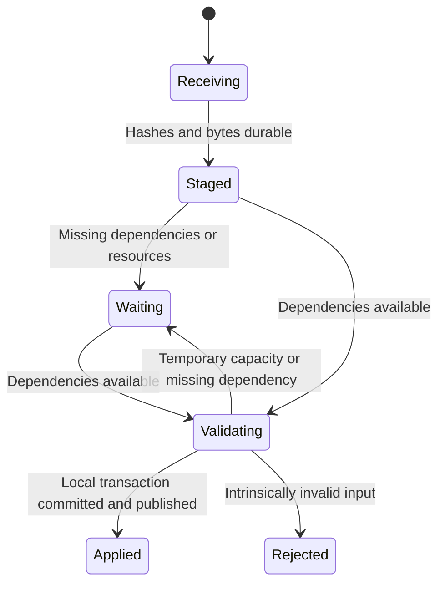

# Native storage and collaboration

[Implementation guide](IMPLEMENTATION_GUIDE.md) · [Engine contracts](ENGINE_CONTRACTS.md) · [Qualification](QUALIFICATION.md) · [References](REFERENCE_PROJECTS.md)

**Status:** proposed native storage/protocol v1; unimplemented. **Decision baseline:** 2026-11-11. This specification chooses a default architecture rather than leaving storage selection to an unspecified future rewrite. MUST/MUST NOT requirements apply to its implementation. Existing Electron/Yjs files remain the migration source, not evidence that this design already works.

## 1. Selected persistence model

Use one SQLite database per native document, WAL mode and `synchronous=FULL`, plus immutable content-addressed asset files shared by a local profile. A separate workspace SQLite database owns local folders, archive state, document discovery and service leases. All databases are local files on a supported filesystem; a network-mounted database or externally synchronized live WAL is not supported. Portable export is the transfer/backup interface.

SQLite WAL supports concurrent readers with one writer and has checkpoint/reader-lifetime constraints [S1]. The document authority owns that writer. SQLite transactions do not create atomicity across separate document databases [S1, S3]; this is why all shards of one document share its database. Cross-document copy/delete is explicitly not one atomic distributed transaction.

Proposed layout:

```text
profile/native-v1/workspace.sqlite
profile/native-v1/documents/<document-id>/document.sqlite
profile/native-v1/assets/sha256/<first-two-hex>/<full-hash>
profile/native-v1/staging/<authority-instance>/<job-id>/
```

The corresponding SQLite `-wal`/`-shm` files are managed by SQLite, not manually truncated or copied as a backup algorithm. Runtime descriptors and credentials are separate from document data. The workspace index is reconstructible from document catalogs; it is not a second authority for shape data or document titles.

### Connection setup and version pinning

Bundle a qualified SQLite build and record `sqlite_version()`, `sqlite_source_id()` and compile options in the build evidence. Require the documented WAL-reset fix: SQLite 3.51.3 or later, or a specifically verified upstream backport; do not silently use an older system library [S1]. Startup executes and reads back:

```sql
PRAGMA journal_mode = WAL;
PRAGMA synchronous = FULL;
PRAGMA foreign_keys = ON;
PRAGMA wal_autocheckpoint = 0;
PRAGMA busy_timeout = 50;
```

Read back connection-local settings on every writer connection. A wrong/ignored setting fails writable open. Use platform-qualified full-sync settings where supported, including the macOS VFS path. FULL WAL commits provide stronger power-loss durability than NORMAL according to SQLite; hardware/filesystem honesty still bounds the guarantee [S2]. Qualification includes actual process termination and platform recovery, not a mock successful `fsync`.

## 2. Tables and durable boundaries

The following logical tables are required; migrations may refine column types/indexes without changing the contract. SQL identifiers are implementation names, not a public query API. Enable constraints and bounded decoding for every serialized field.

| Table | Required keys and content |
| --- | --- |
| `document_meta` | Singleton document ID, native epoch, schema versions, committed local sequence, title, origin/migration data |
| `shards` | Shard ID, kind, stable root/type declarations, checkpoint generation, causal frontier and load diagnostics |
| `transactions` | Unique transaction ID, local publication sequence, origin replica/counter, author/group, causal dependencies, member manifest and payload digest |
| `shard_updates` | `(shard_id, transaction_id, ordinal)`, encoding version, immutable update bytes, digest and length |
| `shard_checkpoints` | Shard/generation, covered transaction cut/frontier, immutable bytes and digest; multiple generations allowed |
| `entity_versions` | Entity ID, valid-from publication sequence, compact authored projection/tombstone; index `(entity_id, sequence)` |
| `node_routes` / `dependencies` | Entity home shard, parent/child/definition/resource edges, valid-from publication sequence and tombstones; derived, rebuildable versioned indexes |
| `asset_refs` | Hash, byte length, media type, referencing shard/transaction and retention class |
| `operation_results` | Durable principal/document/target-epoch/idempotency key, request digest, transaction/result revision and compact result/tombstone |
| `inbox_transfers` / `inbox_fragments` | Transfer ID, sender/epoch, manifest, received hashes, durable staging state and bounded fragments |
| `peer_frontiers` | Peer ID, reserved CRDT client ID, received/applied progress, compatibility and membership status |
| `jobs` / `snapshot_pins` | Resumable intent, publication cut, retained generations, cancellation/result state and expiry |

One `transactions` row and its shard updates, entity projections, dependency changes, resource references and idempotency result commit together. They cannot be acknowledged separately. A SQLite local sequence is not a cross-peer version; use causal frontiers and transaction identities for synchronization.

Text projections reference persistent text state/rope chunks rather than rewriting the entire string into every node row. Editing one leaf updates its own version and affected indexes/dependencies. Imports and initial trust boundaries validate their full input; ordinary local edits validate their changed/dependency closure. Do not rescan every page to validate a scalar edit.

`entity_versions` and immutable checkpoints provide historical material for bounded read snapshots. Capture a publication cut with a short database read and then read immutable/versioned data for that cut. Parent/child membership, home routes, definition and resource dependencies MUST resolve at the same cut; current-only indexes cannot select the closure of an older export or cursor. Either query versioned indexes at that cut or derive the closure from its immutable snapshots. Pin that historical resource/definition closure before releasing its source generations. Long exports must not hold a SQLite read transaction open for their complete duration. Retain the necessary generations/versions through explicit pins, then reclaim after pins release.

## 3. Independently loadable shards

A small catalog shard stores page identities/order and global declarations. Page content initially groups into stable home shards, targeting at most 4,096 nodes or approximately 4 MiB encoded current state before assigning subsequent new nodes to another shard. These are allocation targets, not a guarantee about historical CRDT size or RAM. Large text/resource-heavy nodes may have dedicated shards. The initial 64 MiB encoded-state threshold controls **local write admission and maintenance**, not semantic validity of a remote merge. Refuse an additional local change that crosses it, preserving current data. Independent offline histories can each fit and exceed it when combined; retain such valid remote updates, mark `capacity_wait`, and schedule isolated merge/maintenance with workspace admission. If current resources cannot materialize them, keep durable staging, pause new writes to affected shards and report the blocked closure; never reject valid history as malformed, advance its applied frontier or claim convergence. A later adequately provisioned merge or explicit generation migration must preserve all staged edits. Workspace memory and wire-decoder limits are separate.

Node home shards remain stable across page moves. Placement changes logical ancestry, while `node_routes` locates the node's persistent state. Destination pages load the moved nodes' required home shards; they do not copy/reseed text CRDT items. Deleting a page does not immediately delete home shards that another page or retained history needs. A rebalance/repartition that changes CRDT identity requires an explicit generation transition; it is not an invisible optimization.

Catalog declarations and persisted indexes let the engine discover a requested page's root, node homes, components, styles and assets without decoding all document shards. Load only that dependency closure. Shared definitions use dedicated shards; invalidation identifies dependent nodes, with layout/paint derivation deferred until needed. An offscreen dependent node can remain unrendered, but its semantic export cannot omit an applicable definition change.

A loaded page is editable once its required authorities and dependencies are validated. It must not wait for restoration of unrelated pages. A structurally large edit may legitimately expand its dependency closure; return a job/progress state rather than disguising that as a constant-time leaf change. Imports can publish a complete validated page while other pages remain explicitly unavailable.

### Yrs adapter defaults

Use a version-pinned Yrs adapter initially, with a declared update encoding (`yrs-update-v1`), UTF-16 text offset mode and predeclared root types for operation records, retractions, text containers and marks. Native synchronization is `omc.sync/1`, **not** the old application's collaboration protocol v3.

Yrs version/features are part of the protocol profile. Current documentation distinguishes newer client-ID defaults from the `small-client` compatibility feature [S5]. The first adapter profile uses that feature for a 32-bit client-ID domain and explicitly tests legacy Yjs 13 input; it does not imply native-schema compatibility. Reserve a distinct client ID for each document replica in membership metadata. Agents on one replica use author origins, not additional CRDT writers. An imported archive obtains a new replica identity/client reservation before independent collaboration writes.

Detect duplicate client/replica identities with divergent counters before merging. Do not fix already divergent histories by merely changing a client ID. Preserve both copies and require an explicit recovery/conversion operation. Reuse of an existing profile on another machine must not create two writers with the same durable replica identity.

## 4. Local command, assets and commit algorithm

This algorithm is the default for a durable native write:

1. Authenticate/attribute the caller; validate the envelope, mandatory target epoch, capabilities and request limits. Reject a stale epoch before deduplication. Look up its idempotency key before doing expensive work.
2. Capture a committed snapshot; resolve its read/dependency set and prepare a semantic candidate outside the writer. Validate changed values, topology/dependency closure and resulting capacity. Structural/import operations carry their broader validation scope explicitly.
3. Ingest new resources into same-filesystem staging files. Hash and validate bytes/type/length, flush the file, atomically install the content-hash filename and sync required directories. If a hash already exists, verify its expected bytes/length. Do not overwrite a different payload under the same hash.
4. Enter the short document commit gate. Recheck dependency versions and cancellation. Resolve conflicting pending/committed idempotency requests. Reserve the next local sequence/operation counters provisionally.
5. Apply the prevalidated primitives to the affected in-memory CRDT adapters, capture exact updates and build the final changed projection. These changes are **unpublished**: no normal reader, peer broadcast or success response may observe them. Validate their actual resulting projection against the prepared semantic delta. Large merges/imports must construct isolated affected-shard candidates outside the gate and recheck their base before swapping; only bounded ordinary mutations use this in-gate path. Do not put a seconds-long `apply_update` behind the label “short commit.”
6. `BEGIN IMMEDIATE`; insert the transaction, shard updates, changed entity/index rows, asset references and operation result, then `COMMIT` with FULL synchronization. Allocate committed counters in this same transaction. The transaction touches one document database.
7. After successful COMMIT, atomically install the new engine snapshot, advance the published revision, enqueue peer transmission and return the durable result. Layout/render preparation follows independently unless a request explicitly requires it.

SQLite commit is the durable decision. Yrs mutable transactions commit on drop rather than rolling back on an application validation exception [S5]. If steps 5/6 fail, discard/rebuild the affected unpublished adapters from the last committed checkpoint/update cut before another write. Keep the previous public snapshot available; do not publish a compensating half-edit. If memory publication fails after SQLite commit, restart that document worker and reconstruct from disk; operation lookup must return the committed result.

If COMMIT has an uncertain I/O outcome, reopen/recover through SQLite and consult the transaction/idempotency ledger before retrying. A generic exception is not evidence that the operation did not commit. File resources installed before a failed database transaction are harmless unreferenced candidates for later collection, not proof of a successful edit.

Large validated snapshot imports use a private staging generation and explicit job. Validate the entire declared package and dependency closure before switching its public root/epoch. Replacement of an existing document additionally requires the expected generation, no conflicting owners/pending writes and retained rollback source. A failed candidate never replaces the live root. Progressive foreign import creates a new document and commits complete page groups; interruption retains actual committed pages and an incomplete marker. These modes must not be conflated.

## 5. Recovery and checkpointing

Open with the normal SQLite recovery path; validate application/schema IDs, committed metadata and required checkpoints. Verify resource/checkpoint digests when materializing them, and verify declared metadata/lengths before publication. A missing/corrupt asset yields an explicit unavailable-resource state; an export claiming completeness must fail until resolved. Corrupt semantic state opens in recovery/read-only mode rather than silently dropping acknowledged transactions.

| Failure point | Recovery requirement |
| --- | --- |
| Before resource install | Remove incomplete staging; no referenced edit exists |
| After asset install, before DB commit | Keep prior document; resource is an orphan candidate |
| During SQLite transaction | SQLite recovery determines commit/rollback; never infer outcome from UI |
| After commit, before response/publication | Rebuild committed state; same idempotency key returns original result |
| During checkpoint construction | Ignore incomplete generation; existing checkpoint plus log remains usable |
| During remote fragment staging | Resume/re-request missing fragments; no partial semantic publication |
| During epoch migration | Keep original and new generation isolated; only a verified commit marker changes the active root |

Distinguish **SQLite WAL checkpointing** from **CRDT shard checkpoints**. Schedule passive SQLite checkpoints outside interactive work, initially at 32 MiB WAL size or 30 seconds since the last attempt. Long-running read pins must be released/materialized. At 256 MiB WAL growth, reject new long read pins, run corrective checkpoint scheduling and apply write backpressure if progress cannot be made; never delete the WAL. Idle shutdown may perform a truncating checkpoint only after readers/writers drain. Thresholds are proposed storage defaults, not memory budgets.

Prepare shard checkpoints from a pinned committed cut outside the writer, initially after 1,024 applied updates or 8 MiB of update bytes. Store checkpoint bytes/digest first, then register that generation in a short transaction. It covers an exact causal/publication cut; later updates remain in the log. Reclaim older update payloads only when a verified checkpoint plus retained transaction metadata supports recovery and catch-up, and no snapshot/Undo/migration retention requires them. Compaction must not reseed CRDT identities or drop causal tombstones needed by peers.

No automatic history expiration silently strands offline replicas. If retained history reaches a configured capacity, pause affected new writes with an explicit diagnostic. A user-approved epoch retirement creates a new generation and retains a recoverable old archive; old peers must preserve/export unsynchronized work before conversion. Never label that process a lossless transparent merge.

## 6. Remote receipt and publication

Each transaction header declares native epoch/profile, transaction ID, origin identity/counter, author/group, Lamport value, causal dependency frontiers, participating shard IDs, per-fragment hashes/lengths and required asset hashes. Bind the header digest to the transfer. Peer attribution is checked against authenticated membership/provenance; an arbitrary body cannot claim another replica's operation identity.

The sender preserves application transaction boundaries. A raw CRDT diff can contain only part of a cross-shard operation; it is insufficient as the sole protocol unit. Header and all member fragments are required before application publication. Duplicates with the same ID/digest are harmless; the same identity with another digest is a protocol error and preserves the conflicting evidence for recovery.

The receiver state machine is:



- **Staged ACK:** exact declared bytes are durably stored in the inbox. This does not advance shard application frontiers, semantic revision or the sender's applied-peer count.
- **Applied ACK:** every required fragment/resource has passed validation, its local SQLite transaction has committed, and its projection is published.
- **Rejected:** malformed/forged/incompatible content with an explicit reason; no subset is applied. Temporary RAM pressure or a missing dependency is waiting/backpressure, not evidence that otherwise valid shared state is invalid.

To validate, load the affected shards and actual dependency closure into an isolated candidate, merge updates, compute deterministic conflict/containment projection and check the resulting semantics. Recheck the local base before committing; local edits may have advanced it during preparation. Commit inbox completion, transaction ledger, shard bytes and projections atomically. Only then advertise applied progress. Missing fragments must not expose a moved object in both pages or a new component definition without its grouped overrides.

A peer can durably stage updates for unloaded content without instantiating it. An unvalidated staged update is not used by search, layout, export or component resolution. Opening that scope validates/applies its pending dependencies first. A loaded page remains responsive while independent staged work is scheduled fairly.

## 7. Anti-entropy, offline work and coherent checkpoints

On connection, negotiate epoch, schema, semantic policy, CRDT encoding/client-ID profile, capabilities and limits. Exchange transaction summaries and per-shard state vectors. State vectors help compute missing CRDT content [S5]; the transaction membership ledger determines which complete envelopes must accompany it. Send bounded fragments using the protocol limit in [ENGINE_CONTRACTS.md](ENGINE_CONTRACTS.md#8-proposed-protocol-defaults), with explicit credit and cancellation.

Use live transaction delivery after initial catch-up, but periodically reconcile frontiers and after reconnect. Lost notifications cannot permanently omit an edit. Persist staged and applied progress separately. The host is a transport coordinator and membership authority, not a requirement for local editing: every participant commits to its own database while disconnected.

If required historical payloads have compacted, supply an immutable checkpoint package at a closed causal cut, including shard hashes, transaction membership/dependency summary, definitions and asset inventory. A closed cut includes all fragments/dependencies of every included transaction. The receiver stages and validates the package, then merges with its existing native epoch; it does not overwrite its offline edits. Fetching one page's closure can omit independent pages, but never omit another shard fragment required by a cross-shard transaction in that closure.

Four users means four active independent replicas, not four browser windows attached to one authority. Preserve the four-participant capacity and keep MCP sessions separate. One peer's slow image transfer cannot block local saves or another document's commands. Presence/cursors use a separately coalesced bounded channel, are never persisted as document edits, and may be dropped under pressure.

Maintain pinned authenticated collaboration transport and distinct loopback MCP credentials/endpoints. No automatic relay, NAT traversal or host migration is implied. A surviving peer may explicitly rehost its saved native replica with a new invitation and compatible membership record. An applied ACK confirms that peer's local durability, not a majority/quorum or global serializable commit.

## 8. Conflict semantics and cross-shard transactions

Apply the register, placement, text and author Undo policies in [the engine contract](ENGINE_CONTRACTS.md). They are schema-level rules, not dependent on arrival order or device clock. Local preconditions protect intent at preparation/commit; they do not globally serialize offline peers.

A cross-page move changes the moved root's placement and any required dependency/catalog records. Stable home-shard identity prevents text reseeding. One SQLite transaction installs every participating change locally. Receivers gate visibility on the complete envelope, then converge under the same deterministic projection. Concurrent valid operations may conflict after merging; report the winning operation/repair rather than pretending both original intents remain exactly satisfied.

| Adversarial case | Required behavior |
| --- | --- |
| B receives destination fragment before source fragment | Stage only; no duplicate/vanishing partially moved object |
| A moves a node while B rebalances its former siblings | Rebalance targets observed placement identity; the winning move is not overwritten |
| A edits text offline while B moves its node to another page | Merge the same text identity; show content at the winning placement |
| A/B make parent edges that form a cycle | Deterministic projection repair; equal operation sets give equal visible containment |
| Two peers format the same observed characters differently | Per-attribute stamped winner; disjoint marks merge; unobserved insertions retain their insertion marks |
| A undoes a multi-shard action after B changes one affected property | Retract only A's effects; preserve B; publish the grouped compensation coherently |
| A committed; reply lost; A retries after restart | Persistent idempotency result; no duplicate node/page/comment |
| Remote update exceeds a receiver's temporary cache budget | Bounded waiting/backpressure, not divergent semantic rejection |
| Two databases participate in a cross-document move request | Explicit copy-plus-delete workflow; no claimed SQLite/global atomicity |

## 9. Assets, garbage collection and portable files

Original resource bytes are immutable. Decode/GPU caches are disposable and budgeted separately. A reference becomes usable only after its bytes satisfy the transaction's verification/persistence contract. Independent asset additions merge by hash/identity; colliding named catalog IDs remap through a single semantic import transaction.

Asset collection is disabled by default until the following lease/publication protocol passes qualification. Include committed documents, historical snapshot closures, old checkpoints, archives, migration backups, retained Undo, staged transfers and jobs in its live set; visible pages alone are insufficient. Unknown/unreadable catalogs or unfenced writers prohibit collection.

All reads, ingestion and preparation that can publish a new reference acquire a shared per-hash lease through the workspace asset authority. A publication lease lasts through document COMMIT and registration of its committed reference; asset generation/availability is revalidated at that boundary. The collector acquires the exclusive per-hash lease **before moving** a candidate. While new references/reads for that hash are barred, it rechecks current committed references in every document plus staging, jobs and snapshot pins. A live reference or lease cancels collection. Otherwise, persist quarantine intent, rename/sync the file, record its new generation and release the barrier. This can briefly block that hash, not unrelated documents/resources.

A later read/publication of a quarantined hash must acquire the same barrier and restore/verify the canonical file before granting a lease. Final deletion repeats the exclusive-lease and live-reference check. Crash recovery reconciles quarantine intents with actual files and fences previous authority workers before collection restarts. A preexisting mark-set alone never authorizes rename/unlink. Until tests prove mark→new-reference→quarantine and crash races safe, keep original blobs and enforce disk admission/backpressure instead of enabling a best-effort collector.

Portable native packages contain a versioned manifest, closed committed snapshot cut, required native history/checkpoints, resource hashes and bytes, with explicit size limits and completeness. Never copy only the main `.sqlite` while its WAL may hold committed data. Use SQLite's supported backup/snapshot mechanisms and include the resource closure [S4]. Portable export must exclude credentials, transient peer invitations and local service descriptors.

The workspace has its own WAL/FULL transaction ledger for folder/archive/lifecycle operations and durable principal registrations described in the engine contract. Registration stores only resume-credential hashes and permission binding; document files/exports never contain those credentials. Document creation first durably creates a valid document database, then records workspace membership; a crash between them is recovered by catalog discovery. Archive is a catalog state change. Permanent deletion first records intent, verifies no owners, moves the document into a recoverable trash generation, and later participates in asset collection. Retrying lifecycle jobs is idempotent; losing a workspace row cannot justify deleting an existing document.

## 10. Compatibility and implementation gates

Implement readers for legacy OMC v1/v2/v3, portable v4 and the current working manifest/checkpoint/journal/blob format. Decode/validate legacy state in an isolated converter and archive the original representation. Native sharding/schema migration starts a new native epoch while preserving supported visible identities/semantics; it does **not** preserve raw old Yjs update compatibility by assertion. Old peers are refused before exchange. An old archive cannot silently merge into an edited native epoch: offer independent conversion or an explicit reviewed reconciliation job.

Native package, engine protocol, collaboration protocol and document schema have separate version identifiers. Unknown major versions or required features fail explicitly. Minor additive capabilities are negotiated; unknown optional metadata is retained within bounds. Migration writes a new representation, validates it, crash-tests activation, and preserves a rollback source. Reverting after new native edits requires exporting/preserving those edits, not discarding them to restore the old app.

Start these bounded prototypes early and complete each before its owning milestone closes: the SQLite gate belongs to WP-04/M1; the shard gate to WP-10/M3; replication to WP-10/WP-11/M3. Independent feature lanes may proceed according to the implementation guide; full replication qualification is not a prerequisite for starting native rendering or text work.

1. **SQLite gate:** one document with two readers, one writer and a background checkpoint; 200 deterministic kill points across resource install, commit, result lookup and checkpoint registration. No lost durable ACK or duplicate replay is permitted. Failure blocks the storage lane; fallback is a qualified bundled SQLite/VFS configuration, never `synchronous=OFF`.
2. **Shard gate:** actual large fixture split into page/home shards, two-page moves, shared components, 100 repeated page switches and cold open of one dependency closure. Prove unrelated shards are not decoded. If granularity is wrong, revise allocation/indexing before freezing schema; do not fall back to one monolithic document while claiming partial residency.
3. **Replication gate:** four replicas, shuffled/duplicated/interrupted fragments, checkpoint catch-up and the adversarial cases above. Exercise every two-fragment arrival order plus seeded multi-transaction runs. If the Yrs adapter lacks a required capability, isolate a tested adapter/fork; semantic guarantees are not weakened to pass.

Primary technical sources checked 2026-11-11:

- **S1:** [SQLite WAL architecture, limits and WAL-reset fix](https://www.sqlite.org/wal.html).
- **S2:** [SQLite synchronous and checkpoint pragmas](https://www.sqlite.org/pragma.html#pragma_synchronous).
- **S3:** [SQLite transaction semantics](https://www.sqlite.org/lang_transaction.html).
- **S4:** [SQLite online backup API](https://www.sqlite.org/backup.html).
- **S5:** [Yrs transactions, synchronization, encoding and client-ID features](https://docs.rs/yrs/latest/yrs/), [document options](https://docs.rs/yrs/latest/yrs/doc/struct.Options.html).

The proposed schemas, thresholds and algorithms above are project design decisions. These sources establish their building blocks; only the native qualification suite can establish their behavior in Oh My Canvas.
